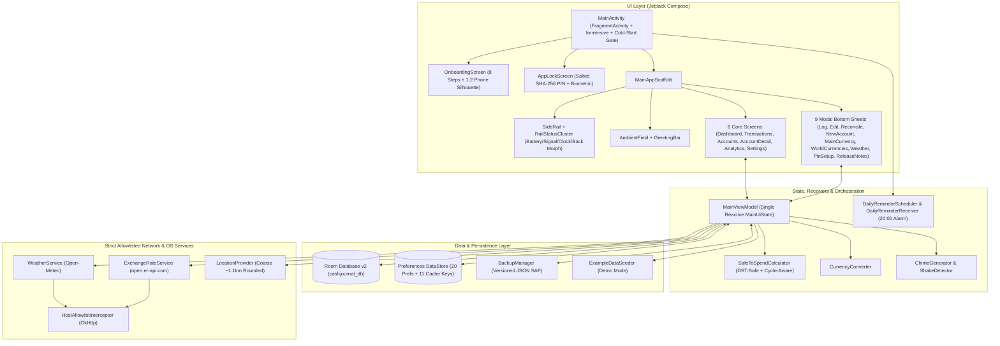

# CashJournal — Complete Application Audit & Feature Reference Report (v2.0)

> [!NOTE]
> **Audit Revision v2.0 (`2026-10-16 19:42 UTC+07:00`)**: This report updates the initial `v1.0.14-dev` audit (`15:54 UTC+07:00`) to reflect all engineering changes delivered across **Phases 10 through 15** (`v1.0.15-dev` $\rightarrow$ `v1.0.18-dev`). All **16 findings** from the initial audit (`CRITICAL-1`, `HIGH-1..4`, `MED-1..5`, `LOW-1..6`) have been verified resolved, and all **10 automated JUnit4 test suites** (`./gradlew testDebugUnitTest`) pass cleanly.

---

## 1. Chronological Audit & Engineering Time Log

All timestamps are recorded in local project time (`2026-10-16`, `UTC+07:00`):

| Timestamp (`+07:00`) | Version / Commit | Phase / Milestone | Summary of Changes & Audit Events |
| :--- | :--- | :--- | :--- |
| `2026-10-15 22:00` | `d08e35a` (`v1.0.9`) | Phase 8 Stabilization | Fixed onboarding permission launcher crash (`fragment-ktx:1.8.1`), clarified local storage sandbox, refined 4-dot cellular signal cluster. |
| `2026-10-15 23:17` | `54d66d5` (`v1.0.10`) | Brand Identity | Integrated official CashJournal Logo v1 across adaptive launcher icons (`mdpi`–`xxxhdpi`) and in-app branding. |
| `2026-10-16 12:52` | `91f3803` (`v1.0.11-dev`) | Stabilization & Sensory | Bilingual localization groundwork, knock/shake detector calibration, and audio chime synthesis. |
| `2026-10-16 13:20` | `337ba09` (`v1.0.12-dev`) | Layout & Lock Lifecycle | Calibrated typography hierarchy, layout geometry, 15s background auto-lock lifecycle, and wave mask performance. |
| `2026-10-16 14:09` | `f1ce18c` | Sub-Phase 9A | Room v1 $\rightarrow$ v2 migration (`initialBalance`), zero-drift SQL balance derivation, backdating, full transaction CRUD (`TransactionEditSheet`), and balance reconciliation (`ReconcileBalanceSheet`). |
| `2026-10-16 14:22` | `10b8967` | Sub-Phase 9B | Versioned JSON backup export & atomic restore via Storage Access Framework (`BackupManager`). |
| `2026-10-16 14:49` | `10c5ec1` (`v1.0.13-dev`) | Sub-Phase 9C | Custom payday cycle start day (`1..28`), expanded 12 preset categories, and manual category picker modal. |
| `2026-10-16 15:43` | `28eaece` (`v1.0.14-dev`) | Pre-Audit Baseline | Synchronized `BuildConfig.VERSION_NAME` display in Settings. |
| **`2026-10-16 15:54`** | **`v1.0.14-dev`** | **Audit Report v1.0** | **Initial full-codebase audit completed.** Identified 1 Critical (`CRITICAL-1`), 4 High (`HIGH-1..4`), 5 Medium (`MED-1..5`), and 6 Low (`LOW-1..6`) findings. Generated `docs/cashjournal_complete_audit_report.{md,pdf}`. |
| `2026-10-16 16:21` | `7bb6203` | **Phase 10 Remediation** | Fixed `CRITICAL-1` (`initialBalance` conversion on currency switch), `HIGH-1` (live `selectedAccount` resolution), `HIGH-2` (`selectedWorldCurrency` sync & conversion math), `HIGH-4` (custom cycle `startingSpent` persistence), and `LOW-5` (New Year `"Yesterday"` & DST-safe `daysLeft`). |
| `2026-10-16 16:31` | `5dcca0d` | **Phase 11 Remediation** | Fixed `HIGH-3` (weather `"Off"` hides widget; pending shows `Thermometer` + `"--"`), `MED-1` (word-boundary regex `\b` in `Category.detectFromNote`), `MED-2` (buffered budget slider `onValueChangeFinished`), and `MED-3` (`SALARY` in income picker, manual category preservation on note edit, expense accent preservation). |
| `2026-10-16 17:08` | `7259a0b` | **Phase 12 Remediation** | Fixed `MED-4` (10,000-round salted SHA-256 PIN hashing + `PinSecurityTest.kt`), `MED-5` (full Bahasa Indonesia localization across UI & ViewModel toasts), `LOW-1` (expanded `PreferencesBackupDto`), `LOW-2` (`DailyReminderScheduler` + `DailyReminderReceiver` at 20:00), `LOW-3`/`LOW-4` (haptics & chime gating, duplicate toast removal), and `LOW-6` (removed unused `gitCommitCount` & `onPinChange`). |
| `2026-10-16 17:33` | `3d3233d` (`v1.0.15-dev`) | Release `v1.0.15-dev` | Tagged & published post-audit remediation release (`v1.0.15-dev`). |
| `2026-10-16 17:49` | `3edae55` (`v1.0.16-dev`) | **Phase 13 Polish** | Added `isPreferencesLoaded` cold-start gate (eliminating Frame-0 onboarding flash) and centered bidirectional spring morph between Status Ring and Back Button in `RailStatusCluster.kt`. |
| `2026-10-16 18:37` | `19ff083` (`v1.0.17-dev`) | **Phase 14 Features** | Added sticky immersive fullscreen (`immersiveModeEnabled`), interactive `PhoneSilhouettePreview` in Onboarding Step 7, auto-triggered `ReleaseNotesSheet` (`lastSeenVersion` check), and live runtime localization for side rail long-press tooltips. |
| `2026-10-16 19:31` | `2c112d3` (`v1.0.18-dev`) | **Phase 15 Polish** | Fixed `AccountDetailScreen` back button gesture closure (`pointerInput(isNestedScreen)`), prevented balance card line wrapping via 2-row header + single-line auto-scaling in `MaskedAmount.kt`, overhauled EN/ID copywriting to natural everyday phrasing, reshaped onboarding phone silhouette to `118×236.dp` (`1:2`) with upright `0°` idle rail, and added inline Knock Sensitivity selector to Onboarding Step 7. |
| **`2026-10-16 19:42`** | **`v1.0.18-dev`** | **Audit Report v2.0** | **Post-Phase-15 re-audit completed.** Verified all 16 initial findings resolved, documented Phases 10–15 features, verified 10/10 JUnit test suites passing, and regenerated `docs/cashjournal_complete_audit_report.{md,pdf}`. |

---

## 2. Executive Summary & Architectural Overview

**CashJournal** (`app.cashjournal`, current version **`1.0.18-dev`**) is a native, offline-first personal finance and cash-flow application for Android (`minSdk 26` / Android 8.0 through `targetSdk 34` / Android 14). It is built with **Kotlin 2.0**, **Jetpack Compose (Material 3 base with a custom Daylight Frosted-Glass Design System)**, **Room SQLite (v2)**, **Jetpack DataStore**, **Kotlinx Serialization**, **OkHttp 4.12**, and **Phosphor Icons**.

### Core Architectural Pillars
1. **100% Free & Keyless**: Zero paid libraries, zero user accounts, and zero API keys. External telemetry uses keyless open endpoints (Open-Meteo for weather/geocoding and ExchangeRate-API Open Access for daily FX rates).
2. **100% Local & Private**: All financial records reside strictly within the device's internal sandbox. Cloud auto-backup and device-to-device extraction are disabled at the OS manifest level (`allowBackup="false"`).
3. **Zero-Drift Mathematical Integrity**: Monetary values are stored exclusively as 64-bit integer minor units (`Long`). Account balances are dynamically derived in SQLite from `initialBalance + SUM(inflows) - SUM(outflows)`, preventing incremental drift across retroactive edits, deletions, currency conversions, and atomic transfers.
4. **Dual-Layer Network Lockdown**: Both Android's [`network_security_config.xml`](file:///c:/Users/Yahya/Projects/CashJournal/app/src/main/res/xml/network_security_config.xml) and a runtime OkHttp [`HostAllowlistInterceptor`](file:///c:/Users/Yahya/Projects/CashJournal/app/src/main/java/app/cashjournal/data/network/HostAllowlistInterceptor.kt) restrict outbound HTTPS traffic to exactly three hosts: `api.open-meteo.com`, `geocoding-api.open-meteo.com`, and `open.er-api.com`.
5. **Ergonomic One-Handed UI & Sensory Feedback**: Features a spring-animated floating [`SideRail`](file:///c:/Users/Yahya/Projects/CashJournal/app/src/main/java/app/cashjournal/ui/components/SideRail.kt) that swaps between left and right screen edges via UI toggle or physical device knock/shake ([`ShakeDetector`](file:///c:/Users/Yahya/Projects/CashJournal/app/src/main/java/app/cashjournal/ui/sensory/ShakeDetector.kt)), paired with procedurally synthesized dual-sine audio chimes ([`ChimeGenerator`](file:///c:/Users/Yahya/Projects/CashJournal/app/src/main/java/app/cashjournal/ui/sensory/ChimeGenerator.kt)), sticky immersive fullscreen mode, and dynamic GPU-rendered background blobs ([`AmbientField`](file:///c:/Users/Yahya/Projects/CashJournal/app/src/main/java/app/cashjournal/ui/components/AmbientField.kt)).

---

## 3. Complete Feature & Functional Reference (`v1.0.18-dev`)

### 3.1 Entry Point, Immersive Mode, App Lock & Lifecycle ([`MainActivity.kt`](file:///c:/Users/Yahya/Projects/CashJournal/app/src/main/java/app/cashjournal/MainActivity.kt))
* **Cold-Start Initialization Gate ([L94-L100](file:///c:/Users/Yahya/Projects/CashJournal/app/src/main/java/app/cashjournal/MainActivity.kt#L94-L100))**: Wait for `state.isPreferencesLoaded` before choosing between `OnboardingScreen`, `AppLockScreen`, or `MainAppScaffold`, rendering a clean `Slate100` background on Frame 0 so existing users never see a momentary onboarding flash on cold start.
* **Sticky Immersive Fullscreen ([L80-L92](file:///c:/Users/Yahya/Projects/CashJournal/app/src/main/java/app/cashjournal/MainActivity.kt#L80-L92))**: Uses `WindowInsetsControllerCompat.BEHAVIOR_SHOW_TRANSIENT_BARS_BY_SWIPE` to hide system status and navigation bars by default (`immersiveModeEnabled = true`), allowing users to reveal them temporarily with an edge swipe or toggle them permanently in Settings.
* **Daily Reminder Alarm Sync ([L71-L78](file:///c:/Users/Yahya/Projects/CashJournal/app/src/main/java/app/cashjournal/MainActivity.kt#L71-L78))**: Reactively schedules or cancels the 20:00 daily reminder via [`DailyReminderScheduler`](file:///c:/Users/Yahya/Projects/CashJournal/app/src/main/java/app/cashjournal/receiver/DailyReminderScheduler.kt) whenever `dailyReminderEnabled` changes.
* **Screen Privacy (`FLAG_SECURE`, [L59-L69](file:///c:/Users/Yahya/Projects/CashJournal/app/src/main/java/app/cashjournal/MainActivity.kt#L59-L69))**: Dynamically applies or clears `WindowManager.LayoutParams.FLAG_SECURE` to block screenshots, screen recording, and recent-app previews.
* **15-Second Background Auto-Lock ([L159-L172](file:///c:/Users/Yahya/Projects/CashJournal/app/src/main/java/app/cashjournal/MainActivity.kt#L159-L172))**: Re-engages [`AppLockScreen`](file:///c:/Users/Yahya/Projects/CashJournal/app/src/main/java/app/cashjournal/ui/screens/AppLockScreen.kt) whenever the app returns from the background after more than `15,000 ms`.
* **Automatic What's New Trigger ([`MainViewModel.kt:217-219`](file:///c:/Users/Yahya/Projects/CashJournal/app/src/main/java/app/cashjournal/ui/MainViewModel.kt#L217-L219))**: On startup, if `onboardingComplete` is true and `prefs.lastSeenVersion != BuildConfig.VERSION_NAME`, automatically presents [`ReleaseNotesSheet`](file:///c:/Users/Yahya/Projects/CashJournal/app/src/main/java/app/cashjournal/ui/sheets/ReleaseNotesSheet.kt) and updates `lastSeenVersion` upon dismissal.

---

### 3.2 First-Run Onboarding Flow ([`OnboardingScreen.kt`](file:///c:/Users/Yahya/Projects/CashJournal/app/src/main/java/app/cashjournal/ui/onboarding/OnboardingScreen.kt))
An 8-step guided flow over the animated [`AmbientField`](file:///c:/Users/Yahya/Projects/CashJournal/app/src/main/java/app/cashjournal/ui/components/AmbientField.kt) with an 8-segment progress bar, spring horizontal slide transitions (`320ms`), tactile haptics gated on `hapticsEnabled`, and natural English/Indonesian copywriting ([`OnboardingStrings.kt`](file:///c:/Users/Yahya/Projects/CashJournal/app/src/main/java/app/cashjournal/ui/onboarding/OnboardingStrings.kt)):

| Step | Title (EN / ID) | Functionality & Interactive Controls |
| :--- | :--- | :--- |
| **Step 1** | *Your money, on your phone.* | Displays the CashJournal squircle emblem and 3 privacy guarantee cards (`ShieldCheck`: No account to create, `DeviceMobile`: Stays on this phone, `CloudSlash`: Nothing uploaded). |
| **Step 2** | *Choose your language* | Instant selection between **English** and **Bahasa Indonesia**; immediately crossfades all onboarding text. |
| **Step 3** | *Where are you from?* | Live-searchable country/currency selector ([`Country.kt`](file:///c:/Users/Yahya/Projects/CashJournal/app/src/main/java/app/cashjournal/domain/model/Country.kt)) with vector [`CountryFlag`](file:///c:/Users/Yahya/Projects/CashJournal/app/src/main/java/app/cashjournal/ui/components/CountryFlag.kt) icons and currency code badges (`IDR`, `USD`, `EUR`, `GBP`, `SGD`, `JPY`, `AUD`, `MYR`). |
| **Step 4** | *What should we call you?* | Optional name input (`max 40 chars`) with a live `SpaceGrotesk` character counter (`N / 40`) and a **Skip** action. |
| **Step 5** | *Show local weather?* | Three privacy-tiered modes: **Approximate location** (~1 km rounded coordinates), **Search for my city** (8 popular city chips: Bandung, Jakarta, Surabaya, Medan, Singapore, Tokyo, London, New York + custom query), or **Not now**. |
| **Step 6** | *Transparent Privacy* | Interactive permission request cards for **Approximate Location** (`ACCESS_COARSE_LOCATION`) and **Daily Reminders** (`POST_NOTIFICATIONS` on Android 13+), plus a read-only **Local Data Storage** card explaining the isolated `Device Sandbox`. |
| **Step 7** | *Where should the menu sit?* | Interactive `118×236.dp` (`1:2` portrait ratio) [`PhoneSilhouettePreview`](file:///c:/Users/Yahya/Projects/CashJournal/app/src/main/java/app/cashjournal/ui/onboarding/OnboardingScreen.kt#L1534-L1765) wireframe that simulates device shake/knock on tap and glides the miniature rail across sides (settling at `0°` upright when idle); Left/Right `SegmentedControl`; **Shake to swap sides** toggle with an inline expandable **Knock Sensitivity** (`Low` / `Medium` / `High`) selector. |
| **Step 8** | *How would you like to start?* | Choose between **Load Demo Mode** (default; populates 4 sample accounts, 10 transactions, and a 7.5M IDR budget via [`ExampleDataSeeder`](file:///c:/Users/Yahya/Projects/CashJournal/app/src/main/java/app/cashjournal/data/ExampleDataSeeder.kt)) or **Start from scratch**, followed by the animated `CheckCircle` completion screen. |

---

### 3.3 Main Scaffold, Side Rail & Shared Components ([`MainAppScaffold.kt`](file:///c:/Users/Yahya/Projects/CashJournal/app/src/main/java/app/cashjournal/ui/MainAppScaffold.kt))

* **Dynamic Content Margins & Rail Physics**:
  * Content padding dynamically mirrors based on rail placement (`20.dp` on the non-rail side, `78.dp` on the rail side) using `spring(stiffness = 320f, dampingRatio = 0.65f)`.
  * When swapping sides (via Settings or physical device knock/shake), the floating rail leaps across the screen while tilting `±18°` (`tiltAngle`) and firing a tactile haptic tick.
* **Floating [`SideRail.kt`](file:///c:/Users/Yahya/Projects/CashJournal/app/src/main/java/app/cashjournal/ui/components/SideRail.kt) & [`RailStatusCluster.kt`](file:///c:/Users/Yahya/Projects/CashJournal/app/src/main/java/app/cashjournal/ui/components/RailStatusCluster.kt)**:
  * **Unified Status Ring (`42.dp`)**: Custom `Canvas` ring displaying:
    * **270° Battery Arc**: Polls `BatteryManager.BATTERY_PROPERTY_CAPACITY` every 30s. Color-coded Emerald (`>30%`), Saffron (`11–30%`), or Berry (`≤10%`), with a Charcoal depleted track.
    * **4-Dot Cellular Signal Cluster**: Polls `TelephonyManager.signalStrength` every 30s and normalizes 4-bar and 5-bar OEM scales via [`SignalStrengthHelper`](file:///c:/Users/Yahya/Projects/CashJournal/app/src/main/java/app/cashjournal/util/SignalStrengthHelper.kt) into 4 polar dots at `60°, 80°, 100°, 120°`.
    * **Center Privacy Vault Button**: Toggles `hideBalances` (`Eye` when visible, `EyeSlash` in Cobalt when masked).
    * **Live Clock**: Displays `HH:mm` (24h) or `h:mm` (12h) below the status ring, updating every 30s.
    * **Centered Spring Morph to Back Button**: On `AccountDetailScreen`, the `42.dp` status ring shrinks (`scaleOut` to `0.15f` over `130ms`) and pops in (`scaleIn` with bouncy spring) as a centered `CaretLeft` back button with `.pointerInput(isNestedScreen)` closure re-binding.
  * **Liquid Tab Drip Indicator**: Switching between the 5 tabs (`Dashboard`, `Transactions`, `Accounts`, `Analytics`, `Settings`) animates a Cobalt droplet over `420ms` that stretches vertically (`+14.dp`) and narrows horizontally (`-6.dp`) mid-flight.
  * **Reactive Localized Long-Press Tooltips & Shockwave**: Holding any rail button floats a frosted glass tooltip label inward (`±66.dp`) using `rememberUpdatedState` so runtime language switches immediately translate tooltips (*"Dasbor"*, *"Transaksi"*, *"Akun"*, *"Analisis"*, *"Pengaturan"*, *"Tambah Transaksi"*, *"Privasi Layar"*).
  * **Quick-Add (`+`) Button**: Anchored at the bottom of the rail to open [`LogTransactionSheet`](file:///c:/Users/Yahya/Projects/CashJournal/app/src/main/java/app/cashjournal/ui/sheets/LogTransactionSheet.kt) from any screen.
* **Per-Digit Wave Privacy Masking & Single-Line Auto-Scaling ([`MaskedAmount.kt`](file:///c:/Users/Yahya/Projects/CashJournal/app/src/main/java/app/cashjournal/ui/components/MaskedAmount.kt))**:
  * Toggling privacy mode triggers a staggered wave (`32ms` per character, right-to-left when hiding, left-to-right when revealing) where each digit shrinks, fades, translates vertically, and morphs into 7 dots (`•••••••`).
  * For large hero figures (`fontSize >= 24.sp`), `MaskedAmount` automatically scales font size (`0.82x` for $\ge 11$ chars, `0.70x` for $\ge 14$ chars) with `maxLines = 1` and `softWrap = false` so multi-million Rupiah balances never wrap across lines.

---

### 3.4 Primary Screens (`ui/screens/`)

| Screen File | Key Features, Telemetry & Interactive Flows |
| :--- | :--- |
| [`DashboardScreen.kt`](file:///c:/Users/Yahya/Projects/CashJournal/app/src/main/java/app/cashjournal/ui/screens/DashboardScreen.kt) | **Total Net Worth** hero header; `28.dp` **Safe-to-Spend Today** glass card with `64.dp` circular `% spent` gauge and status pill (`Safe`, `Near Limit`, `Over Budget`, `Set Budget`, `No Funds`); **Active Accounts** horizontal carousel (`130×96.dp` cards with radial accent haze); **Recent Activity** (top 5 transactions); **Monthly Budget** progress card; bottom mist gradient and [`ScrollForMorePill`](file:///c:/Users/Yahya/Projects/CashJournal/app/src/main/java/app/cashjournal/ui/components/ScrollForMorePill.kt). |
| [`LedgerScreen.kt`](file:///c:/Users/Yahya/Projects/CashJournal/app/src/main/java/app/cashjournal/ui/screens/LedgerScreen.kt) | **Transactions** screen (*"Riwayat Transaksi"*) with 4 live-count filter pills (`All`, `Expense`, `Income`, `Transfer`); instant search bar matching notes, EN/ID category names, and raw amount digits; chronological day grouping (`TODAY`/`HARI INI`, `YESTERDAY`/`KEMARIN` with year-boundary support, or weekday/date headers); tap any row to open [`TransactionEditSheet`](file:///c:/Users/Yahya/Projects/CashJournal/app/src/main/java/app/cashjournal/ui/sheets/TransactionEditSheet.kt). |
| [`AccountsScreen.kt`](file:///c:/Users/Yahya/Projects/CashJournal/app/src/main/java/app/cashjournal/ui/screens/AccountsScreen.kt) | **World Currencies** card synchronized with `userPreferences.selectedWorldCurrency`, showing converted Net Worth via `CurrencyConverter.convertMinorUnits`, 1-unit cross-rate, online/offline status dot, manual refresh, 8 flag chips (`USD`, `EUR`, `SGD`, `JPY`, `GBP`, `MYR`, `SAR`, `THB`), and `+ World` button; `24.dp` account glass cards with `4.dp` left accent border, `% of total` pill, and relative balance bar; interactive **Reorder Mode** (`ArrowUp`/`ArrowDown`). |
| [`AccountDetailScreen.kt`](file:///c:/Users/Yahya/Projects/CashJournal/app/src/main/java/app/cashjournal/ui/screens/AccountDetailScreen.kt) | Live-updating single-account view with `% of total` badge; `24.dp` **Balance Card** with 2-row layout (`BALANCE` label + `Edit Balance` / `Ubah Saldo` pill on top, full-width auto-scaling `MaskedAmount` below); side-by-side **Money In** (`Emerald`: income + transfers in) and **Money Out** (`Charcoal`: expense + transfers out) tiles; filtered account transaction history. |
| [`AnalyticsScreen.kt`](file:///c:/Users/Yahya/Projects/CashJournal/app/src/main/java/app/cashjournal/ui/screens/AnalyticsScreen.kt) | **Last 6 Months** Money In / Money Out paired bar chart (transfers excluded); interactive **Monthly Budget** calibrator with `−` / buffered `Slider` (`onValueChangeFinished` DB commit & chime) / `+` step buttons (`500k` IDR steps); cycle-filtered **Top Spending Categories** Donut Chart (top 4 categories + `Other`). |
| [`SettingsScreen.kt`](file:///c:/Users/Yahya/Projects/CashJournal/app/src/main/java/app/cashjournal/ui/screens/SettingsScreen.kt) | 8 configuration cards: **Language** (`EN`/`ID`), **Main Currency**, **Monthly Reset Day** (`1..28` slider dialog with live cycle preview), **Security & Access** (`PIN Lock`, `Biometric Unlock`, `FLAG_SECURE Screen Privacy`, `Lock App Now`), **Sensory & Feedback** (`Sound Effects`, `Tactile Haptics`, `Daily Reminder` at 20:00), **Menu Position** (`Left`/`Right`, `Full Screen Mode`, `Knock / Shake to Swap`, `Knock Sensitivity`), **Weather** (`Approximate`, `City`, `Off`, `°C`/`°F`), and **Data & Backup** (SAF JSON `Back Up Data` / `Restore Data`, `Export Excel`, `Replay Welcome Guide`, `Delete All Data`, `About` + `What's New`). |
| [`AppLockScreen.kt`](file:///c:/Users/Yahya/Projects/CashJournal/app/src/main/java/app/cashjournal/ui/screens/AppLockScreen.kt) | Full-screen security gate verifying 4-digit PIN against 10,000-round salted SHA-256 hash (`UserPreferencesRepository.verifyPin`), with 4 spring-animated PIN dots, horizontal error shake + reject haptics, 3×4 keypad, and automatic localized `BiometricPrompt` trigger (`300ms` after launch). |

---

### 3.5 Modal Bottom Sheets (`ui/sheets/` — 9 Sheets)

| Sheet File | Purpose & Key Capabilities |
| :--- | :--- |
| [`LogTransactionSheet.kt`](file:///c:/Users/Yahya/Projects/CashJournal/app/src/main/java/app/cashjournal/ui/sheets/LogTransactionSheet.kt) | Segmented type picker (`Expense` Persimmon, `Income` Emerald, `Transfer` Cobalt), backdating chips (`Today`, `Yesterday`, `Custom Date` via `DatePickerDialog`), source/destination account chips, note input with word-boundary regex category detection + type-aware manual category picker modal (includes `Salary` for `Income`), `36.sp` cash-style amount entry, [`CustomNumericKeypad`](file:///c:/Users/Yahya/Projects/CashJournal/app/src/main/java/app/cashjournal/ui/components/CustomNumericKeypad.kt), and [`SaveSplash`](file:///c:/Users/Yahya/Projects/CashJournal/app/src/main/java/app/cashjournal/ui/components/SaveSplash.kt) 14-droplet particle burst. |
| [`TransactionEditSheet.kt`](file:///c:/Users/Yahya/Projects/CashJournal/app/src/main/java/app/cashjournal/ui/sheets/TransactionEditSheet.kt) | Full retroactive editing of any existing transaction (type, backdated timestamp, source/destination accounts, note, manual/auto category, amount) plus safe deletion with confirmation dialog and multi-account balance recalculation. |
| [`ReconcileBalanceSheet.kt`](file:///c:/Users/Yahya/Projects/CashJournal/app/src/main/java/app/cashjournal/ui/sheets/ReconcileBalanceSheet.kt) | **Edit Account Balance** (*"Ubah Saldo Akun"*). Displays `Current App Balance` and live-computed `Difference` (*"Selisih"*, `+` Emerald / `−` Persimmon) as the user types their `Actual Real Balance`, then logs an audited `INCOME` or `EXPENSE` adjustment transaction (*"Balance Adjustment"* / *"Penyesuaian Saldo"*). |
| [`NewAccountSheet.kt`](file:///c:/Users/Yahya/Projects/CashJournal/app/src/main/java/app/cashjournal/ui/sheets/NewAccountSheet.kt) | Creates a new account with localized labels, name (`max 28 chars`), starting `initialBalance`, and 6 `AccentKey` color swatches (`Cobalt`, `Emerald`, `Persimmon`, `Saffron`, `Iris`, `Berry`). |
| [`MainCurrencySheet.kt`](file:///c:/Users/Yahya/Projects/CashJournal/app/src/main/java/app/cashjournal/ui/sheets/MainCurrencySheet.kt) | Searchable country/currency selector with confirmation dialog that converts all existing accounts (`balance` and `initialBalance`), transactions, and monthly budget into the new currency and runs `recalculateAllAccountBalances()`. |
| [`WorldCurrenciesSheet.kt`](file:///c:/Users/Yahya/Projects/CashJournal/app/src/main/java/app/cashjournal/ui/sheets/WorldCurrenciesSheet.kt) | Searchable list of 16 world currencies with vector flags, live/offline sync status badge, 1-unit exchange rates, and converted Net Worth previews. |
| [`WeatherDetailSheet.kt`](file:///c:/Users/Yahya/Projects/CashJournal/app/src/main/java/app/cashjournal/ui/sheets/WeatherDetailSheet.kt) | Bilingual sheet configuring weather location mode (`Use approximate location`, `Search for a city` with live Open-Meteo geocoding results, or `Turn off weather`). |
| [`PinSetupSheet.kt`](file:///c:/Users/Yahya/Projects/CashJournal/app/src/main/java/app/cashjournal/ui/sheets/PinSetupSheet.kt) | Houses both `PinSetupSheet` (2-step create & confirm 4-digit PIN, stored via 10,000-round salted SHA-256) and `PinVerifyOrRemoveSheet` (verifies current PIN before disabling lock). |
| [`ReleaseNotesSheet.kt`](file:///c:/Users/Yahya/Projects/CashJournal/app/src/main/java/app/cashjournal/ui/sheets/ReleaseNotesSheet.kt) | **What's New in v1.0.18-dev** (*"Yang Baru di v1.0.18-dev"*). Bilingual modal sheet presenting icon-badged release highlights automatically on version upgrade or manually from Settings. |

---

## 4. Data Architecture, Security & Mathematical Engine

### 4.1 Room Database Schema (`cashjournal_db`, Version 2)
Defined in [`AppDatabase.kt`](file:///c:/Users/Yahya/Projects/CashJournal/app/src/main/java/app/cashjournal/data/local/AppDatabase.kt) with `MIGRATION_1_2` adding `initialBalance` and 3 query indices (`index_transactions_sourceAccountId`, `index_transactions_destinationAccountId`, `index_transactions_date`).

### 4.2 Zero-Drift Ledger Formula ([`AccountDao.kt`](file:///c:/Users/Yahya/Projects/CashJournal/app/src/main/java/app/cashjournal/data/local/dao/AccountDao.kt#L41-L78))
Every account's `balance` is dynamically recomputed in SQLite inside a `@Transaction` block whenever a transaction is created, edited, deleted, reconciled, converted to a new main currency, seeded, or restored from backup:

$$\text{Balance}_A = \text{InitialBalance}_A + \sum_{\substack{t \in \text{INCOME} \\ \text{src}(t) = A}} \text{amount}_t + \sum_{\substack{t \in \text{TRANSFER} \\ \text{dst}(t) = A}} \text{amount}_t - \sum_{\substack{t \in \text{EXPENSE} \\ \text{src}(t) = A}} \text{amount}_t - \sum_{\substack{t \in \text{TRANSFER} \\ \text{src}(t) = A}} \text{amount}_t$$

### 4.3 Safe-to-Spend & DST-Safe Custom Cycle Engine ([`SafeToSpendCalculator.kt`](file:///c:/Users/Yahya/Projects/CashJournal/app/src/main/java/app/cashjournal/domain/model/SafeToSpendCalculator.kt))
Given a custom payday `cycleStartDay` $d \in [1, 28]$:
* **DST-Safe Remaining Days ([L90-L91](file:///c:/Users/Yahya/Projects/CashJournal/app/src/main/java/app/cashjournal/domain/model/SafeToSpendCalculator.kt#L90-L91))**:
  $$\text{DaysLeft} = \max\left(0, \text{round}\left(\frac{\text{endDayMidnight} - \text{todayMidnight}}{86,400,000}\right)\right)$$
* **Cycle-Aware Starting Spend ([L136-L146](file:///c:/Users/Yahya/Projects/CashJournal/app/src/main/java/app/cashjournal/domain/model/SafeToSpendCalculator.kt#L136-L146))**: Matches `plan.monthKey` against both `cycleMonthKey` (derived from `cycle.startMillis`) and `todayMonthKey` so `startingSpent` never drops to `0` mid-cycle when a custom billing cycle spans two calendar months.
* **Daily Safe-to-Spend Allowance**:
  $$\text{SafePerDay} = \begin{cases} 0 & \text{if } \neg\text{hasAccounts} \lor \text{TotalNetWorth} \le 0 \\ \left\lfloor \dfrac{\max(0, \text{Budget} - \text{TotalSpent})}{\max(1, \text{DaysLeft})} \right\rfloor & \text{otherwise} \end{cases}$$

### 4.4 Salted SHA-256 PIN Hashing ([`UserPreferencesRepository.kt`](file:///c:/Users/Yahya/Projects/CashJournal/app/src/main/java/app/cashjournal/data/preferences/UserPreferencesRepository.kt#L332-L392))
* Generates a cryptographically random 16-byte salt via `SecureRandom` (`32` hex chars).
* Computes `10,000` rounds of iterated `SHA-256(current + salt)` and stores `"$saltHex:$hashHex"`.
* Verifies PINs in constant time via `MessageDigest.isEqual()`, with automatic fallback verification for legacy 64-character unsalted hashes.

### 4.5 Complete Preferences & Backup Coverage ([`BackupManager.kt`](file:///c:/Users/Yahya/Projects/CashJournal/app/src/main/java/app/cashjournal/data/backup/BackupManager.kt))
`PreferencesBackupDto` now serializes and restores all **18 non-sensitive preferences**: `language`, `currencyCode`, `userName`, `cycleStartDay`, `railOnRight`, `shakeToSwap`, `knockSensitivity`, `temperatureUnit`, `soundEffectsEnabled`, `tactileHapticsEnabled`, `dailyReminderEnabled`, `screenPrivacyEnabled`, `weatherOption`, `weatherCityLabel`, `weatherCityLat`, `weatherCityLon`, `selectedWorldCurrency`, and `immersiveModeEnabled` (excluding only security credentials `pinEnabled`, `pinHash`, and `biometricsEnabled`).

---

## 5. Automated Unit Test Suite Audit (10 Test Suites)

All 10 JVM JUnit4 test classes in `app/src/test/java/app/cashjournal/` pass cleanly (`BUILD SUCCESSFUL`):

| Test File | What It Verifies | Status |
| :--- | :--- | :--- |
| [`AcceptanceCheckTest.kt`](file:///c:/Users/Yahya/Projects/CashJournal/app/src/test/java/app/cashjournal/AcceptanceCheckTest.kt) | Build Brief Section 16 acceptance numbers (`Rp 18.450.000` net worth, `Rp 150.294 / day` on Oct 14, 66% ring, `Rp 1M` expense $\rightarrow$ `Rp 91.470 / day` & 79% Near Limit, transfer isolation, knock sensitivity, 7-dot mask). | PASS |
| [`LedgerIntegrityTest.kt`](file:///c:/Users/Yahya/Projects/CashJournal/app/src/test/java/app/cashjournal/LedgerIntegrityTest.kt) | Zero-drift balance derivation on retroactive edits/deletes, atomic transfer net-worth conservation, manual balance reconciliation delta math, backdating, and **`initialBalance` currency conversion zero-drift** (`testCurrencySwitchInitialBalanceConversionZeroDrift`). | PASS |
| [`SafeToSpendTest.kt`](file:///c:/Users/Yahya/Projects/CashJournal/app/src/test/java/app/cashjournal/SafeToSpendTest.kt) | Leap-year February handling, status thresholds, last-day-of-month clamping, custom `cycleStartDay` (`1`, `25`, boundary clamping `0` & `31`), cross-month cycle expense filtering, and **cross-month `startingSpent` persistence**. | PASS |
| [`BackupRestoreTest.kt`](file:///c:/Users/Yahya/Projects/CashJournal/app/src/test/java/app/cashjournal/BackupRestoreTest.kt) | `BackupPayload` JSON round-trip serialization (including all 18 `PreferencesBackupDto` fields), corrupted JSON failure handling, `version <= 0` rejection, and zero-drift recalculation after restore. | PASS |
| [`PinSecurityTest.kt`](file:///c:/Users/Yahya/Projects/CashJournal/app/src/test/java/app/cashjournal/PinSecurityTest.kt) | **New in Phase 12**: Verifies `saltHex:hashHex` format (`32:64` hex chars), per-call salt randomness, 10,000-round salted verification, legacy 64-hex unsalted fallback compatibility, and malformed hash safety. | PASS |
| [`CategoryDetectorTest.kt`](file:///c:/Users/Yahya/Projects/CashJournal/app/src/test/java/app/cashjournal/CategoryDetectorTest.kt) | Keyword detection across all categories plus **word-boundary negative tests** confirming `"theater"`/`"sweater"` do not match `FOOD`, `"chair"`/`"repair"` do not match `UTILITIES`, and `"cost"` does not match `HOUSING`. | PASS |
| [`CurrencyConverterTest.kt`](file:///c:/Users/Yahya/Projects/CashJournal/app/src/test/java/app/cashjournal/CurrencyConverterTest.kt) | Same-currency identity, `USD` $\leftrightarrow$ `IDR` decimal scaling (`2` vs `0` decimals), `EUR` $\rightarrow$ `JPY` cross-rates, and missing-rate fallback. | PASS |
| [`HostAllowlistTest.kt`](file:///c:/Users/Yahya/Projects/CashJournal/app/src/test/java/app/cashjournal/HostAllowlistTest.kt) | Verifies `HostAllowlistInterceptor` permits the 3 allowed hosts and throws `SecurityException` on unauthorized hosts. | PASS |
| [`SignalStrengthHelperTest.kt`](file:///c:/Users/Yahya/Projects/CashJournal/app/src/test/java/app/cashjournal/SignalStrengthHelperTest.kt) | Monotonic mapping of 4-bar and 5-bar cellular signal scales into 4 UI dots. | PASS |
| [`WeatherIconMapperTest.kt`](file:///c:/Users/Yahya/Projects/CashJournal/app/src/test/java/app/cashjournal/WeatherIconMapperTest.kt) | WMO weather code mapping across day/night variants to Phosphor icons. | PASS |

---

## 6. Audit Findings Resolution Ledger & Residual Observations

### 6.1 Resolution Ledger of Initial Audit Findings (Phases 10–12)

| ID | Original Severity | Original Issue Summary | Resolution Status & Verification |
| :--- | :--- | :--- | :--- |
| **CRITICAL-1** | **Critical** | `changeMainCurrency()` converted `acc.balance` but omitted `acc.initialBalance`. | **RESOLVED (Phase 10)** — [`MainViewModel.kt:744-802`](file:///c:/Users/Yahya/Projects/CashJournal/app/src/main/java/app/cashjournal/ui/MainViewModel.kt#L744-L802) converts `initialBalance` and runs `recalculateAllAccountBalances()`. Verified in `LedgerIntegrityTest`. |
| **HIGH-1** | **High** | `_selectedAccount` held a static snapshot on `AccountDetailScreen`. | **RESOLVED (Phase 10)** — [`MainViewModel.kt:161-166`](file:///c:/Users/Yahya/Projects/CashJournal/app/src/main/java/app/cashjournal/ui/MainViewModel.kt#L161-L166) resolves live `selectedAccount` and `selectedReconcileAccount` from `rawAccounts`. |
| **HIGH-2** | **High** | `AccountsScreen` ignored `userPreferences.selectedWorldCurrency` and used hardcoded IDR division. | **RESOLVED (Phase 10)** — [`AccountsScreen.kt:88-115`](file:///c:/Users/Yahya/Projects/CashJournal/app/src/main/java/app/cashjournal/ui/screens/AccountsScreen.kt#L88-L115) binds to `selectedWorldCurrency` and uses `CurrencyConverter.convertMinorUnits`. |
| **HIGH-3** | **High** | Weather `"Off"` (`not_now`) never hid the weather widget in `GreetingBar`. | **RESOLVED (Phase 11)** — [`MainAppScaffold.kt:194-250`](file:///c:/Users/Yahya/Projects/CashJournal/app/src/main/java/app/cashjournal/ui/MainAppScaffold.kt#L194-L250) passes `weatherEnabled = isWeatherEnabled`, shows `Thermometer` + `"--"` when pending, and wires `onWeatherClick`. |
| **HIGH-4** | **High** | `MonthlyPlan.startingSpent` dropped to `0` mid-cycle when `cycleStartDay > 1` crossed a month boundary. | **RESOLVED (Phase 10)** — [`SafeToSpendCalculator.kt:136-146`](file:///c:/Users/Yahya/Projects/CashJournal/app/src/main/java/app/cashjournal/domain/model/SafeToSpendCalculator.kt#L136-L146) checks `plan.monthKey == cycleMonthKey`. Verified in `SafeToSpendTest`. |
| **MED-1** | **Medium** | Substring matching in `Category.detectFromNote` caused false positives (`theater`, `chair`, `cost`). | **RESOLVED (Phase 11)** — [`Category.kt:133-157`](file:///c:/Users/Yahya/Projects/CashJournal/app/src/main/java/app/cashjournal/domain/model/Category.kt#L133-L157) uses pre-compiled word-boundary regex `\b`. Verified in `CategoryDetectorTest`. |
| **MED-2** | **Medium** | Dragging the budget `Slider` spammed Room DB writes and `AudioTrack` chimes on every frame. | **RESOLVED (Phase 11)** — [`AnalyticsScreen.kt:445-465`](file:///c:/Users/Yahya/Projects/CashJournal/app/src/main/java/app/cashjournal/ui/screens/AnalyticsScreen.kt#L445-L465) buffers `sliderBudget` locally and commits on `onValueChangeFinished`. |
| **MED-3** | **Medium** | `SALARY` hidden in `LogTransactionSheet`; manual category wiped on note edit in `TransactionEditSheet`; expense accent overwritten on edit. | **RESOLVED (Phase 11)** — Fixed in [`LogTransactionSheet.kt:205`](file:///c:/Users/Yahya/Projects/CashJournal/app/src/main/java/app/cashjournal/ui/sheets/LogTransactionSheet.kt#L205), [`TransactionEditSheet.kt:475`](file:///c:/Users/Yahya/Projects/CashJournal/app/src/main/java/app/cashjournal/ui/sheets/TransactionEditSheet.kt#L475), and [`MainViewModel.kt:431`](file:///c:/Users/Yahya/Projects/CashJournal/app/src/main/java/app/cashjournal/ui/MainViewModel.kt#L431). |
| **MED-4** | **Medium** | Unsalted SHA-256 PIN hashing in `UserPreferencesRepository`. | **RESOLVED (Phase 12)** — [`UserPreferencesRepository.kt:351-391`](file:///c:/Users/Yahya/Projects/CashJournal/app/src/main/java/app/cashjournal/data/preferences/UserPreferencesRepository.kt#L351-L391) implements 10,000-round salted SHA-256 with `SecureRandom` salt. Verified in `PinSecurityTest`. |
| **MED-5** | **Medium** | Incomplete Bahasa Indonesia (`"in"`) localization across screens, sheets, and ViewModel toasts. | **RESOLVED (Phases 12, 14, 15)** — Full bilingual strings and natural phrasing wired across `AppStrings.kt`, `OnboardingStrings.kt`, `MainViewModel.kt`, screens, tooltips, and sheets. |
| **LOW-1** | **Low** | `PreferencesBackupDto` omitted 6 user preferences. | **RESOLVED (Phase 12 & 14)** — [`BackupManager.kt:133-152`](file:///c:/Users/Yahya/Projects/CashJournal/app/src/main/java/app/cashjournal/data/backup/BackupManager.kt#L133-L152) backs up and restores all 18 non-sensitive preferences. |
| **LOW-2** | **Low** | `dailyReminderEnabled` toggle had no alarm/notification scheduler. | **RESOLVED (Phase 12)** — Implemented [`DailyReminderScheduler.kt`](file:///c:/Users/Yahya/Projects/CashJournal/app/src/main/java/app/cashjournal/receiver/DailyReminderScheduler.kt) and [`DailyReminderReceiver.kt`](file:///c:/Users/Yahya/Projects/CashJournal/app/src/main/java/app/cashjournal/receiver/DailyReminderReceiver.kt). |
| **LOW-3** | **Low** | `tactileHapticsEnabled` bypassed in several controls. | **RESOLVED (Phase 12)** — Enforced across `SegmentedControl`, `CustomNumericKeypad`, `SettingToggleRow`, `PinSetupSheet`, `AppLockScreen`, and `ReleaseNotesSheet`. |
| **LOW-4** | **Low** | Chime played when turning Sound Effects off; duplicate PIN/Biometric toasts. | **RESOLVED (Phase 12)** — Fixed in `MainViewModel.updatePreferences` and `SettingsScreen`. |
| **LOW-5** | **Low** | `"Yesterday"` check failed across Jan 1 / Dec 31; `daysLeft` integer division truncated across DST. | **RESOLVED (Phase 10)** — Fixed via `Calendar.add(DAY_OF_YEAR, -1)` and `Math.round(diffMillis / 86_400_000.0)`. |
| **LOW-6** | **Low** | Unused `gitCommitCount` in `app/build.gradle.kts` and unused `onPinChange` parameter. | **RESOLVED (Phase 12)** — Removed from `app/build.gradle.kts`, `SettingsScreen.kt`, and `MainAppScaffold.kt`. |

---

### 6.2 Residual Minor Observations in `v1.0.18-dev` (Low Priority)

| ID | Severity | Location | Observation & Recommendation |
| :--- | :--- | :--- | :--- |
| **NEW-LOW-1** | **Low** | [`AndroidManifest.xml:33-40`](file:///c:/Users/Yahya/Projects/CashJournal/app/src/main/AndroidManifest.xml#L33-L40) | `DailyReminderReceiver` is declared with `android:exported="true"` and an unguarded custom intent filter (`app.cashjournal.ACTION_DAILY_REMINDER`). Because `DailyReminderScheduler` uses an explicit component intent (`Intent(context, DailyReminderReceiver::class.java)`), setting `android:exported="false"` (or adding a signature-level permission) prevents third-party apps from spoofing reminder broadcasts while still receiving `BOOT_COMPLETED` and `AlarmManager` intents. |
| **NEW-LOW-2** | **Low** | [`MainAppScaffold.kt:480`](file:///c:/Users/Yahya/Projects/CashJournal/app/src/main/java/app/cashjournal/ui/MainAppScaffold.kt#L480), [`MainCurrencySheet.kt`](file:///c:/Users/Yahya/Projects/CashJournal/app/src/main/java/app/cashjournal/ui/sheets/MainCurrencySheet.kt) | Selecting a world currency in `MainAppScaffold.kt:480` calls `viewModel.showToast("Currency changed to $code")` instead of `AppStrings.get(state.userPreferences.language).currencyChangedToast.format(code)`, and `MainCurrencySheet.kt` dialog/header strings remain in English. |
| **NEW-LOW-3** | **Low** | [`app/build.gradle.kts:41-48`](file:///c:/Users/Yahya/Projects/CashJournal/app/build.gradle.kts#L41-L48) | `release` build type uses `sharedDebug` signing config and `isMinifyEnabled = false` to support seamless in-place APK upgrades across development builds. Before public Play Store distribution, configure a dedicated release keystore and enable R8 minification. |
| **NEW-LOW-4** | **Low** | [`ui/preview/`](file:///c:/Users/Yahya/Projects/CashJournal/app/src/main/java/app/cashjournal/ui/preview/FoundationPreviewScreen.kt) | `FoundationPreviewScreen.kt` and `Phase3ComponentsScreen.kt` are historical Phase 2–3 development galleries that are no longer referenced in production navigation and can be moved to `debug` source sets or removed when desired. |
