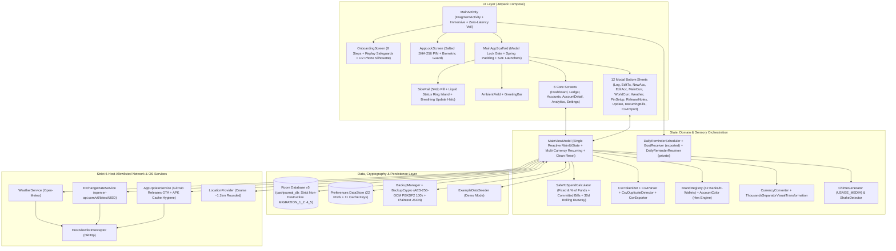

# CashJournal — Complete Application Audit & Feature Reference Report (v5.0)

> [!NOTE]
> **Audit Revision v5.0 (`2026-10-17 19:12 UTC+07:00`)**: This comprehensive audit report updates the previous `v1.0.14-dev` (v1.0), `v1.0.18-dev` (v2.0), `v1.0.28-dev` (v3.0), and `v1.0.35-dev` (v4.0) audits to cover the entire **CashJournal `v1.0.36-dev`** application through **Phase 30**. It documents every feature, screen, modal sheet, custom UI component, sensory engine, security mechanism, Room **v5** database schema, mathematical formula, cryptographic backup specification, CSV bank statement parser, network allowlist rule, resolution of all **26 prior audit findings & observations (`16/16` v1.0 findings + `6/6` v3.0 observations + `4/4` v4.0 observations)**, a **Ground-Truth Code Verification Matrix** answering all external review questions, and all **17 automated JUnit4 test suites (120 unit tests, 100% passing)**.

---

## 1. Chronological Audit & Engineering Time Log

All timestamps are recorded in local project time (`UTC+07:00`):

| Timestamp (`+07:00`) | Version / Commit | Phase / Milestone | Summary of Changes & Audit Events |
| :--- | :--- | :--- | :--- |
| `2026-10-15 22:00` | `d08e35a` (`v1.0.9`) | Phase 8 Stabilization | Fixed onboarding permission launcher crash (`fragment-ktx:1.8.1`), clarified local storage sandbox, refined 4-dot cellular signal cluster. |
| `2026-10-15 23:17` | `54d66d5` (`v1.0.10`) | Brand Identity | Integrated official CashJournal Logo v1 across adaptive launcher icons (`mdpi`–`xxxhdpi`) and in-app branding. |
| `2026-10-16 12:52` | `91f3803` (`v1.0.11-dev`) | Stabilization & Sensory | Bilingual localization groundwork, knock/shake detector calibration, and audio chime synthesis. |
| `2026-10-16 13:20` | `337ba09` (`v1.0.12-dev`) | Layout & Lock Lifecycle | Calibrated typography hierarchy, layout geometry, 15s background auto-lock lifecycle, and wave mask performance. |
| `2026-10-16 14:09` | `f1ce18c` | Sub-Phase 9A | Room v1 $\rightarrow$ v2 migration (`initialBalance`), zero-drift SQL balance derivation, backdating, full transaction CRUD (`TransactionEditSheet`), and balance reconciliation (`ReconcileBalanceSheet`). |
| `2026-10-16 14:22` | `10b8967` | Sub-Phase 9B | Versioned JSON backup export & atomic restore via Storage Access Framework (`BackupManager`). |
| `2026-10-16 14:49` | `10c5ec1` (`v1.0.13-dev`) | Sub-Phase 9C | Custom payday cycle start day (`1..28`), expanded 12 preset categories, and manual category picker modal. |
| `2026-10-16 15:43` | `28eaece` (`v1.0.14-dev`) | Pre-Audit Baseline | Synchronized `BuildConfig.VERSION_NAME` display in Settings. |
| **`2026-10-16 15:54`** | **`v1.0.14-dev`** | **Audit Report v1.0** | **Initial full-codebase audit completed.** Identified 1 Critical (`CRITICAL-1`), 4 High (`HIGH-1..4`), 5 Medium (`MED-1..5`), and 6 Low (`LOW-1..6`) findings. Generated `docs/cashjournal_complete_audit_report.{md,pdf}`. |
| `2026-10-16 16:21` | `7bb6203` | **Phase 10 Remediation** | Fixed `CRITICAL-1` (`initialBalance` conversion on currency switch), `HIGH-1` (live `selectedAccount` resolution), `HIGH-2` (`selectedWorldCurrency` sync & conversion math), `HIGH-4` (custom cycle `startingSpent` persistence), and `LOW-5` (New Year `"Yesterday"` & DST-safe `daysLeft`). |
| `2026-10-16 16:31` | `5dcca0d` | **Phase 11 Remediation** | Fixed `HIGH-3` (weather `"Off"` hides widget; pending shows `Thermometer` + `"--"`), `MED-1` (word-boundary regex `\b` in `Category.detectFromNote`), `MED-2` (buffered budget slider `onValueChangeFinished`), and `MED-3` (`SALARY` in income picker, manual category preservation on note edit, expense accent preservation). |
| `2026-10-16 17:08` | `7259a0b` (`v1.0.15-dev`) | **Phase 12 Remediation** | Fixed `MED-4` (10,000-round salted SHA-256 PIN hashing + `PinSecurityTest.kt`), `MED-5` (full Bahasa Indonesia localization), `LOW-1` (expanded `PreferencesBackupDto`), `LOW-2` (`DailyReminderScheduler` + `DailyReminderReceiver` at 20:00), `LOW-3`/`LOW-4` (haptics & chime gating), and `LOW-6` (dead code removal). |
| `2026-10-16 17:49` | `3edae55` (`v1.0.16-dev`) | **Phase 13 Polish** | Added `isPreferencesLoaded` cold-start gate (eliminating Frame-0 onboarding flash) and centered bidirectional spring morph between Status Ring and Back Button. |
| `2026-10-16 18:37` | `19ff083` (`v1.0.17-dev`) | **Phase 14 Features** | Added sticky immersive fullscreen (`immersiveModeEnabled`), interactive `PhoneSilhouettePreview` in Onboarding Step 7, auto-triggered `ReleaseNotesSheet`, and live runtime localization for side rail long-press tooltips. |
| `2026-10-16 19:31` | `2c112d3` (`v1.0.18-dev`) | **Phase 15 Polish** | Fixed `AccountDetailScreen` back button gesture closure, prevented balance card line wrapping via single-line auto-scaling in `MaskedAmount.kt`, overhauled EN/ID copywriting, reshaped onboarding phone silhouette to `118×236.dp` (`1:2`), and added inline Knock Sensitivity selector to Onboarding Step 7. |
| **`2026-10-16 19:42`** | **`v1.0.18-dev`** | **Audit Report v2.0** | **Post-Phase-15 re-audit completed.** Verified all 16 initial findings resolved, documented Phases 10–15 features, and regenerated `docs/cashjournal_complete_audit_report.{md,pdf}`. |
| `2026-10-16 20:44` | `95927db` (`v1.0.19-dev`) | **Phase 16A/B: Account Types & GitHub OTA** | Added `AccountType` enum (`CASH`, `BANK_DEBIT`, `E_WALLET`, `CREDIT_CARD`, `SAVINGS`), Room v2 $\rightarrow$ v3 migration (`MIGRATION_2_3`) with automatic name-based type inference, `EditAccountSheet.kt`, left-aligned hero balances, and the **GitHub OTA In-App Update System** (`AppUpdateService`, `VersionComparator`, `UpdateSheet`, `FileProvider`, midnight WIB daily check, and allowlisted GitHub domains). |
| `2026-10-16 22:22` | `7c46501` (`v1.0.20-dev`) | **Phase 16C: Zero-Latency Lock Veil** | Moved `isAppLocked` and `isVeiled` into `MainViewModel`; engaged immediate privacy veil in `onPause()` to prevent Frame-0 resume balance flash while gating `autoPromptBiometrics = isAppLocked && !isVeiled` so going to the home screen never triggers a stray biometric prompt. |
| `2026-10-16 23:13` | `3566a10` (`v1.0.21-dev`) | **Phase 17: Runtime Versioning & Lock Isolation** | Added `AppVersionProvider` (`PackageManager` runtime query to bypass stale `BuildConfig` constant inlining), gated `ModalBottomSheet` with `if (!isLocked)` to prevent sheet bleed-through over `AppLockScreen`, and added a 60s `isInstallingUpdate` grace window with explicit OEM package installer URI grants. |
| `2026-10-16 23:37` | `321e31f` (`v1.0.22-dev`) | **Phase 18: OTA Storage Hygiene** | Added `cleanStaleUpdateApks()` and `purgeOtherUpdateApks()` in `AppUpdateService.kt` to automatically purge installed/old `.apk` files from `cacheDir/updates/`. |
| `2026-10-16 23:44` | `a8e7b54` | **Phase 19: Open-Source Showcase** | Created Play-Store-style `README.md` and `LICENSE` (MIT). |
| `2026-10-17 00:28` | `1acd4e0` (`v1.0.23-dev`) | **Phase 20: Smart Brand Colors & Custom Hex** | Created `BrandRegistry.kt` (42 Indonesian & global banks/e-wallets with auto-detected brand hex colors and default `AccountType`), expanded `AccountColor` (`AccentKey`) to a 16-color curated palette + arbitrary `#RRGGBB` custom hex picker (`CustomHexColorDialog.kt`), and added radial color haze on account cards. |
| `2026-10-17 00:57` | `eb01527` (`v1.0.24-dev`) | **Phase 21: Inclusive Spending & Survival Runway** | Upgraded Room v3 $\rightarrow$ v4 (`MIGRATION_3_4`) adding `BudgetMode` (`FIXED_NOMINAL` vs `PERCENTAGE_OF_FUNDS`) and `budgetPercent`; updated `SafeToSpendCalculator` with net-worth percentage budgeting and **Capital Burn-Rate Survival Runway** (`dailyBurnRate`, `survivalDays`, `survivalMonths`). |
| `2026-10-17 10:51` | `0ea309b` (`v1.0.25-dev`) | **Phase 22: Precision FX & Live Number Formatting** | Expanded `% of Total Funds` slider to `1%..100%`; added `showSymbol` to `MaskedAmount`; widened Dashboard account cards to `138.dp`; added `ThousandsSeparatorVisualTransformation.kt` with cursor `OffsetMapping`; anchored `ExchangeRateService` to `/v6/latest/USD` for 6-digit cross-rate precision on low-unit currencies like `IDR`. |
| `2026-10-17 11:36` | `859d244` (`v1.0.26-dev`) | **Phase 23: Disk-Aware OTA & Onboarding Safeguards** | Added disk-aware `ReadyToInstall` promotion in `MainViewModel` (skipping redundant APK downloads), 1-tap update sheet launch from glowing `SideRail` Settings icon, and onboarding replay safeguards (confirmation dialog, Step 1 `X` cancel + `BackHandler`, and Step 8 defaulting to `"Keep Existing Accounts"` when accounts exist). |
| `2026-10-17 12:54` | `74440da` (`v1.0.27-dev`) | **Phase 24: Liquid Status Island & One-Handed UX** | Engineered the **Liquid Floating Status Ring Island** (detaching upward above `SideRail` on `AccountDetailScreen`), moved `AccountsScreen` `Reorder` and `+ Add` actions to a bottom **Thumb-Zone Floating Action Dock** with `animateItemPlacement` card reordering, unified account editing & balance reconciliation into `EditAccountSheet.kt`, extracted the **App Updates** card in Settings, and upgraded `ChimeGenerator` to `USAGE_MEDIA` (`0.65` amplitude). |
| `2026-10-17 13:14` | `72793a8` (`v1.0.28-dev`) | **Phase 25: 54dp Island, Breathing Halo & Release Notes** | Matched detached Liquid Status Island width (`42.dp` $\rightarrow$ `54.dp`) to `SideRail`, replaced the Settings update dot with a centered **Cobalt Breathing & Ripple Halo**, added `<queries>` for package installer visibility on Android 11+, and curated user-friendly bilingual highlights in `ReleaseNotesSheet.kt`. |
| **`2026-10-17 13:25`** | **`v1.0.28-dev`** | **Audit Report v3.0** | **Complete `v1.0.28-dev` audit & feature inventory.** Verified all 14 JUnit4 test suites (91 unit tests) passing and identified 6 minor observations (`OBS-1`..`OBS-6`). |
| `2026-10-17 13:45` | `bb62d72` | **Strategic Roadmap (Phases 26–29)** | Logged external review notes (`docs/cashjournal_review_notes_from_Claude.md`) and architected the Phase 26–29 engineering roadmap in `docs/PROJECT_LOG.md`. |
| `2026-10-17 14:14` | `8b4c8cd` (`v1.0.29-dev`) | **Phase 26: Security, Hygiene & 30-Day Runway** | Resolved `OBS-1`, `OBS-2`, `OBS-3`, `OBS-4`, `OBS-6`: split `BOOT_COMPLETED` into `BootReceiver.kt` (`exported="true"`) and locked `DailyReminderReceiver.kt` (`exported="false"`); deleted dead `ReconcileBalanceSheet`, `FoundationPreviewScreen`, and `Phase3ComponentsScreen`; added `ThousandsSeparatorVisualTransformation` to `EditAccountSheet`; localized `MainCurrencySheet` & currency toast; upgraded `SafeToSpendCalculator` to a **trailing 30-day rolling burn window** with a **5-day calibration threshold** (`isCalibrating`, `calibrationDaysNeeded`); refined network transparency copy. |
| `2026-10-17 14:44` | `e18eeb7` (`v1.0.30-dev`) | **Phase 27: Recurring Transactions & Scheduled Bills** | Upgraded Room v4 $\rightarrow$ v5 (`MIGRATION_4_5`) adding `recurring_transactions`; created `RecurringTransaction`, `RecurringTransactionDao`, and `RecurringBillsSheet.kt` (1,095 lines); integrated `committedBills` deduction into `SafeToSpendCalculator`; added Dashboard **Upcoming Bills** card, Settings **Recurring Bills** card, and 1-tap **Mark as Paid** confirmation. |
| `2026-10-17 15:32` | `f6c8b26` (`v1.0.31-dev`) | **Hotfix: Startup & Migration Resilience** | Added `.fallbackToDestructiveMigration()` in `AppDatabase`, `.catch` flow guards in `MainViewModel`, and `Build.VERSION.SDK_INT >= P` + `Throwable` guards on `TelephonyManager.signalStrength` in `RailStatusCluster`. |
| `2026-10-17 15:49` | `3e07abc` (`v1.0.32-dev`) | **Hotfix: DEX 255-Register `VerifyError` Fix** | Resolved Android ART `java.lang.VerifyError` by refactoring `ScreenStrings` in `AppStrings.kt` from a 301-parameter `data class` into an `interface ScreenStrings` with zero-arg property getters (`EnglishScreenStrings`, `IndonesianScreenStrings`); added `MigrationTest.kt` (7 real SQLite JDBC tests covering `MIGRATION_1_2` through `MIGRATION_4_5`). |
| `2026-10-17 16:14` | `a401da8` (`v1.0.33-dev`) | **Hotfix: Account Activity Ledger Isolation** | Enforced `destinationAccountId = null` for non-`TRANSFER` transactions across `MainViewModel`, `LogTransactionSheet`, and `TransactionEditSheet`, plus startup self-healing SQL `TransactionDao.sanitizeNonTransferDestinations()`. |
| `2026-10-17 16:50` | `e87a6bf` (`v1.0.34-dev`) | **Phase 28: CSV Bank Import & Spreadsheet Export** | Created `CsvTokenizer.kt`, `CsvParser.kt` (auto-detecting Indonesian BCA `CR`/`DB`, Mandiri `Debit`/`Kredit`, BNI/BRI, and US/EU decimal formats across 13 date patterns + Indonesian month names), `CsvDuplicateDetector.kt`, `CsvExporter.kt`, and `CsvImportSheet.kt`; added `"Import CSV"` on `AccountDetailScreen` and CSV Import/Export rows in `SettingsScreen`; added `CsvParserTest.kt` (6 tests). |
| `2026-10-17 17:35` | `3ade377` (`v1.0.35-dev`) | **Phase 29: AES-256-GCM Backups & Release Hardening** | Resolved `OBS-5`: added `BackupCrypto.kt` (`PBKDF2WithHmacSHA256` 100k iterations + `AES/GCM/NoPadding` + 34-byte `"CJENC1"` header), password-protected `.cashjournal.enc` export & auto-detected restore in `BackupManager` and `SettingsScreen`, R8 minification (`isMinifyEnabled = true`), `proguard-rules.pro`, external release keystore support, `autoVersionCode`, and `BackupCryptoTest.kt` (5 tests). |
| **`2026-10-17 17:41`** | **`v1.0.35-dev`** | **Audit Report v4.0** | **Complete `v1.0.35-dev` codebase audit.** Verified all 6 v3.0 observations resolved, audited Phases 26–29, verified 17 JUnit4 test suites (118 unit tests), and identified 4 minor observations (`OBS-NEW-1`..`OBS-NEW-4`). |
| `2026-10-17 18:15` | `61b5f96` (`v1.0.36-dev`) | **Phase 30: Data Integrity Hardening** | Resolved all 4 Audit v4.0 observations (`OBS-NEW-1`..`OBS-NEW-4`): removed `.fallbackToDestructiveMigration()` from `AppDatabase.kt`; added multi-currency conversion for `recurring_transactions.amount` in `MainViewModel.changeMainCurrency()`; added `recurringTransactionDao().deleteAll()` to `MainViewModel.clearAllData()`; normalized `category = item.category.key` in `MainViewModel.confirmCsvImport()`; updated `ReleaseNotesSheet.kt` for `v1.0.36-dev`; and added 2 unit tests in `LedgerIntegrityTest.kt` (120 total tests). |
| **`2026-10-17 19:12`** | **`v1.0.36-dev`** | **Audit Report v5.0** | **Complete `v1.0.36-dev` codebase audit & verification matrix.** Verified all 26 prior audit findings & observations (`16/16` v1.0 + `6/6` v3.0 + `4/4` v4.0) resolved, verified all 17 JUnit4 test suites (120 unit tests) passing, answered all 8 external review verification questions, and updated `docs/cashjournal_complete_audit_report.{md,pdf}`. |

---

## 2. Executive Summary & Architectural Overview

**CashJournal** (`app.cashjournal`, current version **`1.0.36-dev`**) is a native, offline-first personal finance, multi-account ledger, recurring bills manager, bank statement importer, and capital runway application for Android (`minSdk 26` / Android 8.0 through `targetSdk 34` / Android 14). It is built with **Kotlin 2.0**, **Jetpack Compose (Material 3 foundation with a bespoke Daylight Frosted-Glass Design System)**, **Room SQLite (v5)**, **Jetpack DataStore**, **Kotlinx Serialization**, **OkHttp 4.12**, and **Phosphor Icons**.

### Core Architectural Pillars
1. **100% Free & Keyless**: Zero paid SDKs, zero user accounts, and zero API keys. External telemetry uses keyless public endpoints: Open-Meteo for weather/geocoding, ExchangeRate-API Open Access (`/v6/latest/USD`) for high-precision daily FX cross-rates, and GitHub Releases API for self-contained OTA updates.
2. **100% Local, Transparent & Cryptographically Protected**: All financial records reside strictly within the device's internal sandbox (`cashjournal_db` and `user_preferences.preferences_pb`). Cloud auto-backup and device-to-device extraction are disabled at the OS manifest level (`android:allowBackup="false"`). User-initiated backups support authenticated **AES-256-GCM** encryption (`PBKDF2WithHmacSHA256`, 100,000 iterations, random 16-byte salt & 12-byte IV) via [`BackupCrypto.kt`](file:///c:/Users/Yahya/Projects/CashJournal/app/src/main/java/app/cashjournal/data/backup/BackupCrypto.kt).
3. **Zero-Drift & Zero-Loss Mathematical Integrity**: Monetary values are stored exclusively as 64-bit integer minor units (`Long`). Account balances are dynamically derived in SQLite from `initialBalance + SUM(inflows) - SUM(outflows)`, eliminating floating-point rounding and incremental drift across retroactive edits, deletions, inline balance reconciliations, CSV statement imports, recurring bill payments, currency conversions (including recurring bills), and atomic transfers. Forward database upgrades are strictly non-destructive (`MIGRATION_1_2` through `MIGRATION_4_5` without `.fallbackToDestructiveMigration()`).
4. **Dual-Layer Network Lockdown & Manifest Isolation**:
   * Both Android's [`network_security_config.xml`](file:///c:/Users/Yahya/Projects/CashJournal/app/src/main/res/xml/network_security_config.xml) (`cleartextTrafficPermitted="false"`) and a runtime OkHttp [`HostAllowlistInterceptor`](file:///c:/Users/Yahya/Projects/CashJournal/app/src/main/java/app/cashjournal/data/network/HostAllowlistInterceptor.kt) restrict outbound HTTPS traffic to **6 allowlisted hosts**: `api.open-meteo.com`, `geocoding-api.open-meteo.com`, `open.er-api.com`, `api.github.com`, `github.com`, and `objects.githubusercontent.com`.
   * Broadcast receivers are strictly isolated in [`AndroidManifest.xml`](file:///c:/Users/Yahya/Projects/CashJournal/app/src/main/AndroidManifest.xml#L42-L53): [`BootReceiver`](file:///c:/Users/Yahya/Projects/CashJournal/app/src/main/java/app/cashjournal/data/reminder/BootReceiver.kt) (`android:exported="true"`) handles `ACTION_BOOT_COMPLETED` solely to reschedule alarms, while [`DailyReminderReceiver`](file:///c:/Users/Yahya/Projects/CashJournal/app/src/main/java/app/cashjournal/data/reminder/DailyReminderReceiver.kt) is locked with `android:exported="false"` so third-party apps cannot spoof notifications.
5. **Ergonomic One-Handed Physics & Sensory Feedback**:
   * Floating `54.dp` [`SideRail`](file:///c:/Users/Yahya/Projects/CashJournal/app/src/main/java/app/cashjournal/ui/components/SideRail.kt) that leaps between left and right screen edges via UI toggle or physical device knock/shake ([`ShakeDetector`](file:///c:/Users/Yahya/Projects/CashJournal/app/src/main/java/app/cashjournal/ui/sensory/ShakeDetector.kt)).
   * **Liquid Floating Status Ring Island** that detaches upward (`42.dp` $\rightarrow$ `54.dp`) above the rail when viewing nested screens (`AccountDetailScreen`) so the privacy toggle remains reachable while the `CaretLeft` Back button emerges in the rail's top slot.
   * **Thumb-Zone Floating Action Dock** at the bottom of `AccountsScreen` for effortless one-handed account creation and reordering.
   * Procedurally synthesized dual-sine audio chimes ([`ChimeGenerator`](file:///c:/Users/Yahya/Projects/CashJournal/app/src/main/java/app/cashjournal/ui/sensory/ChimeGenerator.kt)) routed through `AudioAttributes.USAGE_MEDIA` (`0.65` peak amplitude).

---

## 3. Complete Feature & Functional Inventory (`v1.0.36-dev`)

### 3.1 Entry Point, Zero-Latency Privacy Veil, Immersive Mode & Lifecycle ([`MainActivity.kt`](file:///c:/Users/Yahya/Projects/CashJournal/app/src/main/java/app/cashjournal/MainActivity.kt))
* **Cold-Start Initialization Gate ([L95-L100](file:///c:/Users/Yahya/Projects/CashJournal/app/src/main/java/app/cashjournal/MainActivity.kt#L95-L100))**: Waits for `state.isPreferencesLoaded` before rendering `OnboardingScreen`, `AppLockScreen`, or `MainAppScaffold`, painting a clean `Slate100` surface on Frame 0 so returning users never experience a momentary onboarding flash.
* **Zero-Latency Background Privacy Veil & Biometric Guard ([`MainActivity.kt:53-58, 145-181`](file:///c:/Users/Yahya/Projects/CashJournal/app/src/main/java/app/cashjournal/MainActivity.kt#L145-L181), [`MainViewModel.kt:357-391`](file:///c:/Users/Yahya/Projects/CashJournal/app/src/main/java/app/cashjournal/ui/MainViewModel.kt#L357-L391))**:
  * **Immediate Veil on Pause**: When `hasPinConfigured()` is true and the user minimizes the app or turns off the screen (`onPause()`), `viewModel.onAppBackgrounded()` immediately sets `_isVeiled = true` (unless handing off to the system APK installer). This hides `MainAppScaffold` (`Modifier.alpha(0f)`) and mounts `AppLockScreen` *before* the OS captures the recent-apps thumbnail, eliminating any Frame-0 balance flash upon unlock.
  * **Biometric Prompt Suppression on Minimize**: `AppLockScreen` receives `autoPromptBiometrics = isAppLocked && !isVeiled` ([`MainActivity.kt:149`](file:///c:/Users/Yahya/Projects/CashJournal/app/src/main/java/app/cashjournal/MainActivity.kt#L149)). When going to the home screen, `isVeiled` is true while `isAppLocked` remains false, preventing Android's system fingerprint dialog from popping up over the home launcher.
  * **15-Second Auto-Lock & 60-Second OTA Grace Window**: On `onResume()`, `viewModel.onAppForegrounded()` clears `_isVeiled` and promotes `_isAppLocked = true` if more than `15,000 ms` elapsed in the background (bypassed during a `60,000 ms` `isInstallingUpdate` grace window when installing an OTA update).
* **Modal Bottom Sheet Lock Isolation ([`MainAppScaffold.kt:489`](file:///c:/Users/Yahya/Projects/CashJournal/app/src/main/java/app/cashjournal/ui/MainAppScaffold.kt#L489))**: Because Compose Material 3 `ModalBottomSheet` renders inside a separate OS `DialogWindow` above the Activity's main content tree, `MainAppScaffold` wraps `ModalBottomSheet` in `if (!isLocked)` so open sheets immediately unmount when the app locks or veils.
* **Sticky Immersive Fullscreen ([`MainActivity.kt:81-93`](file:///c:/Users/Yahya/Projects/CashJournal/app/src/main/java/app/cashjournal/MainActivity.kt#L81-L93))**: Uses `WindowInsetsControllerCompat.BEHAVIOR_SHOW_TRANSIENT_BARS_BY_SWIPE` to hide system status and navigation bars by default (`immersiveModeEnabled = true`).
* **Screen Privacy (`FLAG_SECURE`, [`MainActivity.kt:60-70`](file:///c:/Users/Yahya/Projects/CashJournal/app/src/main/java/app/cashjournal/MainActivity.kt#L60-L70))**: Dynamically applies or clears `WindowManager.LayoutParams.FLAG_SECURE` to block screenshots and screen recording.
* **Startup Self-Healing & What's New Trigger ([`MainViewModel.kt:280-313`](file:///c:/Users/Yahya/Projects/CashJournal/app/src/main/java/app/cashjournal/ui/MainViewModel.kt#L280-L313))**:
  * Queries `PackageManager.getPackageInfo` at runtime ([`AppVersionProvider.kt`](file:///c:/Users/Yahya/Projects/CashJournal/app/src/main/java/app/cashjournal/util/AppVersionProvider.kt)) to avoid stale compile-time `BuildConfig.VERSION_NAME` inlining.
  * Runs `database.transactionDao().sanitizeNonTransferDestinations()` on startup to clear any legacy non-null `destinationAccountId` on `EXPENSE`/`INCOME` rows so Account Detail activity feeds remain strictly isolated.
  * Cleans stale OTA `.apk` files, automatically opens [`ReleaseNotesSheet`](file:///c:/Users/Yahya/Projects/CashJournal/app/src/main/java/app/cashjournal/ui/sheets/ReleaseNotesSheet.kt) when `lastSeenVersion != currentRuntimeVersion`, and performs a quiet daily GitHub update check once per calendar day in WIB (`Asia/Jakarta`).

---

### 3.2 First-Run & Replayable Onboarding Flow ([`OnboardingScreen.kt`](file:///c:/Users/Yahya/Projects/CashJournal/app/src/main/java/app/cashjournal/ui/onboarding/OnboardingScreen.kt))
An 8-step guided flow over the animated [`AmbientField`](file:///c:/Users/Yahya/Projects/CashJournal/app/src/main/java/app/cashjournal/ui/components/AmbientField.kt) with an 8-segment progress bar, spring horizontal slide transitions (`320ms`), tactile haptics, transparent English/Indonesian privacy copy ([`OnboardingStrings.kt`](file:///c:/Users/Yahya/Projects/CashJournal/app/src/main/java/app/cashjournal/ui/onboarding/OnboardingStrings.kt)), and **Ledger-Safe Replay Safeguards**:

| Step | Title (EN / ID) | Functionality, Safeguards & Interactive Controls |
| :--- | :--- | :--- |
| **Step 1** | *Your money, on your phone.* | Displays the CashJournal squircle emblem and 3 privacy guarantee cards (`ShieldCheck`, `DeviceMobile`, `CloudSlash` — *"Zero financial data leaves your phone. Only approximate coordinates are sent to fetch weather."*). **Replay Safeguard**: When `hasExistingAccounts` is true (replaying from Settings), renders a top-right `X` close button and wires `BackHandler` to safely exit back to the app without modifying data. |
| **Step 2** | *Choose your language* | Instant selection between **English** and **Bahasa Indonesia**; immediately crossfades all onboarding text. |
| **Step 3** | *Where are you from?* | Live-searchable country/currency selector ([`Country.kt`](file:///c:/Users/Yahya/Projects/CashJournal/app/src/main/java/app/cashjournal/domain/model/Country.kt)) with vector [`CountryFlag`](file:///c:/Users/Yahya/Projects/CashJournal/app/src/main/java/app/cashjournal/ui/components/CountryFlag.kt) icons and currency code badges (`IDR`, `USD`, `EUR`, `GBP`, `SGD`, `JPY`, `AUD`, `MYR`). |
| **Step 4** | *What should we call you?* | Optional name input (`max 40 chars`) with a live `SpaceGrotesk` character counter (`N / 40`) and a **Skip** action. |
| **Step 5** | *Show local weather?* | Three privacy-tiered modes: **Approximate location** (~1 km rounded coordinates), **Search for my city** (8 popular city chips + custom query), or **Not now**. |
| **Step 6** | *Transparent Privacy* | Interactive permission request cards for **Approximate Location** (`ACCESS_COARSE_LOCATION` — *"Only approximate coordinates are sent to fetch weather"*) and **Daily Reminders** (`POST_NOTIFICATIONS` on Android 13+), plus a read-only **Local Data Storage** card explaining the isolated `Device Sandbox`. |
| **Step 7** | *Where should the menu sit?* | Interactive `118×236.dp` (`1:2` portrait ratio) [`PhoneSilhouettePreview`](file:///c:/Users/Yahya/Projects/CashJournal/app/src/main/java/app/cashjournal/ui/onboarding/OnboardingScreen.kt#L1557-L1788) wireframe that simulates device shake/knock on tap and glides the miniature rail across sides; Left/Right `SegmentedControl`; **Shake to swap sides** toggle with an inline expandable **Knock Sensitivity** (`Low` / `Medium` / `High`) selector. |
| **Step 8** | *How would you like to start?* | **Fresh Install (`!hasExistingAccounts`)**: Defaults to **Load Demo Mode** (4 sample accounts, 10 transactions, and a 7.5M IDR budget via [`ExampleDataSeeder`](file:///c:/Users/Yahya/Projects/CashJournal/app/src/main/java/app/cashjournal/data/ExampleDataSeeder.kt)) or **Start from scratch**. **Replay Mode (`hasExistingAccounts`)**: Dynamically defaults `loadExampleData = false` and relabels Card 2 to **"Keep Existing Accounts"** (*"Pertahankan Rekening Saat Ini"*) so users never accidentally inject demo accounts into their real ledger. Also records `lastSeenVersion` upon completion. |

---

### 3.3 Main Scaffold, Side Rail, Liquid Status Island & Shared Components

* **Dynamic Content Margins & Rail Swap Physics ([`MainAppScaffold.kt:132-166`](file:///c:/Users/Yahya/Projects/CashJournal/app/src/main/java/app/cashjournal/ui/MainAppScaffold.kt#L132-L166))**:
  * Content padding dynamically mirrors based on rail placement (`20.dp` on the non-rail side, `78.dp` on the rail side) using `spring(stiffness = 320f, dampingRatio = 0.65f)`.
  * When swapping sides (via Settings or physical device knock/shake), the floating rail leaps across the screen while tilting `±18°` (`tiltAngle`) and firing a tactile haptic tick.
* **Floating `54.dp` [`SideRail.kt`](file:///c:/Users/Yahya/Projects/CashJournal/app/src/main/java/app/cashjournal/ui/components/SideRail.kt) & Liquid Status Ring Island ([`RailStatusCluster.kt`](file:///c:/Users/Yahya/Projects/CashJournal/app/src/main/java/app/cashjournal/ui/components/RailStatusCluster.kt))**:
  * **Unified Status Ring (`StatusRingCanvas`)**: Custom `Canvas` ring displaying:
    * **270° Battery Arc**: Polls `BatteryManager.BATTERY_PROPERTY_CAPACITY` every 30s (wrapped in `try/catch (Throwable)`). Color-coded Emerald (`>30%`), Saffron (`11–30%`), or Red Alert (`≤10%`), with a Charcoal depleted track.
    * **4-Dot Cellular Signal Cluster**: Polls `TelephonyManager.signalStrength` every 30s (guarded by `Build.VERSION.SDK_INT >= Build.VERSION_CODES.P` and `try/catch (Throwable)`) and normalizes 4-bar and 5-bar OEM scales via [`SignalStrengthHelper`](file:///c:/Users/Yahya/Projects/CashJournal/app/src/main/java/app/cashjournal/util/SignalStrengthHelper.kt) into 4 polar dots at `60°, 80°, 100°, 120°`.
    * **Center Privacy Vault Button**: Toggles `hideBalances` (`Eye` when visible, `EyeSlash` when masked).
    * **Live Clock**: Displays `HH:mm` (24h) or `h:mm` (12h) below the top slot, updating every 30s.
  * **Liquid Floating Status Ring Island (`SideRail.kt:123-131, 249-295, 501-570`)**:
    * On top-level screens (`islandProgress = 0f`), the `42.dp` Status Ring sits inside the top slot of the `54.dp` `SideRail`.
    * When entering a nested screen (`AccountDetailScreen`, `isNestedScreen = true`, `islandProgress -> 1f` via `spring(dampingRatio = 0.72f, stiffness = 320f)`), the Status Ring detaches upward (`targetOffsetY` from `12.dp` to `-64.dp`, resting `10.dp` above the sidebar), stretches with liquid sine physics (`stretch = sin(islandProgress * PI) * 0.18f`), and expands from `42.dp` to **`54.dp`** (`islandSize = 42.dp + 12.dp * islandProgress`, `targetOffsetX -> 0.dp`) to match the exact width of the `SideRail` below it.
    * Simultaneously, a `42.dp` circular `CaretLeft` **Back Button** blooms into the vacated top slot of the `SideRail` (`caretAlpha`, `caretScale`). Users can both tap Back *and* toggle balance masking on `AccountDetailScreen` without losing either control.
  * **Liquid Tab Drip Indicator (`SideRail.kt:160-187, 334-354`)**: Switching between the 5 tabs (`Dashboard`, `Transactions`, `Accounts`, `Analytics`, `Settings`) animates a Cobalt droplet over `420ms` that stretches vertically (`+14.dp`) and narrows horizontally (`-6.dp`) mid-flight.
  * **Cobalt Breathing & Ripple Update Halo (`SideRail.kt:591-702`)**: When an OTA update is downloaded and ready to install (`isUpdateReady = true`) and the user is not on the Settings tab, the `GearSix` Settings icon stays in neutral `Slate500` while a centered dual-layer Cobalt aura animates behind it (inner radial breathing glow + outer expanding `1.dp` Cobalt ripple). Tapping the glowing Settings button navigates to Settings and immediately opens `UpdateSheet` for 1-tap installation.
  * **Quick-Add (`+`) Button**: Anchored at the bottom of the rail to open [`LogTransactionSheet`](file:///c:/Users/Yahya/Projects/CashJournal/app/src/main/java/app/cashjournal/ui/sheets/LogTransactionSheet.kt) from any screen.
* **Left-Aligned Per-Digit Wave Masking & Auto-Scaling ([`MaskedAmount.kt`](file:///c:/Users/Yahya/Projects/CashJournal/app/src/main/java/app/cashjournal/ui/components/MaskedAmount.kt))**:
  * Supports optional currency prefix display (`showSymbol: Boolean = false`, rendering e.g. `Rp 549.760` when visible and `Rp •••••••` when masked).
  * Uses `.wrapContentWidth(Alignment.Start)` so hero numbers stay left-aligned on wide cards.
  * Triggers a staggered wave (`32ms` per character) when toggling privacy and automatically scales font size (`0.82x` for $\ge 11$ chars, `0.70x` for $\ge 14$ chars) on hero amounts (`fontSize >= 24.sp`) so large Rupiah balances never wrap.
* **DEX-Safe Bilingual Localization Architecture ([`AppStrings.kt`](file:///c:/Users/Yahya/Projects/CashJournal/app/src/main/java/app/cashjournal/ui/i18n/AppStrings.kt))**:
  * Engineered as an `interface ScreenStrings` (325 localized properties) backed by zero-argument singleton classes `EnglishScreenStrings` and `IndonesianScreenStrings`. This completely avoids Android ART's 255-register `invoke-range` constructor limit (`java.lang.VerifyError`) while providing zero-allocation runtime language switching.

---

### 3.4 Smart Brand Color Auto-Detection & Custom Hex Color Engine ([`BrandRegistry.kt`](file:///c:/Users/Yahya/Projects/CashJournal/app/src/main/java/app/cashjournal/domain/model/BrandRegistry.kt), [`AccentKey.kt`](file:///c:/Users/Yahya/Projects/CashJournal/app/src/main/java/app/cashjournal/domain/model/AccentKey.kt))

* **5 Account Categories ([`AccountType.kt`](file:///c:/Users/Yahya/Projects/CashJournal/app/src/main/java/app/cashjournal/domain/model/AccountType.kt))**:
  1. `CASH` — *Cash / Wallet* (*Tunai / Dompet*), icon `PhosphorIcons.Regular.Wallet`
  2. `BANK_DEBIT` — *Bank / Debit* (*Bank / Debit*), icon `PhosphorIcons.Regular.Bank`
  3. `E_WALLET` — *E-Wallet* (*E-Wallet*), icon `PhosphorIcons.Regular.DeviceMobile`
  4. `CREDIT_CARD` — *Credit Card* (*Kartu Kredit*), icon `PhosphorIcons.Regular.CreditCard`
  5. `SAVINGS` — *Savings / Invest* (*Tabungan / Investasi*), icon `PhosphorIcons.Regular.Vault`
* **42 Registered Financial Institutions (`BrandRegistry.kt`)**:
  * **Indonesian Banks (19)**: `BCA Prioritas` (`#B38E44`, `SAVINGS`), `BCA` (`#0060AF`), `Bank Mandiri` (`#002D62`), `BNI` (`#F15A24`), `BRI` (`#00529C`), `BSI` (`#00A39D`), `CIMB Niaga` (`#8B0000`), `Permata Bank` (`#008D36`), `Bank Danamon` (`#F47920`), `Bank BTN` (`#004899`), `Jenius (BTPN)` (`#00A3E0`), `Bank Jago` (`#FF8A00`), `Blu by BCA Digital` (`#00B4D8`), `SeaBank` (`#FF5722`, `SAVINGS`), `Allo Bank` (`#6C5CE7`), `Bank Neo Commerce` (`#FFC700`, `SAVINGS`), `OCBC NISP` (`#ED1C24`), `Panin Bank` (`#003366`), `Bank Mega` (`#F39200`, `CREDIT_CARD`).
  * **Indonesian E-Wallets (7)**: `GoPay` (`#00AED6`), `OVO` (`#4C3494`), `DANA` (`#118EEA`), `ShopeePay` (`#EE4D2D`), `LinkAja` (`#ED1C24`), `AstraPay` (`#003882`), `i.saku` (`#0082C8`).
  * **Global Institutions & Cash (16)**: `American Express` (`#006FCF`), `Chase` (`#117AC9`), `Bank of America` (`#E31837`), `Wells Fargo` (`#D71E28`), `Citibank` (`#003B70`), `HSBC` (`#DB0011`), `Standard Chartered` (`#00508F`), `DBS Bank` (`#212121`), `UOB` (`#002856`), `PayPal` (`#003087`), `Wise` (`#9FE870`), `Revolut` (`#191C1F`), `Monzo` (`#FF5050`), `Apple Card / Cash` (`#6E7174`), and `Cash / Dompet` (`#10B981`).
* **Universal `AccountColor` & `CustomHexColorDialog.kt`**:
  * Supports the 6 legacy `AccentKey` constants (`COBALT`, `EMERALD`, `PERSIMMON`, `SAFFRON`, `IRIS`, `BERRY`), a 16-swatch `curatedPalette` (`CHARCOAL_TITANIUM` through `INDIGO_NIGHT`), and any custom 6-digit `#RRGGBB` hex code entered via [`CustomHexColorDialog.kt`](file:///c:/Users/Yahya/Projects/CashJournal/app/src/main/java/app/cashjournal/ui/components/CustomHexColorDialog.kt).

---

### 3.5 Primary Screens (`ui/screens/` — 7 Screens)

| Screen File | Key Features, Telemetry & Interactive Flows |
| :--- | :--- |
| [`DashboardScreen.kt`](file:///c:/Users/Yahya/Projects/CashJournal/app/src/main/java/app/cashjournal/ui/screens/DashboardScreen.kt) | **Total Net Worth** hero header; `28.dp` **Safe-to-Spend Today** glass card with `64.dp` circular `% spent` gauge, stacked status pill (`Safe`, `Near Limit`, `Over Budget`, `Set Budget`, `No Funds`) + **30-Day Rolling Capital Survival Runway** pill (`Runway: ~X.X mo` / `~X days`, or Saffron `Calibrating... (X days needed)` when history $<5$ days), and full-width remaining budget subline (plus Saffron `Committed Bills: Rp X` indicator when active recurring bills are due); **Active Accounts** horizontal carousel (`138×96.dp` cards with radial brand color haze and `showSymbol = true`); **Upcoming Bills** card (when recurring bills exist, showing total committed amount and `Manage` button); **Recent Activity** (top 5 transactions); **Monthly Budget Runway** card. |
| [`LedgerScreen.kt`](file:///c:/Users/Yahya/Projects/CashJournal/app/src/main/java/app/cashjournal/ui/screens/LedgerScreen.kt) | **Transactions** screen (*"Riwayat Transaksi"*) with 4 live-count filter pills (`All`, `Expense`, `Income`, `Transfer`); instant search bar matching notes, EN/ID category names, and raw amount digits; chronological day grouping (`TODAY`/`HARI INI`, `YESTERDAY`/`KEMARIN`, or weekday/date headers); tap any row to open [`TransactionEditSheet`](file:///c:/Users/Yahya/Projects/CashJournal/app/src/main/java/app/cashjournal/ui/sheets/TransactionEditSheet.kt). |
| [`AccountsScreen.kt`](file:///c:/Users/Yahya/Projects/CashJournal/app/src/main/java/app/cashjournal/ui/screens/AccountsScreen.kt) | **World Currencies** card synchronized with `userPreferences.selectedWorldCurrency` and USD-anchored cross-rates (`1 <World> = <Main>`), online/offline status dot, manual refresh, 8 flag chips, and `+ World` button; `LazyColumn` of `24.dp` account glass cards with `AccountType` icon, radial brand haze, `4.dp` left border, `% of total` pill, `showSymbol = true` balance, relative balance bar, and spring `animateItemPlacement` reordering; **Thumb-Zone Floating Action Dock** anchored at the bottom center housing the `Reorder`/`Done` pill and `+ Add` pill. |
| [`AccountDetailScreen.kt`](file:///c:/Users/Yahya/Projects/CashJournal/app/src/main/java/app/cashjournal/ui/screens/AccountDetailScreen.kt) | Live-updating single-account view while the `SideRail` morphs its top Status Ring into a floating `54.dp` island above the rail; header with `AccountType` icon, account name, and `% of total` badge; `24.dp` **Balance Card** with **`Manage` / `Kelola` button** (opening [`EditAccountSheet`](file:///c:/Users/Yahya/Projects/CashJournal/app/src/main/java/app/cashjournal/ui/sheets/EditAccountSheet.kt)) AND **`Import CSV` / `Impor CSV` button** (launching the system file picker pre-targeted to this account); side-by-side **Money In** (`Emerald`) and **Money Out** (`Charcoal`) tiles; strictly isolated account transaction history. |
| [`AnalyticsScreen.kt`](file:///c:/Users/Yahya/Projects/CashJournal/app/src/main/java/app/cashjournal/ui/screens/AnalyticsScreen.kt) | **Last 6 Months** Money In / Money Out paired bar chart (transfers excluded); **Monthly Budget** calibrator with **Mode Switcher Chips** (`Fixed Amount` vs `% of Total Funds`), responsive target header (`TARGET BUDGET` vs `TARGET: N% OF FUNDS`), interactive `−` / buffered `Slider` / `+` controls (`500k` IDR steps in Fixed mode; `1%..100%` slider in Percentage mode), and embedded **30-Day Rolling Capital Survival Runway** card (or calibration notice when history $<5$ days); cycle-filtered **Top Spending Categories** Donut Chart. |
| [`SettingsScreen.kt`](file:///c:/Users/Yahya/Projects/CashJournal/app/src/main/java/app/cashjournal/ui/screens/SettingsScreen.kt) | **12 organized configuration cards**: (1) **Language** (`EN`/`ID`), (2) **Main Currency**, (3) **Monthly Reset Day** (`1..28` slider dialog), (4) **Recurring Bills** (`Manage Recurring Bills` opening [`RecurringBillsSheet`](file:///c:/Users/Yahya/Projects/CashJournal/app/src/main/java/app/cashjournal/ui/sheets/RecurringBillsSheet.kt)), (5) **Security & Access** (`PIN Lock`, `Biometric Unlock`, `FLAG_SECURE Screen Privacy`, `Lock App Now`), (6) **Sensory & Feedback** (`Sound Effects`, `Tactile Haptics`, `Daily Reminder` at 20:00), (7) **Menu Position** (`Left`/`Right`, `Full Screen Mode`, `Knock / Shake to Swap`, `Knock Sensitivity`), (8) **Weather** (`Approximate`, `City`, `Off`, `°C`/`°F`), (9) **Data & Backup** (**Export Encrypted Backup `.enc`** with password dialog, **Export Plaintext JSON**, **Restore Data** with automatic encrypted header detection & password prompt, **Import Bank Statement `.csv`**, **Export Spreadsheet `.csv`**), (10) **App Updates** (`Check for Updates` + `What's New`), (11) **About** (dynamic runtime version + transparent network/offline notice), and (12) **Developer & Danger Zone** (`Replay Welcome Guide` + `Delete All Data`). |
| [`AppLockScreen.kt`](file:///c:/Users/Yahya/Projects/CashJournal/app/src/main/java/app/cashjournal/ui/screens/AppLockScreen.kt) | Full-screen security gate verifying 4-digit PIN against 10,000-round salted SHA-256 hash, with 4 spring-animated PIN dots, horizontal error shake + reject haptics, 3×4 keypad, and gated `BiometricPrompt` (`autoPromptBiometrics = isAppLocked && !isVeiled`). |

---

### 3.6 Modal Bottom Sheets (`ui/sheets/` — 12 Sheets)

| Sheet File | Purpose & Key Capabilities |
| :--- | :--- |
| [`LogTransactionSheet.kt`](file:///c:/Users/Yahya/Projects/CashJournal/app/src/main/java/app/cashjournal/ui/sheets/LogTransactionSheet.kt) | Segmented type picker (`Expense` Persimmon, `Income` Emerald, `Transfer` Cobalt), backdating chips (`Today`, `Yesterday`, `Custom Date` via `DatePickerDialog`), source/destination account chips (enforcing `destAccountId = null` unless `type == TRANSFER`), note input with word-boundary regex category detection + manual category picker modal, `36.sp` amount entry, [`CustomNumericKeypad`](file:///c:/Users/Yahya/Projects/CashJournal/app/src/main/java/app/cashjournal/ui/components/CustomNumericKeypad.kt), and [`SaveSplash`](file:///c:/Users/Yahya/Projects/CashJournal/app/src/main/java/app/cashjournal/ui/components/SaveSplash.kt) particle burst. |
| [`TransactionEditSheet.kt`](file:///c:/Users/Yahya/Projects/CashJournal/app/src/main/java/app/cashjournal/ui/sheets/TransactionEditSheet.kt) | Full retroactive editing of any existing transaction (type, backdated timestamp, source/destination accounts with non-transfer null isolation, note, manual/auto category, amount) plus safe deletion with confirmation dialog and multi-account balance recalculation. |
| [`NewAccountSheet.kt`](file:///c:/Users/Yahya/Projects/CashJournal/app/src/main/java/app/cashjournal/ui/sheets/NewAccountSheet.kt) | Creates a new account with 5 `AccountType` chips, account name (`max 28 chars`) with live [`BrandRegistry`](file:///c:/Users/Yahya/Projects/CashJournal/app/src/main/java/app/cashjournal/domain/model/BrandRegistry.kt) brand auto-detection badge, starting balance input formatted live with [`ThousandsSeparatorVisualTransformation`](file:///c:/Users/Yahya/Projects/CashJournal/app/src/main/java/app/cashjournal/ui/components/ThousandsSeparatorVisualTransformation.kt), 16 curated color swatches, and `+ Hex` custom color dialog. |
| [`EditAccountSheet.kt`](file:///c:/Users/Yahya/Projects/CashJournal/app/src/main/java/app/cashjournal/ui/sheets/EditAccountSheet.kt) | **Unified Account Manager & Balance Reconciler**. Edits `AccountType`, account name (with live brand auto-detection), and `AccountColor` (16 curated swatches + `+ Hex` dialog), AND includes an inline **Balance Reconciliation** section with live [`ThousandsSeparatorVisualTransformation`](file:///c:/Users/Yahya/Projects/CashJournal/app/src/main/java/app/cashjournal/ui/sheets/EditAccountSheet.kt#L429) (`KeyboardType.Number`), `+`/`−` difference pill (`balanceDelta`), and optional adjustment note (`reconcileNote`), plus a guarded **Delete Account** button (`canDelete = state.accounts.size > 1`). |
| [`RecurringBillsSheet.kt`](file:///c:/Users/Yahya/Projects/CashJournal/app/src/main/java/app/cashjournal/ui/sheets/RecurringBillsSheet.kt) | **Recurring Bills & Subscriptions Manager (Phase 27)**. Dual-mode sheet: (1) **List View** with a `Total Committed (This Cycle)` summary card, `+ Add` button, and interactive bill cards showing category icon, source account, frequency (`Monthly`/`Weekly`), due-day status pill (`Paused`, `Paid this cycle`, `Due today`, `Due in Xd`, `Day X`), active toggle switch, and 1-tap **Mark as Paid** confirmation dialog; (2) **Add / Edit Form** with `Expense`/`Income` type switcher, title, live thousands-formatted amount, `Monthly` (`1..28` day) or `Weekly` (`Mon..Sun`) selector, source account chips, category chips, active switch, and delete action. |
| [`CsvImportSheet.kt`](file:///c:/Users/Yahya/Projects/CashJournal/app/src/main/java/app/cashjournal/ui/sheets/CsvImportSheet.kt) | **Smart Bank Statement CSV Import Preview Sheet (Phase 28)**. Displays file name, 3 summary stat boxes (`Total Rows`, `Selected` in Emerald, `Duplicates` in Saffron), target account chip selector (switching target account dynamically re-runs duplicate detection), `Select All` / `Deselect All`, and a scrollable list of parsed transactions with checkboxes, `DUPLICATE` badge, auto-detected category (`item.category.key`), formatted date, and signed amount. |
| [`MainCurrencySheet.kt`](file:///c:/Users/Yahya/Projects/CashJournal/app/src/main/java/app/cashjournal/ui/sheets/MainCurrencySheet.kt) | Fully localized searchable country/currency selector with confirmation dialog (`changeMainCurrencyConfirmTitle`, `changeMainCurrencyConfirmMessage`) that atomically converts all existing accounts (`balance` and `initialBalance`), transactions, monthly budget, AND **recurring bills** (`recurring_transactions.amount`) into the new currency and runs `recalculateAllAccountBalances()`. |
| [`WorldCurrenciesSheet.kt`](file:///c:/Users/Yahya/Projects/CashJournal/app/src/main/java/app/cashjournal/ui/sheets/WorldCurrenciesSheet.kt) | Searchable list of 16 world currencies with vector flags, live/offline sync status badge, 1-unit exchange rates, and converted Net Worth previews. |
| [`WeatherDetailSheet.kt`](file:///c:/Users/Yahya/Projects/CashJournal/app/src/main/java/app/cashjournal/ui/sheets/WeatherDetailSheet.kt) | Bilingual sheet configuring weather location mode (`Use approximate location`, `Search for a city` with live Open-Meteo geocoding results, or `Turn off weather`). |
| [`PinSetupSheet.kt`](file:///c:/Users/Yahya/Projects/CashJournal/app/src/main/java/app/cashjournal/ui/sheets/PinSetupSheet.kt) | Houses both `PinSetupSheet` (2-step create & confirm 4-digit PIN, stored via 10,000-round salted SHA-256) and `PinVerifyOrRemoveSheet` (verifies current PIN before disabling lock). |
| [`ReleaseNotesSheet.kt`](file:///c:/Users/Yahya/Projects/CashJournal/app/src/main/java/app/cashjournal/ui/sheets/ReleaseNotesSheet.kt) | **What's New in v1.0.36-dev** (*"Yang Baru di v1.0.36-dev"*). Bilingual modal sheet presenting 4 icon-badged highlights (*Data Protection & Zero-Loss Engine*, *Multi-Currency Recurring Bills*, *Password-Protected Encrypted Backups*, *Clean Reset & Import Consistency*). |
| [`UpdateSheet.kt`](file:///c:/Users/Yahya/Projects/CashJournal/app/src/main/java/app/cashjournal/ui/sheets/UpdateSheet.kt) | **GitHub OTA Update System** modal sheet handling all 6 `UpdateState` states (`Checking`, `UpToDate`, `Error`, `Available`, `Downloading` with live MB/progress bar & *Download in Background* button, and `ReadyToInstall` with release notes, Android 8+ unknown-sources permission check, and 1-tap APK installation). |

---

### 3.7 Recurring Transactions & Scheduled Bills Engine ([`RecurringTransaction.kt`](file:///c:/Users/Yahya/Projects/CashJournal/app/src/main/java/app/cashjournal/domain/model/RecurringTransaction.kt), [`RecurringTransactionDao.kt`](file:///c:/Users/Yahya/Projects/CashJournal/app/src/main/java/app/cashjournal/data/local/dao/RecurringTransactionDao.kt))
* **Supported Frequencies (`RecurrenceFrequency`)**:
  * `MONTHLY`: `dueDay` $\in [1, 28]$ (day of month).
  * `WEEKLY`: `dueDay` $\in [1, 7]$ (`1 = Monday` .. `7 = Sunday`).
* **Cycle Commitment Check (`isCommittedInCycle(cycleStartMillis, cycleEndMillis)`)**:
  * Returns `true` when `isActive == true`, `type == TransactionType.EXPENSE`, and `lastLoggedDate` is either `null` or outside `[cycleStartMillis, cycleEndMillis]`.
  * All unpaid active recurring expenses are summed into `committedBills` inside [`SafeToSpendCalculator.kt:175-189`](file:///c:/Users/Yahya/Projects/CashJournal/app/src/main/java/app/cashjournal/domain/model/SafeToSpendCalculator.kt#L175-L189) and deducted upfront from the remaining budget (`remaining = (effectiveBudget - totalSpent - committedBills).coerceAtLeast(0L)`) so fixed obligations (rent, internet, subscriptions) are protected before computing the daily Safe-to-Spend allowance.
* **Multi-Currency Conversion & Clean Reset Integration (New in Phase 30)**:
  * Switching the main currency in [`MainViewModel.changeMainCurrency()`](file:///c:/Users/Yahya/Projects/CashJournal/app/src/main/java/app/cashjournal/ui/MainViewModel.kt#L1299-L1319) automatically converts every recurring bill's `amount` using `CurrencyConverter.convertMinorUnits()` inside the same `@Transaction` block as accounts, transactions, and monthly plans.
  * Executing a full data reset in [`MainViewModel.clearAllData()`](file:///c:/Users/Yahya/Projects/CashJournal/app/src/main/java/app/cashjournal/ui/MainViewModel.kt#L1330-L1337) invokes `database.recurringTransactionDao().deleteAll()` alongside accounts, transactions, and monthly plans.
* **1-Tap "Mark as Paid" Execution ([`MainViewModel.kt:1426-1474`](file:///c:/Users/Yahya/Projects/CashJournal/app/src/main/java/app/cashjournal/ui/MainViewModel.kt#L1426-L1474))**:
  * Inserts a real `TransactionEntity` into the ledger for the target `sourceAccountId`, triggers `accountDao().recalculateAccountBalance()`, sets `lastLoggedDate = now` on the `RecurringTransactionEntity` (transitioning its status pill to Emerald `"Paid this cycle"` / `"Lunas siklus ini"`), and plays the audio/haptic confirmation.

---

### 3.8 Smart CSV Bank Statement Import & Spreadsheet Export ([`data/csv/`](file:///c:/Users/Yahya/Projects/CashJournal/app/src/main/java/app/cashjournal/data/csv/CsvParser.kt))
* **RFC 4180 Tokenizer ([`CsvTokenizer.kt`](file:///c:/Users/Yahya/Projects/CashJournal/app/src/main/java/app/cashjournal/data/csv/CsvTokenizer.kt))**:
  * Strips UTF-8 BOM (`\uFEFF`), auto-detects comma (`,`) vs semicolon (`;`) delimiters inside unquoted headers, and handles multi-line quoted fields and escaped quotes (`""`).
* **Multi-Bank Statement Heuristics ([`CsvParser.kt`](file:///c:/Users/Yahya/Projects/CashJournal/app/src/main/java/app/cashjournal/data/csv/CsvParser.kt))**:
  * Skips bank metadata/account summary preamble rows (up to 15 rows) until it locates the header row matching date (`tanggal`, `date`, `tgl`, `posting date`, `trx date`) and amount/debit/credit keywords.
  * **Supported Bank Formats**:
    1. **BCA Statement Format**: Single `Jumlah`/`Mutasi` column with trailing `CR`/`DB` suffix inside the amount string (e.g., `"25.000,00 DB"` or `"15,000,000.00 CR"`) or a separate `DB/CR` column.
    2. **Bank Mandiri / BNI / BRI Format**: Separate `Debit` (`Keluar`) and `Kredit` (`Masuk`) columns.
    3. **Generic / International Format**: Signed single `Amount`/`Nominal` column (`-50000` $\rightarrow$ `EXPENSE`, `+50000` $\rightarrow$ `INCOME`).
  * **Smart Number & Date Parsing**: Auto-distinguishes Indonesian/European (`1.250.000,00`) vs US/International (`1,250,000.00`) decimal/thousands separators, normalizes Indonesian month names (`Mei`, `Agt`/`Agu`, `Okt`, `Des`), and parses 13 date/timestamp patterns.
  * **Noise Filtering & Normalized Auto-Categorization**: Skips `SALDO AWAL` / `OPENING BALANCE` / `SALDO AKHIR` summary rows, classifies each imported note using `Category.detectFromNote(title)`, and persists `category = item.category.key` ([`MainViewModel.kt:1551`](file:///c:/Users/Yahya/Projects/CashJournal/app/src/main/java/app/cashjournal/ui/MainViewModel.kt#L1551)).
* **Duplicate Detection ([`CsvDuplicateDetector.kt`](file:///c:/Users/Yahya/Projects/CashJournal/app/src/main/java/app/cashjournal/data/csv/CsvDuplicateDetector.kt))**:
  * Flags an imported row as `isDuplicate = true` (and defaults `isSelected = false`) if an existing transaction on the target account matches `amount`, `type`, same calendar day (or $\le 24\text{h}$), and normalized alphanumeric title containment (when both titles are $\ge 4$ chars).
* **Spreadsheet CSV Export ([`CsvExporter.kt`](file:///c:/Users/Yahya/Projects/CashJournal/app/src/main/java/app/cashjournal/data/csv/CsvExporter.kt))**:
  * Exports all ledger transactions to a clean UTF-8 `.csv` spreadsheet with columns: `ID,Date,Time,Type,Category,Title,Amount,Currency,SourceAccount,DestinationAccount`.

---

## 4. Data Architecture, Cryptography, OTA Engine & Mathematical Formulas

### 4.1 Room Database Schema (`cashjournal_db`, Version 5 — Strict Non-Destructive Forward Upgrades)
Defined in [`AppDatabase.kt`](file:///c:/Users/Yahya/Projects/CashJournal/app/src/main/java/app/cashjournal/data/local/AppDatabase.kt) with four deterministic forward migrations (all verified against real SQLite in [`MigrationTest.kt`](file:///c:/Users/Yahya/Projects/CashJournal/app/src/test/java/app/cashjournal/MigrationTest.kt)) and **zero destructive forward fallback** (`.fallbackToDestructiveMigration()` removed in Phase 30):
* **`MIGRATION_1_2`**: Added `initialBalance INTEGER NOT NULL DEFAULT 0` to `accounts`, reconstructed `initialBalance = balance - net_flows` from existing transactions, and created 3 indices on `transactions` (`sourceAccountId`, `destinationAccountId`, `date`).
* **`MIGRATION_2_3`**: Added `accountType TEXT NOT NULL DEFAULT 'BANK_DEBIT'` to `accounts` and automatically inferred `CASH`, `E_WALLET`, `CREDIT_CARD`, and `SAVINGS` from existing account names via SQL `LOWER(name) LIKE` rules.
* **`MIGRATION_3_4`**: Added `budgetMode TEXT NOT NULL DEFAULT 'FIXED_NOMINAL'` and `budgetPercent INTEGER NOT NULL DEFAULT 10` to `monthly_plans`.
* **`MIGRATION_4_5`**: Created the `recurring_transactions` table with 15 columns and 3 indices (`index_recurring_transactions_sourceAccountId`, `index_recurring_transactions_isActive`, `index_recurring_transactions_dueDay`).

| Table | Primary Key | Columns & Types |
| :--- | :--- | :--- |
| `accounts` ([`AccountEntity.kt`](file:///c:/Users/Yahya/Projects/CashJournal/app/src/main/java/app/cashjournal/data/local/entity/AccountEntity.kt)) | `id: String` (UUID) | `name: String`, `accentKey: String` (preset key or `#RRGGBB`), `accountType: String` (`AccountType`), `balance: Long`, `initialBalance: Long`, `sortIndex: Int`, `updatedAt: Long` |
| `transactions` ([`TransactionEntity.kt`](file:///c:/Users/Yahya/Projects/CashJournal/app/src/main/java/app/cashjournal/data/local/entity/TransactionEntity.kt)) | `id: String` (UUID) | `title: String`, `category: String`, `type: String` (`EXPENSE`/`INCOME`/`TRANSFER`), `amount: Long`, `date: Long`, `iconKey: String`, `accentKey: String`, `sourceAccountId: String?`, `destinationAccountId: String?`, `updatedAt: Long` |
| `monthly_plans` ([`MonthlyPlanEntity.kt`](file:///c:/Users/Yahya/Projects/CashJournal/app/src/main/java/app/cashjournal/data/local/entity/MonthlyPlanEntity.kt)) | `id: String` (`"primary_plan"`) | `budget: Long`, `startingSpent: Long`, `monthKey: String` (`YYYY-MM`), `budgetMode: String` (`FIXED_NOMINAL`/`PERCENTAGE_OF_FUNDS`), `budgetPercent: Int` (`1..100`) |
| `recurring_transactions` ([`RecurringTransactionEntity.kt`](file:///c:/Users/Yahya/Projects/CashJournal/app/src/main/java/app/cashjournal/data/local/entity/RecurringTransactionEntity.kt)) | `id: String` (UUID) | `title: String`, `category: String`, `type: String`, `amount: Long`, `frequency: String` (`MONTHLY`/`WEEKLY`), `dueDay: Int`, `sourceAccountId: String?`, `destinationAccountId: String?`, `isActive: Int`, `autoLog: Int`, `lastLoggedDate: Long?`, `note: String`, `createdAt: Long`, `updatedAt: Long` |

### 4.2 Zero-Drift Ledger Formula & Account Activity Isolation ([`AccountDao.kt`](file:///c:/Users/Yahya/Projects/CashJournal/app/src/main/java/app/cashjournal/data/local/dao/AccountDao.kt#L41-L78), [`TransactionDao.kt:33-38`](file:///c:/Users/Yahya/Projects/CashJournal/app/src/main/java/app/cashjournal/data/local/dao/TransactionDao.kt#L33-L38))
Every account's `balance` is dynamically recomputed in SQLite inside a `@Transaction` block whenever a transaction is created, edited, deleted, reconciled, imported via CSV, paid from recurring bills, converted to a new main currency, seeded, or restored from backup:

$$\text{Balance}_A = \text{InitialBalance}_A + \sum_{\substack{t \in \text{INCOME} \\ \text{src}(t) = A}} \text{amount}_t + \sum_{\substack{t \in \text{TRANSFER} \\ \text{dst}(t) = A}} \text{amount}_t - \sum_{\substack{t \in \text{EXPENSE} \\ \text{src}(t) = A}} \text{amount}_t - \sum_{\substack{t \in \text{TRANSFER} \\ \text{src}(t) = A}} \text{amount}_t$$

In addition, `destinationAccountId` is strictly enforced as `NULL` whenever `type != TRANSFER` both at write time (`logTransaction`, `editTransaction`, `confirmCsvImport`) and via startup self-healing SQL (`UPDATE transactions SET destinationAccountId = NULL WHERE type != 'TRANSFER' AND destinationAccountId IS NOT NULL`).

### 4.3 Inclusive Safe-to-Spend, Committed Bills & 30-Day Rolling Survival Runway ([`SafeToSpendCalculator.kt`](file:///c:/Users/Yahya/Projects/CashJournal/app/src/main/java/app/cashjournal/domain/model/SafeToSpendCalculator.kt))
Given a custom payday `cycleStartDay` $d \in [1, 28]$:
1. **Effective Budget (`effectiveBudget`, [L162-L173](file:///c:/Users/Yahya/Projects/CashJournal/app/src/main/java/app/cashjournal/domain/model/SafeToSpendCalculator.kt#L162-L173))**:
   $$\text{EffectiveBudget} = \begin{cases} \left\lfloor \text{TotalNetWorth} \times \dfrac{\text{clamp}(\text{budgetPercent}, 1, 100)}{100.0} \right\rfloor & \text{if } \text{budgetMode} = \text{PERCENTAGE\_OF\_FUNDS} \land \text{TotalNetWorth} > 0 \\ 0 & \text{if } \text{budgetMode} = \text{PERCENTAGE\_OF\_FUNDS} \land \text{TotalNetWorth} \le 0 \\ \text{plan.budget} & \text{if } \text{budgetMode} = \text{FIXED\_NOMINAL} \end{cases}$$
2. **Committed Bills Deduction & Daily Safe-to-Spend Allowance ([L175-L198](file:///c:/Users/Yahya/Projects/CashJournal/app/src/main/java/app/cashjournal/domain/model/SafeToSpendCalculator.kt#L175-L198))**:
   $$\text{CommittedBills} = \sum_{\substack{r \in \text{Recurring} \\ r.\text{isCommittedInCycle}}} r.\text{amount}, \quad \text{Remaining} = \max\left(0, \text{EffectiveBudget} - \text{TotalSpent} - \text{CommittedBills}\right)$$
   $$\text{SafePerDay} = \begin{cases} 0 & \text{if } \neg\text{hasAccounts} \lor \text{TotalNetWorth} \le 0 \\ \left\lfloor \dfrac{\text{Remaining}}{\max(1, \text{DaysLeft})} \right\rfloor & \text{otherwise} \end{cases}$$
3. **Trailing 30-Day Rolling Capital Burn-Rate & 5-Day Calibration Gate ([L200-L248](file:///c:/Users/Yahya/Projects/CashJournal/app/src/main/java/app/cashjournal/domain/model/SafeToSpendCalculator.kt#L200-L248))**:
   * **History Span**: Measured from the earliest expense date (`earliestExpenseMillis`) to `todayMidnight`:
     $$\text{HistorySpanDays} = \left\lfloor \frac{\text{todayMidnight} - \text{earliestMidnight}}{86,400,000} \right\rfloor + 1, \quad \text{EffectiveHistoryDays} = \begin{cases} \max(\text{HistorySpanDays}, \text{DaysElapsedInCycle}) & \text{if } \text{startingSpent} > 0 \\ \text{HistorySpanDays} & \text{otherwise} \end{cases}$$
   * **5-Day Calibration Gate**:
     $$\text{isCalibrating} = \text{hasAnyExpenses} \land (\text{EffectiveHistoryDays} < 5), \quad \text{CalibrationDaysNeeded} = \max(0, 5 - \text{EffectiveHistoryDays})$$
   * **30-Day Rolling Burn Rate** (computed when $\text{EffectiveHistoryDays} \ge 5$):
     $$\text{EffectiveWindowDays} = \min(30, \text{EffectiveHistoryDays}), \quad \text{DailyBurnRate} = \left\lfloor \frac{\text{Rolling30dExpenseSum}}{\text{EffectiveWindowDays}} \right\rfloor$$
     $$\text{SurvivalDays} = \left\lfloor \frac{\text{TotalNetWorth}}{\text{DailyBurnRate}} \right\rfloor, \quad \text{SurvivalMonths} = \frac{\text{TotalNetWorth} / \text{DailyBurnRate}}{30.0}$$

### 4.4 Authenticated AES-256-GCM Backup Cryptography ([`BackupCrypto.kt`](file:///c:/Users/Yahya/Projects/CashJournal/app/src/main/java/app/cashjournal/data/backup/BackupCrypto.kt), [`BackupManager.kt`](file:///c:/Users/Yahya/Projects/CashJournal/app/src/main/java/app/cashjournal/data/backup/BackupManager.kt))
* **Key Derivation (`PBKDF2WithHmacSHA256`)**: Derives a 256-bit key from the user's password using a cryptographically random 16-byte `SecureRandom` salt and `100,000` iterations.
* **Authenticated Cipher (`AES/GCM/NoPadding`)**: Encrypts the UTF-8 JSON `BackupPayload` (containing `accounts`, `transactions`, `monthlyPlan`, `preferences`, and `recurringTransactions`) with a random 12-byte IV and a 128-bit authentication tag. Wrong passwords or single-byte ciphertext tampering immediately fail GCM tag verification (`DecryptionFailedException`).
* **34-Byte Binary Header Format (`.cashjournal.enc`)**:
  $$\underbrace{\texttt{"CJENC1"}}_{\text{6B Magic}} \;\|\; \underbrace{\texttt{0x000186A0}}_{\text{4B Big-Endian Iterations (100,000)}} \;\|\; \underbrace{\text{Salt}}_{\text{16 Bytes}} \;\|\; \underbrace{\text{IV}}_{\text{12 Bytes}} \;\|\; \underbrace{\text{Ciphertext + 16B GCM Tag}}_{\text{Variable Length}}$$

### 4.5 GitHub OTA Update, R8 Minification & Release Signing ([`AppUpdateService.kt`](file:///c:/Users/Yahya/Projects/CashJournal/app/src/main/java/app/cashjournal/data/update/AppUpdateService.kt), [`app/build.gradle.kts`](file:///c:/Users/Yahya/Projects/CashJournal/app/build.gradle.kts), [`proguard-rules.pro`](file:///c:/Users/Yahya/Projects/CashJournal/app/proguard-rules.pro))
* **Automatic Monotonic `versionCode`**: Computed at build time as `((System.currentTimeMillis() / 1000) - 1767225600L).toInt().coerceAtLeast(100)` (`autoVersionCode`), guaranteeing every build has a strictly increasing version code.
* **Release Signing & R8 Hardening**: `buildTypes.release` enables `isMinifyEnabled = true` with comprehensive ProGuard/R8 rules in [`proguard-rules.pro`](file:///c:/Users/Yahya/Projects/CashJournal/app/proguard-rules.pro) preserving Room entities/DAOs, Kotlinx Serialization `@Serializable` DTOs (`BackupPayload`, `ExchangeRateModels`, `WeatherModels`, `AppUpdateModel`), and OkHttp/Coroutines metadata (reducing the release APK by >36% from `12.4 MB` down to `7.8 MB`). Reads external keystore credentials (`CASHJOURNAL_RELEASE_KEYSTORE`, `CASHJOURNAL_RELEASE_STORE_PASSWORD`, `CASHJOURNAL_RELEASE_KEY_ALIAS`, `CASHJOURNAL_RELEASE_KEY_PASSWORD`) from `gradle.properties` or environment variables, with automatic fallback to `debug.keystore` for developer OTA builds.

---

## 5. Automated Unit Test Suite Audit (17 Test Suites — 120 Unit Tests)

All **17 JVM JUnit4 test classes (120 individual unit tests)** in `app/src/test/java/app/cashjournal/` pass with **0 failures and 0 errors** (`.\gradlew.bat testDebugUnitTest`):

| Test Suite Class | Tests | What It Verifies | Status |
| :--- | :---: | :--- | :---: |
| [`AcceptanceCheckTest.kt`](file:///c:/Users/Yahya/Projects/CashJournal/app/src/test/java/app/cashjournal/AcceptanceCheckTest.kt) | 7 | Build Brief Section 16 acceptance numbers (`Rp 18.450.000` net worth, `Rp 150.294 / day` on Oct 14, 66% ring, `Rp 1M` expense $\rightarrow$ `Rp 91.470 / day` & 79% Near Limit, transfer isolation, knock sensitivity, 7-dot mask). | **PASS** |
| [`AccountTypeTest.kt`](file:///c:/Users/Yahya/Projects/CashJournal/app/src/test/java/app/cashjournal/AccountTypeTest.kt) | 4 | Verifies `AccountType.fromKey` parsing, `inferFromName` keyword inference across EN/ID names (`Dompet Tunai` $\rightarrow$ `CASH`, `GoPay`/`OVO` $\rightarrow$ `E_WALLET`, `BCA Credit Card` $\rightarrow$ `CREDIT_CARD`, `Dana Darurat`/`Bibit` $\rightarrow$ `SAVINGS`), and bilingual titles/placeholders. | **PASS** |
| [`AppUpdateTest.kt`](file:///c:/Users/Yahya/Projects/CashJournal/app/src/test/java/app/cashjournal/AppUpdateTest.kt) | 4 | Verifies `VersionComparator.isNewer` across semantic versions and `-dev` suffixes, plus `cleanStaleUpdateApks` and `purgeOtherUpdateApks` file system cache hygiene. | **PASS** |
| [`BackupCryptoTest.kt`](file:///c:/Users/Yahya/Projects/CashJournal/app/src/test/java/app/cashjournal/BackupCryptoTest.kt) | 5 | Verifies AES-256-GCM encrypt/decrypt round-trip, wrong-password `DecryptionFailedException`, tampered ciphertext GCM authentication failure, `isEncrypted` magic header detection vs plaintext JSON, and corrupt/truncated header rejection. | **PASS** |
| [`BackupRestoreTest.kt`](file:///c:/Users/Yahya/Projects/CashJournal/app/src/test/java/app/cashjournal/BackupRestoreTest.kt) | 7 | `BackupPayload` JSON round-trip (including `accountType`, `budgetMode`, `budgetPercent`, `recurringTransactions`, and 22 `PreferencesBackupDto` fields), encrypted stream round-trip, `inspectBackup` format detection, and zero-drift recalculation. | **PASS** |
| [`BrandRegistryTest.kt`](file:///c:/Users/Yahya/Projects/CashJournal/app/src/test/java/app/cashjournal/BrandRegistryTest.kt) | 10 | Verifies Indonesian bank detection (`BCA`, `BCA Prioritas`, `Mandiri`, `Jago`, `SeaBank`), e-wallet detection (`GoPay`, `OVO`, `ShopeePay`), global bank detection (`Chase`, `Amex`, `Wise`), cash aliases (`Dompet Tunai`), word-boundary anti-collision, custom `#RRGGBB` hex parsing, and legacy `AccentKey` backward compatibility. | **PASS** |
| [`CategoryDetectorTest.kt`](file:///c:/Users/Yahya/Projects/CashJournal/app/src/test/java/app/cashjournal/CategoryDetectorTest.kt) | 9 | Keyword detection across all categories plus word-boundary negative tests confirming `"theater"`, `"chair"`, and `"cost"` do not false-match. | **PASS** |
| [`CsvParserTest.kt`](file:///c:/Users/Yahya/Projects/CashJournal/app/src/test/java/app/cashjournal/CsvParserTest.kt) | 6 | Verifies BCA `CR`/`DB` format with `SALDO AWAL` filtering, Mandiri separate `Debit`/`Kredit` columns with Indonesian month names (`Mei`), quoted multiline fields & escaped quotes, European semicolon/comma decimals, `CsvDuplicateDetector` matching, and `CsvExporter` round-trip. | **PASS** |
| [`CurrencyConverterTest.kt`](file:///c:/Users/Yahya/Projects/CashJournal/app/src/test/java/app/cashjournal/CurrencyConverterTest.kt) | 7 | Same-currency identity, `USD` $\leftrightarrow$ `IDR` decimal scaling (`2` vs `0` decimals), `EUR` $\rightarrow$ `JPY` cross-rates, high-precision USD-anchored `IDR` $\rightarrow$ `EUR`/`JPY` conversion, and missing-rate fallback. | **PASS** |
| [`HostAllowlistTest.kt`](file:///c:/Users/Yahya/Projects/CashJournal/app/src/test/java/app/cashjournal/HostAllowlistTest.kt) | 3 | Verifies `HostAllowlistInterceptor` permits the 6 allowlisted hosts (`api.open-meteo.com`, `geocoding-api.open-meteo.com`, `open.er-api.com`, `api.github.com`, `github.com`, `objects.githubusercontent.com`) and throws `SecurityException` on unauthorized hosts. | **PASS** |
| [`LedgerIntegrityTest.kt`](file:///c:/Users/Yahya/Projects/CashJournal/app/src/test/java/app/cashjournal/LedgerIntegrityTest.kt) | 7 | **Expanded in Phase 30 (+2 tests)**: Zero-drift balance derivation on retroactive edits/deletes, atomic transfer net-worth conservation, manual balance reconciliation delta math, backdating, `initialBalance` currency conversion zero-drift, **multi-currency recurring bill conversion (`testCurrencyConversionConvertsRecurringBillsAndCommittedRunwayConsistently`)**, and **complete 4-table wipe on reset (`testFullResetClearsAllTablesCompletely`)**. | **PASS** |
| [`MigrationTest.kt`](file:///c:/Users/Yahya/Projects/CashJournal/app/src/test/java/app/cashjournal/MigrationTest.kt) | 7 | Executes real SQLite JDBC (`sqlite-jdbc:3.46.0.0`) migrations `v1 -> v2`, `v2 -> v3`, `v3 -> v4`, `v4 -> v5`, and full `v1 -> v5` chain, verifying data preservation, `initialBalance` reconstruction, `accountType` SQL inference, and exact schema parity with Room's `createAllTables` v5 schema. | **PASS** |
| [`PinSecurityTest.kt`](file:///c:/Users/Yahya/Projects/CashJournal/app/src/test/java/app/cashjournal/PinSecurityTest.kt) | 5 | Verifies `saltHex:hashHex` format (`32:64` hex chars), per-call salt randomness, 10,000-round salted verification, legacy 64-hex unsalted fallback compatibility, and malformed hash safety. | **PASS** |
| [`SafeToSpendTest.kt`](file:///c:/Users/Yahya/Projects/CashJournal/app/src/test/java/app/cashjournal/SafeToSpendTest.kt) | 23 | Leap-year February handling, status thresholds, custom `cycleStartDay`, cross-month `startingSpent`, `PERCENTAGE_OF_FUNDS` dynamic budget, **5-day calibration threshold (`isCalibrating`, `calibrationDaysNeeded`)**, **trailing 30-day rolling burn rate across payday resets**, and **recurring `committedBills` deduction & paid-in-cycle exclusion**. | **PASS** |
| [`SignalStrengthHelperTest.kt`](file:///c:/Users/Yahya/Projects/CashJournal/app/src/test/java/app/cashjournal/SignalStrengthHelperTest.kt) | 3 | Monotonic mapping of 4-bar and 5-bar cellular signal scales into 4 UI dots. | **PASS** |
| [`ThousandsSeparatorVisualTransformationTest.kt`](file:///c:/Users/Yahya/Projects/CashJournal/app/src/test/java/app/cashjournal/ThousandsSeparatorVisualTransformationTest.kt) | 5 | Verifies dot (`.`) and comma (`,`) thousand-separator formatting and bidirectional cursor `OffsetMapping` (`originalToTransformed` and `transformedToOriginal`). | **PASS** |
| [`WeatherIconMapperTest.kt`](file:///c:/Users/Yahya/Projects/CashJournal/app/src/test/java/app/cashjournal/WeatherIconMapperTest.kt) | 8 | WMO weather code mapping across day/night variants to Phosphor icons. | **PASS** |
| **TOTAL** | **120** | **17 Test Suites** | **100% PASS** |

---

## 6. Audit Findings Resolution Ledger & Ground-Truth Verification Matrix (`v1.0.36-dev`)

### 6.1 Complete Resolution of Prior Audit Findings & Observations (26 / 26 Resolved)
All **16 findings from Audit v1.0** (`CRITICAL-1`, `HIGH-1..4`, `MED-1..5`, `LOW-1..6`), all **6 observations from Audit v3.0 (`OBS-1`..`OBS-6`)**, AND all **4 observations from Audit v4.0 (`OBS-NEW-1`..`OBS-NEW-4`)** have been completely resolved:

| ID | Origin | Prior Observation Summary | Resolution in Codebase (`v1.0.15-dev` – `v1.0.36-dev`) | Status |
| :--- | :--- | :--- | :--- | :---: |
| **`CRITICAL-1`** | Audit v1.0 | `changeMainCurrency()` omitted `acc.initialBalance` conversion. | Converts both `balance` and `initialBalance` and recalculates all balances (Phase 10, `7bb6203`). | **RESOLVED** |
| **`HIGH-1..4`** | Audit v1.0 | Stale `selectedAccount`, world currency sync, weather `Off` state, custom cycle `startingSpent`. | Live state derivation, USD-anchored FX, hidden weather `Off` state, `cycleMonthKey` matching (Phases 10–11, 22). | **RESOLVED** |
| **`MED-1..5`** | Audit v1.0 | Category `\b` regex, buffered slider, `SALARY` picker, 10k salted SHA-256 PIN, ID localization. | Pre-compiled `\b` regex, buffered slider, type-aware categories, 10k salted SHA-256, 325-key `AppStrings` (Phases 11–12). | **RESOLVED** |
| **`LOW-1..6`** | Audit v1.0 | Backup prefs, Daily Reminder scheduler, haptics/chime gating, DST/New Year dates, dead code. | 22-pref backup, 20:00 `AlarmManager` scheduler, haptics checks, DST rounding (Phases 10–12). | **RESOLVED** |
| **`OBS-1`** | Audit v3.0 | `EditAccountSheet.kt` balance reconciliation field lacked live thousands separator. | Added `ThousandsSeparatorVisualTransformation(groupingSeparator)` and `KeyboardType.Number` in [`EditAccountSheet.kt:428-429`](file:///c:/Users/Yahya/Projects/CashJournal/app/src/main/java/app/cashjournal/ui/sheets/EditAccountSheet.kt#L428-L429) (Phase 26, `8b4c8cd`). | **RESOLVED** |
| **`OBS-2` & `6`** | Audit v3.0 | Obsolete `ReconcileBalanceSheet.kt`, `FoundationPreviewScreen.kt`, and `Phase3ComponentsScreen.kt`. | Deleted all 3 unused files and removed `ActiveSheet.RECONCILE_BALANCE` (Phase 26, `8b4c8cd`). | **RESOLVED** |
| **`OBS-3`** | Audit v3.0 | `DailyReminderReceiver` was declared with `android:exported="true"`. | Split `BootReceiver` (`exported="true"`) and locked `DailyReminderReceiver` (`exported="false"`) in [`AndroidManifest.xml:42-53`](file:///c:/Users/Yahya/Projects/CashJournal/app/src/main/AndroidManifest.xml#L42-L53) (Phase 26, `8b4c8cd`). | **RESOLVED** |
| **`OBS-4`** | Audit v3.0 | `MainAppScaffold.kt` currency toast and `MainCurrencySheet.kt` dialog strings were in English. | Wired `strings.currencyChangedToast` and localized `MainCurrencySheet.kt` (Phase 26, `8b4c8cd`). | **RESOLVED** |
| **`OBS-5`** | Audit v3.0 | `release` build type had `isMinifyEnabled = false` and no external release keystore config. | Enabled R8 minification (`isMinifyEnabled = true`), added `proguard-rules.pro`, and external keystore loading (Phase 29, `3ade377`). | **RESOLVED** |
| **`OBS-NEW-1`** | Audit v4.0 | `clearAllData()` omitted `database.recurringTransactionDao().deleteAll()`. | Added `database.recurringTransactionDao().deleteAll()` inside [`MainViewModel.kt:1336`](file:///c:/Users/Yahya/Projects/CashJournal/app/src/main/java/app/cashjournal/ui/MainViewModel.kt#L1336) and verified in [`LedgerIntegrityTest.kt:272-306`](file:///c:/Users/Yahya/Projects/CashJournal/app/src/test/java/app/cashjournal/LedgerIntegrityTest.kt#L272-L306) (Phase 30, `61b5f96`). | **RESOLVED** |
| **`OBS-NEW-2`** | Audit v4.0 | `changeMainCurrency()` did not convert `recurring_transactions.amount`. | Converts all `recurring_transactions.amount` via `CurrencyConverter.convertMinorUnits` inside [`MainViewModel.kt:1299-1318`](file:///c:/Users/Yahya/Projects/CashJournal/app/src/main/java/app/cashjournal/ui/MainViewModel.kt#L1299-L1318) and verified in [`LedgerIntegrityTest.kt:207-269`](file:///c:/Users/Yahya/Projects/CashJournal/app/src/test/java/app/cashjournal/LedgerIntegrityTest.kt#L207-L269) (Phase 30, `61b5f96`). | **RESOLVED** |
| **`OBS-NEW-3`** | Audit v4.0 | `confirmCsvImport()` saved `category = item.category.name` instead of `item.category.key`. | Updated [`MainViewModel.kt:1551`](file:///c:/Users/Yahya/Projects/CashJournal/app/src/main/java/app/cashjournal/ui/MainViewModel.kt#L1551) to save `category = item.category.key` (`"Food"`, `"Housing"`, etc.) (Phase 30, `61b5f96`). | **RESOLVED** |
| **`OBS-NEW-4`** | Audit v4.0 | `.fallbackToDestructiveMigration()` in `AppDatabase.kt` risked wiping data on unexpected schema mismatch. | Removed `.fallbackToDestructiveMigration()` from [`AppDatabase.kt:138-145`](file:///c:/Users/Yahya/Projects/CashJournal/app/src/main/java/app/cashjournal/data/local/AppDatabase.kt#L138-L145) (Phase 30, `61b5f96`). | **RESOLVED** |

---

### 6.2 Ground-Truth Code Verification Matrix (Answering External Reviewer Questions in `docs/cashjournal_review_notes_from_Claude.md`)
To assist external architectural reviews, the table below provides direct source-code answers and line citations for all 8 verification questions in [`docs/cashjournal_review_notes_from_Claude.md:146-158`](file:///c:/Users/Yahya/Projects/CashJournal/docs/cashjournal_review_notes_from_Claude.md#L146-L158):

| # | Reviewer Verification Question | Ground-Truth Answer & Source Citation (`v1.0.36-dev`) |
| :---: | :--- | :--- |
| **Q1** | *Is `.fallbackToDestructiveMigration()` still present in the release build path?* | **No.** Removed in Phase 30 (`61b5f96`). [`AppDatabase.kt:138-145`](file:///c:/Users/Yahya/Projects/CashJournal/app/src/main/java/app/cashjournal/data/local/AppDatabase.kt#L138-L145) configures only `.addMigrations(MIGRATION_1_2, MIGRATION_2_3, MIGRATION_3_4, MIGRATION_4_5)` and `.fallbackToDestructiveMigrationOnDowngrade()`. |
| **Q2** | *Does `changeMainCurrency()` update `recurring_transactions.amount`?* | **Yes.** Added in Phase 30 (`61b5f96`). [`MainViewModel.kt:1299-1319`](file:///c:/Users/Yahya/Projects/CashJournal/app/src/main/java/app/cashjournal/ui/MainViewModel.kt#L1299-L1319) converts all `recurring_transactions.amount` values via `CurrencyConverter.convertMinorUnits()` and writes them inside `database.withTransaction`. Verified by `LedgerIntegrityTest.testCurrencyConversionConvertsRecurringBillsAndCommittedRunwayConsistently`. |
| **Q3** | *Does `clearAllData()` clear the recurring bills table?* | **Yes.** Added in Phase 30 (`61b5f96`). [`MainViewModel.kt:1330-1337`](file:///c:/Users/Yahya/Projects/CashJournal/app/src/main/java/app/cashjournal/ui/MainViewModel.kt#L1330-L1337) calls `database.recurringTransactionDao().deleteAll()` inside `database.withTransaction`. Verified by `LedgerIntegrityTest.testFullResetClearsAllTablesCompletely`. |
| **Q4** | *How is the PIN stored and verified, and is there any rate limiting or lockout?* | [`UserPreferencesRepository.kt:353-398`](file:///c:/Users/Yahya/Projects/CashJournal/app/src/main/java/app/cashjournal/data/preferences/UserPreferencesRepository.kt#L353-L398) hashes the 4-digit PIN using a 16-byte `SecureRandom` salt and `10,000` iterative rounds of `SHA-256` (`saltHex:hashHex`), verified in constant time via `MessageDigest.isEqual`. In [`AppLockScreen.kt:96-116`](file:///c:/Users/Yahya/Projects/CashJournal/app/src/main/java/app/cashjournal/ui/screens/AppLockScreen.kt#L96-L116), a wrong PIN triggers a `400ms` reset delay + haptic shake; there is currently no exponential backoff lockout or Android Keystore wrapping. |
| **Q5** | *Is the Room database encrypted at rest, or only backups?* | **Only exported `.cashjournal.enc` backups are encrypted at the application layer** (via `AES-256-GCM` in [`BackupCrypto.kt`](file:///c:/Users/Yahya/Projects/CashJournal/app/src/main/java/app/cashjournal/data/backup/BackupCrypto.kt)). The internal `cashjournal_db` SQLite file relies on Android's OS-level File-Based Encryption (FBE) and UID sandbox isolation (`android:allowBackup="false"`), without SQLCipher. |
| **Q6** | *How are credit card balances treated in the runway calculation?* | In [`MainViewModel.kt:247-258`](file:///c:/Users/Yahya/Projects/CashJournal/app/src/main/java/app/cashjournal/ui/MainViewModel.kt#L247-L258), `totalWorth = rawAccounts.sumOf { it.balance }` sums all accounts regardless of `AccountType` (including `CREDIT_CARD` and `SAVINGS`) and passes `totalWorth` as `totalNetWorth` into `SafeToSpendCalculator.calculate()`. Positive balances on a `CREDIT_CARD` account add to `totalNetWorth`; negative balances reduce `totalNetWorth`. |
| **Q7** | *Does the onboarding privacy copy say what the app actually sends over the network?* | **Yes.** [`OnboardingStrings.kt:84, 102`](file:///c:/Users/Yahya/Projects/CashJournal/app/src/main/java/app/cashjournal/ui/onboarding/OnboardingStrings.kt#L84) states: *"Zero financial data leaves your phone. Only approximate coordinates are sent to fetch weather"* (*"Nol data keuangan keluar dari ponsel Anda. Hanya koordinat perkiraan yang dikirim untuk memuat cuaca"*), and [`AppStrings.kt:648`](file:///c:/Users/Yahya/Projects/CashJournal/app/src/main/java/app/cashjournal/ui/i18n/AppStrings.kt#L648) (`aboutPrivacyNotice`) explains that only weather, anonymous USD exchange rates, and GitHub update checks use the internet. |
| **Q8** | *Do chimes default to on or off?* | **On (`true`).** In [`UserPreferencesRepository.kt:37, 118`](file:///c:/Users/Yahya/Projects/CashJournal/app/src/main/java/app/cashjournal/data/preferences/UserPreferencesRepository.kt#L37), `soundEffectsEnabled` defaults to `true`. Users can toggle it off anytime in **Settings $\rightarrow$ Sensory & Feedback $\rightarrow$ Sound Effects**. |

---

### 6.3 Future Optional Roadmap & Enhancement Candidates (Post-`v1.0.36-dev`)
While all 26 functional and data-integrity audit findings across Revisions v1.0–v4.0 are 100% resolved, the following optional architectural enhancements (highlighted in `docs/cashjournal_review_notes_from_Claude.md`) represent high-value candidates for future phases:
1. **PIN Lockout Rate-Limiting & Hardware Keystore / SQLCipher Evaluation**: Add an in-memory/persisted failed-attempt counter with exponential cooldown (e.g., 30s lockout after 5 failed PIN attempts) in `AppLockScreen.kt`, and evaluate Android Keystore key wrapping or SQLCipher if rooted-device forensic resistance is desired.
2. **Liquid-Only Runway Filter (`AccountType.CREDIT_CARD` Exclusion Option)**: Optionally exclude `AccountType.CREDIT_CARD` positive credit limits (or treat credit cards strictly as liabilities) when computing liquid `totalNetWorth` for the Capital Burn-Rate Survival Runway.
3. **Opt-In Sound Effects Default**: Consider defaulting `soundEffectsEnabled = false` in `UserPreferences` if silent-by-default behavior on `USAGE_MEDIA` is preferred for first-time users.
4. **Local Budget Threshold Alerts & Sinking-Fund Goals**: Local notification alerts when cycle spending crosses 80% / 100% of budget, and dedicated savings goals / reserved funds.
