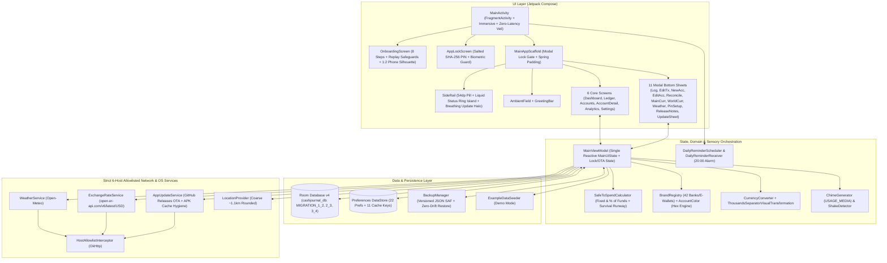

# CashJournal — Complete Application Audit & Feature Reference Report (v3.0)

> [!NOTE]
> **Audit Revision v3.0 (`2026-10-17 13:25 UTC+07:00`)**: This comprehensive audit report updates the previous `v1.0.14-dev` (v1.0) and `v1.0.18-dev` (v2.0) audits to cover the entire **CashJournal `v1.0.28-dev`** application through **Phase 25**. It documents every feature, screen, modal sheet, custom UI component, sensory engine, security mechanism, Room v4 database schema, mathematical formula, network allowlist rule, and all **14 automated JUnit4 test suites (91 unit tests, 100% passing)**.

---

## 1. Chronological Audit & Engineering Time Log

All timestamps are recorded in local project time (`UTC+07:00`):

| Timestamp (`+07:00`) | Version / Commit | Phase / Milestone | Summary of Changes & Audit Events |
| :--- | :--- | :--- | :--- |
| `2026-10-15 22:00` | `d08e35a` (`v1.0.9`) | Phase 8 Stabilization | Fixed onboarding permission launcher crash (`fragment-ktx:1.8.1`), clarified local storage sandbox, refined 4-dot cellular signal cluster. |
| `2026-10-15 23:17` | `54d66d5` (`v1.0.10`) | Brand Identity | Integrated official CashJournal Logo v1 across adaptive launcher icons (`mdpi`–`xxxhdpi`) and in-app branding. |
| `2026-10-16 12:52` | `91f3803` (`v1.0.11-dev`) | Stabilization & Sensory | Bilingual localization groundwork, knock/shake detector calibration, and audio chime synthesis. |
| `2026-10-16 13:20` | `337ba09` (`v1.0.12-dev`) | Layout & Lock Lifecycle | Calibrated typography hierarchy, layout geometry, 15s background auto-lock lifecycle, and wave mask performance. |
| `2026-10-16 14:09` | `f1ce18c` | Sub-Phase 9A | Room v1 $\rightarrow$ v2 migration (`initialBalance`), zero-drift SQL balance derivation, backdating, full transaction CRUD (`TransactionEditSheet`), and balance reconciliation (`ReconcileBalanceSheet`). |
| `2026-10-16 14:22` | `10b8967` | Sub-Phase 9B | Versioned JSON backup export & atomic restore via Storage Access Framework (`BackupManager`). |
| `2026-10-16 14:49` | `10c5ec1` (`v1.0.13-dev`) | Sub-Phase 9C | Custom payday cycle start day (`1..28`), expanded 12 preset categories, and manual category picker modal. |
| `2026-10-16 15:43` | `28eaece` (`v1.0.14-dev`) | Pre-Audit Baseline | Synchronized `BuildConfig.VERSION_NAME` display in Settings. |
| **`2026-10-16 15:54`** | **`v1.0.14-dev`** | **Audit Report v1.0** | **Initial full-codebase audit completed.** Identified 1 Critical (`CRITICAL-1`), 4 High (`HIGH-1..4`), 5 Medium (`MED-1..5`), and 6 Low (`LOW-1..6`) findings. Generated `docs/cashjournal_complete_audit_report.{md,pdf}`. |
| `2026-10-16 16:21` | `7bb6203` | **Phase 10 Remediation** | Fixed `CRITICAL-1` (`initialBalance` conversion on currency switch), `HIGH-1` (live `selectedAccount` resolution), `HIGH-2` (`selectedWorldCurrency` sync & conversion math), `HIGH-4` (custom cycle `startingSpent` persistence), and `LOW-5` (New Year `"Yesterday"` & DST-safe `daysLeft`). |
| `2026-10-16 16:31` | `5dcca0d` | **Phase 11 Remediation** | Fixed `HIGH-3` (weather `"Off"` hides widget; pending shows `Thermometer` + `"--"`), `MED-1` (word-boundary regex `\b` in `Category.detectFromNote`), `MED-2` (buffered budget slider `onValueChangeFinished`), and `MED-3` (`SALARY` in income picker, manual category preservation on note edit, expense accent preservation). |
| `2026-10-16 17:08` | `7259a0b` (`v1.0.15-dev`) | **Phase 12 Remediation** | Fixed `MED-4` (10,000-round salted SHA-256 PIN hashing + `PinSecurityTest.kt`), `MED-5` (full Bahasa Indonesia localization), `LOW-1` (expanded `PreferencesBackupDto`), `LOW-2` (`DailyReminderScheduler` + `DailyReminderReceiver` at 20:00), `LOW-3`/`LOW-4` (haptics & chime gating), and `LOW-6` (dead code removal). |
| `2026-10-16 17:49` | `3edae55` (`v1.0.16-dev`) | **Phase 13 Polish** | Added `isPreferencesLoaded` cold-start gate (eliminating Frame-0 onboarding flash) and centered bidirectional spring morph between Status Ring and Back Button. |
| `2026-10-16 18:37` | `19ff083` (`v1.0.17-dev`) | **Phase 14 Features** | Added sticky immersive fullscreen (`immersiveModeEnabled`), interactive `PhoneSilhouettePreview` in Onboarding Step 7, auto-triggered `ReleaseNotesSheet`, and live runtime localization for side rail long-press tooltips. |
| `2026-10-16 19:31` | `2c112d3` (`v1.0.18-dev`) | **Phase 15 Polish** | Fixed `AccountDetailScreen` back button gesture closure, prevented balance card line wrapping via single-line auto-scaling in `MaskedAmount.kt`, overhauled EN/ID copywriting, reshaped onboarding phone silhouette to `118×236.dp` (`1:2`), and added inline Knock Sensitivity selector to Onboarding Step 7. |
| **`2026-10-16 19:42`** | **`v1.0.18-dev`** | **Audit Report v2.0** | **Post-Phase-15 re-audit completed.** Verified all 16 initial findings resolved, documented Phases 10–15 features, and regenerated `docs/cashjournal_complete_audit_report.{md,pdf}`. |
| `2026-10-16 20:44` | `95927db` (`v1.0.19-dev`) | **Phase 16A/B: Account Types & GitHub OTA** | Added `AccountType` enum (`CASH`, `BANK_DEBIT`, `E_WALLET`, `CREDIT_CARD`, `SAVINGS`), Room v2 $\rightarrow$ v3 migration (`MIGRATION_2_3`) with automatic name-based type inference, `EditAccountSheet.kt`, left-aligned hero balances, and the **GitHub OTA In-App Update System** (`AppUpdateService`, `VersionComparator`, `UpdateSheet`, `FileProvider`, midnight WIB daily check, and allowlisted GitHub domains). |
| `2026-10-16 22:22` | `7c46501` (`v1.0.20-dev`) | **Phase 16C: Zero-Latency Lock Veil** | Moved `isAppLocked` and `isVeiled` into `MainViewModel`; engaged immediate privacy veil in `onPause()` to prevent Frame-0 resume balance flash while gating `autoPromptBiometrics = isAppLocked && !isVeiled` so going to the home screen never triggers a stray biometric prompt. |
| `2026-10-16 23:13` | `3566a10` (`v1.0.21-dev`) | **Phase 17: Runtime Versioning & Lock Isolation** | Added `AppVersionProvider` (`PackageManager` runtime query to bypass stale `BuildConfig` constant inlining), gated `ModalBottomSheet` with `if (!isLocked)` to prevent sheet bleed-through over `AppLockScreen`, and added a 60s `isInstallingUpdate` grace window with explicit OEM package installer URI grants. |
| `2026-10-16 23:37` | `321e31f` (`v1.0.22-dev`) | **Phase 18: OTA Storage Hygiene** | Added `cleanStaleUpdateApks()` and `purgeOtherUpdateApks()` in `AppUpdateService.kt` to automatically purge installed/old `.apk` files from `cacheDir/updates/`. |
| `2026-10-16 23:44` | `a8e7b54` | **Phase 19: Open-Source Showcase** | Created Play-Store-style `README.md` and `LICENSE` (MIT). |
| `2026-10-17 00:28` | `1acd4e0` (`v1.0.23-dev`) | **Phase 20: Smart Brand Colors & Custom Hex** | Created `BrandRegistry.kt` (42 Indonesian & global banks/e-wallets with auto-detected brand hex colors and default `AccountType`), expanded `AccountColor` (`AccentKey`) to a 16-color curated palette + arbitrary `#RRGGBB` custom hex picker (`CustomHexColorDialog.kt`), and added radial color haze on account cards. |
| `2026-10-17 00:57` | `eb01527` (`v1.0.24-dev`) | **Phase 21: Inclusive Spending & Survival Runway** | Upgraded Room v3 $\rightarrow$ v4 (`MIGRATION_3_4`) adding `BudgetMode` (`FIXED_NOMINAL` vs `PERCENTAGE_OF_FUNDS`) and `budgetPercent`; updated `SafeToSpendCalculator` with net-worth percentage budgeting and **Capital Burn-Rate Survival Runway** (`dailyBurnRate`, `survivalDays`, `survivalMonths`). |
| `2026-10-17 10:51` | `0ea309b` (`v1.0.25-dev`) | **Phase 22: Precision FX & Live Number Formatting** | Expanded `% of Total Funds` slider to `1%..100%`; added `showSymbol` to `MaskedAmount`; widened Dashboard account cards to `138.dp`; added `ThousandsSeparatorVisualTransformation.kt` with cursor `OffsetMapping`; anchored `ExchangeRateService` to `/v6/latest/USD` for 6-digit cross-rate precision on low-unit currencies like `IDR`. |
| `2026-10-17 11:36` | `859d244` (`v1.0.26-dev`) | **Phase 23: Disk-Aware OTA & Onboarding Safeguards** | Added disk-aware `ReadyToInstall` promotion in `MainViewModel` (skipping redundant APK downloads), 1-tap update sheet launch from glowing `SideRail` Settings icon, and onboarding replay safeguards (confirmation dialog, Step 1 `X` cancel + `BackHandler`, and Step 8 defaulting to `"Keep Existing Accounts"` when accounts exist). |
| `2026-10-17 12:54` | `74440da` (`v1.0.27-dev`) | **Phase 24: Liquid Status Island & One-Handed UX** | Engineered the **Liquid Floating Status Ring Island** (detaching upward above `SideRail` on `AccountDetailScreen`), moved `AccountsScreen` `Reorder` and `+ Add` actions to a bottom **Thumb-Zone Floating Action Dock** with `animateItemPlacement` card reordering, unified account editing & balance reconciliation into `EditAccountSheet.kt`, extracted the **App Updates** card in Settings, and upgraded `ChimeGenerator` to `USAGE_MEDIA` (`0.65` amplitude). |
| `2026-10-17 13:14` | `72793a8` (`v1.0.28-dev`) | **Phase 25: 54dp Island, Breathing Halo & Release Notes** | Matched detached Liquid Status Island width (`42.dp` $\rightarrow$ `54.dp`) to `SideRail`, replaced the Settings update dot with a centered **Cobalt Breathing & Ripple Halo**, added `<queries>` for package installer visibility on Android 11+, and curated user-friendly bilingual highlights in `ReleaseNotesSheet.kt`. |
| **`2026-10-17 13:25`** | **`v1.0.28-dev`** | **Audit Report v3.0** | **Complete `v1.0.28-dev` audit & feature inventory.** Verified all 14 JUnit4 test suites (91 unit tests) passing and updated `docs/cashjournal_complete_audit_report.{md,pdf}`. |

---

## 2. Executive Summary & Architectural Overview

**CashJournal** (`app.cashjournal`, current version **`1.0.28-dev`**) is a native, offline-first personal finance, multi-account ledger, and capital runway application for Android (`minSdk 26` / Android 8.0 through `targetSdk 34` / Android 14). It is built with **Kotlin 2.0**, **Jetpack Compose (Material 3 foundation with a bespoke Daylight Frosted-Glass Design System)**, **Room SQLite (v4)**, **Jetpack DataStore**, **Kotlinx Serialization**, **OkHttp 4.12**, and **Phosphor Icons**.

### Core Architectural Pillars
1. **100% Free & Keyless**: Zero paid SDKs, zero user accounts, and zero API keys. External telemetry uses keyless public endpoints: Open-Meteo for weather/geocoding, ExchangeRate-API Open Access (`/v6/latest/USD`) for high-precision daily FX cross-rates, and GitHub Releases API for self-contained OTA updates.
2. **100% Local & Private**: All financial records reside strictly within the device's internal sandbox (`cashjournal_db` and `user_preferences.preferences_pb`). Cloud auto-backup and device-to-device extraction are disabled at the OS manifest level (`android:allowBackup="false"`).
3. **Zero-Drift Mathematical Integrity**: Monetary values are stored exclusively as 64-bit integer minor units (`Long`). Account balances are dynamically derived in SQLite from `initialBalance + SUM(inflows) - SUM(outflows)`, eliminating floating-point rounding and incremental drift across retroactive edits, deletions, inline balance reconciliations, currency conversions, and atomic transfers.
4. **Dual-Layer Network Lockdown**: Both Android's [`network_security_config.xml`](file:///c:/Users/Yahya/Projects/CashJournal/app/src/main/res/xml/network_security_config.xml) (`cleartextTrafficPermitted="false"`) and a runtime OkHttp [`HostAllowlistInterceptor`](file:///c:/Users/Yahya/Projects/CashJournal/app/src/main/java/app/cashjournal/data/network/HostAllowlistInterceptor.kt) restrict outbound HTTPS traffic to exactly **6 allowlisted hosts**:
   * `api.open-meteo.com` & `geocoding-api.open-meteo.com` (Weather & City Search)
   * `open.er-api.com` (USD-Anchored World Exchange Rates)
   * `api.github.com`, `github.com`, & `objects.githubusercontent.com` (GitHub OTA Release Check & APK Download)
5. **Ergonomic One-Handed Physics & Sensory Feedback**:
   * Floating `54.dp` [`SideRail`](file:///c:/Users/Yahya/Projects/CashJournal/app/src/main/java/app/cashjournal/ui/components/SideRail.kt) that leaps between left and right screen edges via UI toggle or physical device knock/shake ([`ShakeDetector`](file:///c:/Users/Yahya/Projects/CashJournal/app/src/main/java/app/cashjournal/ui/sensory/ShakeDetector.kt)).
   * **Liquid Floating Status Ring Island** that detaches upward (`42.dp` $\rightarrow$ `54.dp`) above the rail when viewing nested screens (`AccountDetailScreen`) so the privacy toggle remains reachable while the `CaretLeft` Back button emerges in the rail's top slot.
   * **Thumb-Zone Floating Action Dock** at the bottom of `AccountsScreen` for effortless one-handed account creation and reordering.
   * Procedurally synthesized dual-sine audio chimes ([`ChimeGenerator`](file:///c:/Users/Yahya/Projects/CashJournal/app/src/main/java/app/cashjournal/ui/sensory/ChimeGenerator.kt)) routed through `AudioAttributes.USAGE_MEDIA` (`0.65` peak amplitude).

---

## 3. Complete Feature & Functional Inventory (`v1.0.28-dev`)

### 3.1 Entry Point, Zero-Latency Privacy Veil, Immersive Mode & Lifecycle ([`MainActivity.kt`](file:///c:/Users/Yahya/Projects/CashJournal/app/src/main/java/app/cashjournal/MainActivity.kt))
* **Cold-Start Initialization Gate ([L95-L100](file:///c:/Users/Yahya/Projects/CashJournal/app/src/main/java/app/cashjournal/MainActivity.kt#L95-L100))**: Waits for `state.isPreferencesLoaded` before rendering `OnboardingScreen`, `AppLockScreen`, or `MainAppScaffold`, painting a clean `Slate100` surface on Frame 0 so returning users never experience a momentary onboarding flash.
* **Zero-Latency Background Privacy Veil & Biometric Guard ([`MainActivity.kt:53-58, 145-181`](file:///c:/Users/Yahya/Projects/CashJournal/app/src/main/java/app/cashjournal/MainActivity.kt#L145-L181), [`MainViewModel.kt:332-366`](file:///c:/Users/Yahya/Projects/CashJournal/app/src/main/java/app/cashjournal/ui/MainViewModel.kt#L332-L366))**:
  * **Immediate Veil on Pause**: When `hasPinConfigured()` is true and the user minimizes the app or turns off the screen (`onPause()`), `viewModel.onAppBackgrounded()` immediately sets `_isVeiled = true` (unless handing off to the system APK installer). This hides `MainAppScaffold` (`Modifier.alpha(0f)`) and mounts `AppLockScreen` *before* the OS captures the recent-apps thumbnail, eliminating any Frame-0 balance flash upon unlock.
  * **Biometric Prompt Suppression on Minimize**: `AppLockScreen` receives `autoPromptBiometrics = isAppLocked && !isVeiled` ([`MainActivity.kt:149`](file:///c:/Users/Yahya/Projects/CashJournal/app/src/main/java/app/cashjournal/MainActivity.kt#L149)). When going to the home screen, `isVeiled` is true while `isAppLocked` remains false, preventing Android's system fingerprint dialog from popping up over the home launcher.
  * **15-Second Auto-Lock & 60-Second OTA Grace Window**: On `onResume()`, `viewModel.onAppForegrounded()` clears `_isVeiled` and promotes `_isAppLocked = true` if more than `15,000 ms` elapsed in the background (bypassed during a `60,000 ms` `isInstallingUpdate` grace window when installing an OTA update).
* **Modal Bottom Sheet Lock Isolation ([`MainAppScaffold.kt:411`](file:///c:/Users/Yahya/Projects/CashJournal/app/src/main/java/app/cashjournal/ui/MainAppScaffold.kt#L411))**: Because Compose Material 3 `ModalBottomSheet` renders inside a separate OS `DialogWindow` above the Activity's main content tree, `MainAppScaffold` wraps `ModalBottomSheet` in `if (!isLocked)` so open sheets immediately unmount when the app locks or veils.
* **Sticky Immersive Fullscreen ([`MainActivity.kt:81-93`](file:///c:/Users/Yahya/Projects/CashJournal/app/src/main/java/app/cashjournal/MainActivity.kt#L81-L93))**: Uses `WindowInsetsControllerCompat.BEHAVIOR_SHOW_TRANSIENT_BARS_BY_SWIPE` to hide system status and navigation bars by default (`immersiveModeEnabled = true`).
* **Screen Privacy (`FLAG_SECURE`, [`MainActivity.kt:60-70`](file:///c:/Users/Yahya/Projects/CashJournal/app/src/main/java/app/cashjournal/MainActivity.kt#L60-L70))**: Dynamically applies or clears `WindowManager.LayoutParams.FLAG_SECURE` to block screenshots and screen recording.
* **Dynamic Runtime Versioning & What's New Trigger ([`AppVersionProvider.kt`](file:///c:/Users/Yahya/Projects/CashJournal/app/src/main/java/app/cashjournal/util/AppVersionProvider.kt), [`MainViewModel.kt:261-268`](file:///c:/Users/Yahya/Projects/CashJournal/app/src/main/java/app/cashjournal/ui/MainViewModel.kt#L261-L268))**: Queries `PackageManager.getPackageInfo` at runtime to avoid stale compile-time `BuildConfig.VERSION_NAME` inlining, cleans stale OTA `.apk` files, automatically opens [`ReleaseNotesSheet`](file:///c:/Users/Yahya/Projects/CashJournal/app/src/main/java/app/cashjournal/ui/sheets/ReleaseNotesSheet.kt) when `lastSeenVersion != currentRuntimeVersion`, and performs a quiet daily GitHub update check once per calendar day in WIB (`Asia/Jakarta`).

---

### 3.2 First-Run & Replayable Onboarding Flow ([`OnboardingScreen.kt`](file:///c:/Users/Yahya/Projects/CashJournal/app/src/main/java/app/cashjournal/ui/onboarding/OnboardingScreen.kt))
An 8-step guided flow over the animated [`AmbientField`](file:///c:/Users/Yahya/Projects/CashJournal/app/src/main/java/app/cashjournal/ui/components/AmbientField.kt) with an 8-segment progress bar, spring horizontal slide transitions (`320ms`), tactile haptics, natural English/Indonesian copywriting ([`OnboardingStrings.kt`](file:///c:/Users/Yahya/Projects/CashJournal/app/src/main/java/app/cashjournal/ui/onboarding/OnboardingStrings.kt)), and **Ledger-Safe Replay Safeguards**:

| Step | Title (EN / ID) | Functionality, Safeguards & Interactive Controls |
| :--- | :--- | :--- |
| **Step 1** | *Your money, on your phone.* | Displays the CashJournal squircle emblem and 3 privacy guarantee cards (`ShieldCheck`, `DeviceMobile`, `CloudSlash`). **Replay Safeguard**: When `hasExistingAccounts` is true (replaying from Settings), renders a top-right `X` close button and wires `BackHandler` to safely exit back to the app without modifying data. |
| **Step 2** | *Choose your language* | Instant selection between **English** and **Bahasa Indonesia**; immediately crossfades all onboarding text. |
| **Step 3** | *Where are you from?* | Live-searchable country/currency selector ([`Country.kt`](file:///c:/Users/Yahya/Projects/CashJournal/app/src/main/java/app/cashjournal/domain/model/Country.kt)) with vector [`CountryFlag`](file:///c:/Users/Yahya/Projects/CashJournal/app/src/main/java/app/cashjournal/ui/components/CountryFlag.kt) icons and currency code badges (`IDR`, `USD`, `EUR`, `GBP`, `SGD`, `JPY`, `AUD`, `MYR`). |
| **Step 4** | *What should we call you?* | Optional name input (`max 40 chars`) with a live `SpaceGrotesk` character counter (`N / 40`) and a **Skip** action. |
| **Step 5** | *Show local weather?* | Three privacy-tiered modes: **Approximate location** (~1 km rounded coordinates), **Search for my city** (8 popular city chips + custom query), or **Not now**. |
| **Step 6** | *Transparent Privacy* | Interactive permission request cards for **Approximate Location** (`ACCESS_COARSE_LOCATION`) and **Daily Reminders** (`POST_NOTIFICATIONS` on Android 13+), plus a read-only **Local Data Storage** card explaining the isolated `Device Sandbox`. |
| **Step 7** | *Where should the menu sit?* | Interactive `118×236.dp` (`1:2` portrait ratio) [`PhoneSilhouettePreview`](file:///c:/Users/Yahya/Projects/CashJournal/app/src/main/java/app/cashjournal/ui/onboarding/OnboardingScreen.kt#L1557-L1788) wireframe that simulates device shake/knock on tap and glides the miniature rail across sides; Left/Right `SegmentedControl`; **Shake to swap sides** toggle with an inline expandable **Knock Sensitivity** (`Low` / `Medium` / `High`) selector. |
| **Step 8** | *How would you like to start?* | **Fresh Install (`!hasExistingAccounts`)**: Defaults to **Load Demo Mode** (4 sample accounts, 10 transactions, and a 7.5M IDR budget via [`ExampleDataSeeder`](file:///c:/Users/Yahya/Projects/CashJournal/app/src/main/java/app/cashjournal/data/ExampleDataSeeder.kt)) or **Start from scratch**. **Replay Mode (`hasExistingAccounts`)**: Dynamically defaults `loadExampleData = false` and relabels Card 2 to **"Keep Existing Accounts"** (*"Pertahankan Rekening Saat Ini"*) so users never accidentally inject demo accounts into their real ledger. Also records `lastSeenVersion` upon completion. |

---

### 3.3 Main Scaffold, Side Rail, Liquid Status Island & Shared Components

* **Dynamic Content Margins & Rail Swap Physics ([`MainAppScaffold.kt:122-156`](file:///c:/Users/Yahya/Projects/CashJournal/app/src/main/java/app/cashjournal/ui/MainAppScaffold.kt#L122-L156))**:
  * Content padding dynamically mirrors based on rail placement (`20.dp` on the non-rail side, `78.dp` on the rail side) using `spring(stiffness = 320f, dampingRatio = 0.65f)`.
  * When swapping sides (via Settings or physical device knock/shake), the floating rail leaps across the screen while tilting `±18°` (`tiltAngle`) and firing a tactile haptic tick.
* **Floating `54.dp` [`SideRail.kt`](file:///c:/Users/Yahya/Projects/CashJournal/app/src/main/java/app/cashjournal/ui/components/SideRail.kt) & Liquid Status Ring Island ([`RailStatusCluster.kt`](file:///c:/Users/Yahya/Projects/CashJournal/app/src/main/java/app/cashjournal/ui/components/RailStatusCluster.kt))**:
  * **Unified Status Ring (`StatusRingCanvas`)**: Custom `Canvas` ring displaying:
    * **270° Battery Arc**: Polls `BatteryManager.BATTERY_PROPERTY_CAPACITY` every 30s. Color-coded Emerald (`>30%`), Saffron (`11–30%`), or Red Alert (`≤10%`), with a Charcoal depleted track.
    * **4-Dot Cellular Signal Cluster**: Polls `TelephonyManager.signalStrength` every 30s and normalizes 4-bar and 5-bar OEM scales via [`SignalStrengthHelper`](file:///c:/Users/Yahya/Projects/CashJournal/app/src/main/java/app/cashjournal/util/SignalStrengthHelper.kt) into 4 polar dots at `60°, 80°, 100°, 120°`.
    * **Center Privacy Vault Button**: Toggles `hideBalances` (`Eye` when visible, `EyeSlash` when masked).
    * **Live Clock**: Displays `HH:mm` (24h) or `h:mm` (12h) below the top slot, updating every 30s.
  * **Liquid Floating Status Ring Island (`SideRail.kt:123-131, 249-295, 501-570`)**:
    * On top-level screens (`islandProgress = 0f`), the `42.dp` Status Ring sits inside the top slot of the `54.dp` `SideRail`.
    * When entering a nested screen (`AccountDetailScreen`, `isNestedScreen = true`, `islandProgress -> 1f` via `spring(dampingRatio = 0.72f, stiffness = 320f)`), the Status Ring detaches upward (`targetOffsetY` from `12.dp` to `-64.dp`, resting `10.dp` above the sidebar), stretches with liquid sine physics (`stretch = sin(islandProgress * PI) * 0.18f`), and expands from `42.dp` to **`54.dp`** (`islandSize = 42.dp + 12.dp * islandProgress`, `targetOffsetX -> 0.dp`) to match the exact width of the `SideRail` below it.
    * Simultaneously, a `42.dp` circular `CaretLeft` **Back Button** blooms into the vacated top slot of the `SideRail` (`caretAlpha`, `caretScale`). Users can both tap Back *and* toggle balance masking on `AccountDetailScreen` without losing either control.
  * **Liquid Tab Drip Indicator (`SideRail.kt:160-187, 334-354`)**: Switching between the 5 tabs (`Dashboard`, `Transactions`, `Accounts`, `Analytics`, `Settings`) animates a Cobalt droplet over `420ms` that stretches vertically (`+14.dp`) and narrows horizontally (`-6.dp`) mid-flight.
  * **Cobalt Breathing & Ripple Update Halo (`SideRail.kt:591-702`)**: When an OTA update is downloaded and ready to install (`isUpdateReady = true`) and the user is not on the Settings tab, the `GearSix` Settings icon stays in neutral `Slate500` while a centered dual-layer Cobalt aura animates behind it:
    * **Inner Breathing Halo**: Radial Cobalt gradient pulsing between `scale` `0.98f` $\leftrightarrow$ `1.18f` and `alpha` `0.40f` $\leftrightarrow$ `0.85f` over `1600ms`.
    * **Outer Expanding Ripple**: Circular `1.dp` Cobalt border expanding from `scale` `1.05f` $\rightarrow$ `1.45f` while fading `alpha` `0.45f` $\rightarrow$ `0.0f` over `2400ms`.
    * Tapping the glowing Settings button navigates to Settings and immediately opens `UpdateSheet` for 1-tap installation ([`MainAppScaffold.kt:379-384`](file:///c:/Users/Yahya/Projects/CashJournal/app/src/main/java/app/cashjournal/ui/MainAppScaffold.kt#L379-L384)).
  * **Reactive Localized Long-Press Tooltips & Shockwave**: Holding any rail button (including the detached Status Ring Island or Back Caret) floats a frosted-glass tooltip capsule inward (`±66.dp`).
  * **Quick-Add (`+`) Button**: Anchored at the bottom of the rail to open [`LogTransactionSheet`](file:///c:/Users/Yahya/Projects/CashJournal/app/src/main/java/app/cashjournal/ui/sheets/LogTransactionSheet.kt) from any screen.
* **Left-Aligned Per-Digit Wave Masking & Auto-Scaling ([`MaskedAmount.kt`](file:///c:/Users/Yahya/Projects/CashJournal/app/src/main/java/app/cashjournal/ui/components/MaskedAmount.kt))**:
  * Supports optional currency prefix display (`showSymbol: Boolean = false`, rendering e.g. `Rp 549.760` when visible and `Rp •••••••` when masked).
  * Uses `.wrapContentWidth(Alignment.Start)` so hero numbers stay left-aligned on wide cards.
  * Triggers a staggered wave (`32ms` per character) when toggling privacy and automatically scales font size (`0.82x` for $\ge 11$ chars, `0.70x` for $\ge 14$ chars) on hero amounts (`fontSize >= 24.sp`) so large Rupiah balances never wrap.

---

### 3.4 Smart Brand Color Auto-Detection & Custom Hex Color Engine ([`BrandRegistry.kt`](file:///c:/Users/Yahya/Projects/CashJournal/app/src/main/java/app/cashjournal/domain/model/BrandRegistry.kt), [`AccentKey.kt`](file:///c:/Users/Yahya/Projects/CashJournal/app/src/main/java/app/cashjournal/domain/model/AccentKey.kt))

* **5 Account Categories ([`AccountType.kt`](file:///c:/Users/Yahya/Projects/CashJournal/app/src/main/java/app/cashjournal/domain/model/AccountType.kt))**:
  1. `CASH` — *Cash / Wallet* (*Tunai / Dompet*), icon `PhosphorIcons.Regular.Wallet`
  2. `BANK_DEBIT` — *Bank / Debit* (*Bank / Debit*), icon `PhosphorIcons.Regular.Bank`
  3. `E_WALLET` — *E-Wallet* (*E-Wallet*), icon `PhosphorIcons.Regular.DeviceMobile`
  4. `CREDIT_CARD` — *Credit Card* (*Kartu Kredit*), icon `PhosphorIcons.Regular.CreditCard`
  5. `SAVINGS` — *Savings / Invest* (*Tabungan / Investasi*), icon `PhosphorIcons.Regular.Vault`
* **42 Registered Financial Institutions (`BrandRegistry.kt`)**:
  * **Indonesian Banks (19)**: `BCA Prioritas` (`#B38E44`, `SAVINGS`), `BCA` (`#0060AF`), `Bank Mandiri` (`#002D62`), `BNI` (`#F15A24`), `BRI` (`#00529C`), `BSI` (`#00A39D`), `CIMB Niaga` (`#8B0000`), `Permata Bank` (`#008D36`), `Bank Danamon` (`#F47920`), `Bank BTN` (`#004899`), `Jenius (BTPN)` (`#00A3E0`), `Bank Jago` (`#FF8A00`), `Blu by BCA Digital` (`#00B4D8`), `SeaBank` (`#FF5722`, `SAVINGS`), `Allo Bank` (`#6C5CE7`), `Bank Neo Commerce` (`#FFC700`, `SAVINGS`), `OCBC NISP` (`#ED1C24`), `Panin Bank` (`#003366`), `Bank Mega` (`#F39200`, `CREDIT_CARD`).
  * **Indonesian E-Wallets (7)**: `GoPay` (`#00AED6`), `OVO` (`#4C3494`), `DANA` (`#118EEA`), `ShopeePay` (`#EE4D2D`), `LinkAja` (`#ED1C24`), `AstraPay` (`#003882`), `i.saku` (`#0082C8`).
  * **Global Institutions & Cash (16)**: `American Express` (`#006FCF`), `Chase` (`#117AC9`), `Bank of America` (`#E31837`), `Wells Fargo` (`#D71E28`), `Citibank` (`#003B70`), `HSBC` (`#DB0011`), `Standard Chartered` (`#00508F`), `DBS Bank` (`#212121`), `UOB` (`#002856`), `PayPal` (`#003087`), `Wise` (`#9FE870`), `Revolut` (`#191C1F`), `Monzo` (`#FF5050`), `Apple Card / Cash` (`#6E7174`), and `Cash / Dompet` (`#10B981`).
  * **Sub-Millisecond Word-Boundary Matcher (`BrandRegistry.matchBrand`)**: Evaluates multi-word keywords first (e.g., matching `"BCA Prioritas"` before `"BCA"`), then single-word tokens (`kw == token`) so short substrings never false-trigger inside unrelated words.
* **Universal `AccountColor` & `CustomHexColorDialog.kt`**:
  * Supports the 6 legacy `AccentKey` constants (`COBALT`, `EMERALD`, `PERSIMMON`, `SAFFRON`, `IRIS`, `BERRY`), a 16-swatch `curatedPalette` (`CHARCOAL_TITANIUM` through `INDIGO_NIGHT`), and any custom 6-digit `#RRGGBB` hex code entered via [`CustomHexColorDialog.kt`](file:///c:/Users/Yahya/Projects/CashJournal/app/src/main/java/app/cashjournal/ui/components/CustomHexColorDialog.kt).
  * Account cards on `DashboardScreen` and `AccountsScreen` render a soft radial color haze (`Brush.radialGradient` at `14%–16%` alpha) and a `4.dp` accent bar using `account.accentKey.color`.

---

### 3.5 Primary Screens (`ui/screens/`)

| Screen File | Key Features, Telemetry & Interactive Flows |
| :--- | :--- |
| [`DashboardScreen.kt`](file:///c:/Users/Yahya/Projects/CashJournal/app/src/main/java/app/cashjournal/ui/screens/DashboardScreen.kt) | **Total Net Worth** hero header; `28.dp` **Safe-to-Spend Today** glass card with `64.dp` circular `% spent` gauge, stacked status pill (`Safe`, `Near Limit`, `Over Budget`, `Set Budget`, `No Funds`) + **Capital Survival Runway** pill (`Runway: ~X.X mo` / `~X days`), and full-width remaining budget subline (with `(% of funds)` indicator when in percentage mode); **Active Accounts** horizontal carousel (`138×96.dp` cards with radial brand color haze and `showSymbol = true`); **Recent Activity** (top 5 transactions); **Monthly Budget Runway** card; bottom mist gradient and [`ScrollForMorePill`](file:///c:/Users/Yahya/Projects/CashJournal/app/src/main/java/app/cashjournal/ui/components/ScrollForMorePill.kt). |
| [`LedgerScreen.kt`](file:///c:/Users/Yahya/Projects/CashJournal/app/src/main/java/app/cashjournal/ui/screens/LedgerScreen.kt) | **Transactions** screen (*"Riwayat Transaksi"*) with 4 live-count filter pills (`All`, `Expense`, `Income`, `Transfer`); instant search bar matching notes, EN/ID category names, and raw amount digits; chronological day grouping (`TODAY`/`HARI INI`, `YESTERDAY`/`KEMARIN`, or weekday/date headers); tap any row to open [`TransactionEditSheet`](file:///c:/Users/Yahya/Projects/CashJournal/app/src/main/java/app/cashjournal/ui/sheets/TransactionEditSheet.kt). |
| [`AccountsScreen.kt`](file:///c:/Users/Yahya/Projects/CashJournal/app/src/main/java/app/cashjournal/ui/screens/AccountsScreen.kt) | **World Currencies** card synchronized with `userPreferences.selectedWorldCurrency` and USD-anchored cross-rates (`1 <World> = <Main>`), online/offline status dot, manual refresh, 8 flag chips, and `+ World` button; `LazyColumn` of `24.dp` account glass cards with `AccountType` icon, radial brand haze, `4.dp` left border, `% of total` pill, `showSymbol = true` balance,relative balance bar, and spring `animateItemPlacement` reordering; **Thumb-Zone Floating Action Dock** anchored at the bottom center housing the `Reorder`/`Done` pill and `+ Add` pill. |
| [`AccountDetailScreen.kt`](file:///c:/Users/Yahya/Projects/CashJournal/app/src/main/java/app/cashjournal/ui/screens/AccountDetailScreen.kt) | Live-updating single-account view while the `SideRail` morphs its top Status Ring into a floating `54.dp` island above the rail; header with `AccountType` icon, account name, and `% of total` badge; `24.dp` **Balance Card** with thumb-accessible **`Manage` / `Kelola` button** (and full-card click target) opening the unified [`EditAccountSheet`](file:///c:/Users/Yahya/Projects/CashJournal/app/src/main/java/app/cashjournal/ui/sheets/EditAccountSheet.kt); side-by-side **Money In** (`Emerald`) and **Money Out** (`Charcoal`) tiles; filtered account transaction history. |
| [`AnalyticsScreen.kt`](file:///c:/Users/Yahya/Projects/CashJournal/app/src/main/java/app/cashjournal/ui/screens/AnalyticsScreen.kt) | **Last 6 Months** Money In / Money Out paired bar chart (transfers excluded); **Monthly Budget** calibrator with **Mode Switcher Chips** (`Fixed Amount` vs `% of Total Funds`), responsive target header (`TARGET BUDGET` vs `TARGET: N% OF FUNDS` / `TARGET: N% DANA`), interactive `−` / buffered `Slider` / `+` controls (`500k` IDR steps in Fixed mode; `1%..100%` slider in Percentage mode), and embedded **Capital Survival Runway** card showing daily burn rate (`Rp X/day`) and total net-worth survival duration; cycle-filtered **Top Spending Categories** Donut Chart. |
| [`SettingsScreen.kt`](file:///c:/Users/Yahya/Projects/CashJournal/app/src/main/java/app/cashjournal/ui/screens/SettingsScreen.kt) | **11 organized configuration cards**: (1) **Language** (`EN`/`ID`), (2) **Main Currency**, (3) **Monthly Reset Day** (`1..28` slider dialog), (4) **Security & Access** (`PIN Lock`, `Biometric Unlock`, `FLAG_SECURE Screen Privacy`, `Lock App Now`), (5) **Sensory & Feedback** (`Sound Effects`, `Tactile Haptics`, `Daily Reminder` at 20:00), (6) **Menu Position** (`Left`/`Right`, `Full Screen Mode`, `Knock / Shake to Swap`, `Knock Sensitivity`), (7) **Weather** (`Approximate`, `City`, `Off`, `°C`/`°F`), (8) **Data & Backup** (SAF JSON `Back Up Data` / `Restore Data`, `Export Excel`), (9) **App Updates** (`Check for Updates` with live `Update ready to install` badge + `What's New`), (10) **About** (dynamic runtime version + offline privacy notice), and (11) **Developer & Danger Zone** (`Replay Welcome Guide` with confirmation dialog + `Delete All Data`). |
| [`AppLockScreen.kt`](file:///c:/Users/Yahya/Projects/CashJournal/app/src/main/java/app/cashjournal/ui/screens/AppLockScreen.kt) | Full-screen security gate verifying 4-digit PIN against 10,000-round salted SHA-256 hash, with 4 spring-animated PIN dots, horizontal error shake + reject haptics, 3×4 keypad, and gated `BiometricPrompt` (`autoPromptBiometrics = isAppLocked && !isVeiled`). |

---

### 3.6 Modal Bottom Sheets (`ui/sheets/` — 11 Sheets)

| Sheet File | Purpose & Key Capabilities |
| :--- | :--- |
| [`LogTransactionSheet.kt`](file:///c:/Users/Yahya/Projects/CashJournal/app/src/main/java/app/cashjournal/ui/sheets/LogTransactionSheet.kt) | Segmented type picker (`Expense` Persimmon, `Income` Emerald, `Transfer` Cobalt), backdating chips (`Today`, `Yesterday`, `Custom Date` via `DatePickerDialog`), source/destination account chips, note input with word-boundary regex category detection + manual category picker modal, `36.sp` amount entry, [`CustomNumericKeypad`](file:///c:/Users/Yahya/Projects/CashJournal/app/src/main/java/app/cashjournal/ui/components/CustomNumericKeypad.kt), and [`SaveSplash`](file:///c:/Users/Yahya/Projects/CashJournal/app/src/main/java/app/cashjournal/ui/components/SaveSplash.kt) particle burst. |
| [`TransactionEditSheet.kt`](file:///c:/Users/Yahya/Projects/CashJournal/app/src/main/java/app/cashjournal/ui/sheets/TransactionEditSheet.kt) | Full retroactive editing of any existing transaction (type, backdated timestamp, source/destination accounts, note, manual/auto category, amount) plus safe deletion with confirmation dialog and multi-account balance recalculation. |
| [`NewAccountSheet.kt`](file:///c:/Users/Yahya/Projects/CashJournal/app/src/main/java/app/cashjournal/ui/sheets/NewAccountSheet.kt) | Creates a new account with 5 `AccountType` chips, account name (`max 28 chars`) with live [`BrandRegistry`](file:///c:/Users/Yahya/Projects/CashJournal/app/src/main/java/app/cashjournal/domain/model/BrandRegistry.kt) brand auto-detection badge, starting balance input formatted live with [`ThousandsSeparatorVisualTransformation`](file:///c:/Users/Yahya/Projects/CashJournal/app/src/main/java/app/cashjournal/ui/components/ThousandsSeparatorVisualTransformation.kt), 16 curated color swatches, and `+ Hex` custom color dialog. |
| [`EditAccountSheet.kt`](file:///c:/Users/Yahya/Projects/CashJournal/app/src/main/java/app/cashjournal/ui/sheets/EditAccountSheet.kt) | **Unified Account Manager & Balance Reconciler**. Edits `AccountType`, account name (with live brand auto-detection), and `AccountColor` (16 curated swatches + `+ Hex` dialog), AND includes an inline **Balance Reconciliation** section showing a live `+`/`−` difference pill (`balanceDelta`) and optional adjustment note (`reconcileNote`), plus a guarded **Delete Account** button (`canDelete = state.accounts.size > 1`). |
| [`ReconcileBalanceSheet.kt`](file:///c:/Users/Yahya/Projects/CashJournal/app/src/main/java/app/cashjournal/ui/sheets/ReconcileBalanceSheet.kt) | Standalone balance reconciliation sheet (`ActiveSheet.RECONCILE_BALANCE`) retained for compatibility alongside the unified `EditAccountSheet`. |
| [`MainCurrencySheet.kt`](file:///c:/Users/Yahya/Projects/CashJournal/app/src/main/java/app/cashjournal/ui/sheets/MainCurrencySheet.kt) | Searchable country/currency selector with confirmation dialog that converts all existing accounts (`balance` and `initialBalance`), transactions, and monthly budget into the new currency and runs `recalculateAllAccountBalances()`. |
| [`WorldCurrenciesSheet.kt`](file:///c:/Users/Yahya/Projects/CashJournal/app/src/main/java/app/cashjournal/ui/sheets/WorldCurrenciesSheet.kt) | Searchable list of 16 world currencies with vector flags, live/offline sync status badge, 1-unit exchange rates, and converted Net Worth previews. |
| [`WeatherDetailSheet.kt`](file:///c:/Users/Yahya/Projects/CashJournal/app/src/main/java/app/cashjournal/ui/sheets/WeatherDetailSheet.kt) | Bilingual sheet configuring weather location mode (`Use approximate location`, `Search for a city` with live Open-Meteo geocoding results, or `Turn off weather`). |
| [`PinSetupSheet.kt`](file:///c:/Users/Yahya/Projects/CashJournal/app/src/main/java/app/cashjournal/ui/sheets/PinSetupSheet.kt) | Houses both `PinSetupSheet` (2-step create & confirm 4-digit PIN, stored via 10,000-round salted SHA-256) and `PinVerifyOrRemoveSheet` (verifies current PIN before disabling lock). |
| [`ReleaseNotesSheet.kt`](file:///c:/Users/Yahya/Projects/CashJournal/app/src/main/java/app/cashjournal/ui/sheets/ReleaseNotesSheet.kt) | **What's New in v1.0.28-dev** (*"Yang Baru di v1.0.28-dev"*). Bilingual modal sheet presenting 4 icon-badged highlights (*Floating Privacy Bubble*, *One-Handed Account Actions*, *Unified Account Manager*, *Fluid Card Motion & Touch Audio*). |
| [`UpdateSheet.kt`](file:///c:/Users/Yahya/Projects/CashJournal/app/src/main/java/app/cashjournal/ui/sheets/UpdateSheet.kt) | **GitHub OTA Update System** modal sheet handling all 6 `UpdateState` states (`Checking`, `UpToDate`, `Error`, `Available`, `Downloading` with live MB/progress bar & *Download in Background* button, and `ReadyToInstall` with release notes, Android 8+ unknown-sources permission check, and 1-tap APK installation). |

---

## 4. Data Architecture, OTA Engine & Mathematical Formulas

### 4.1 Room Database Schema (`cashjournal_db`, Version 4)
Defined in [`AppDatabase.kt`](file:///c:/Users/Yahya/Projects/CashJournal/app/src/main/java/app/cashjournal/data/local/AppDatabase.kt) with three deterministic forward migrations:
* **`MIGRATION_1_2`**: Added `initialBalance INTEGER NOT NULL DEFAULT 0` to `accounts`, reconstructed `initialBalance = balance - net_flows` from existing transactions, and created 3 indices on `transactions` (`sourceAccountId`, `destinationAccountId`, `date`).
* **`MIGRATION_2_3`**: Added `accountType TEXT NOT NULL DEFAULT 'BANK_DEBIT'` to `accounts` and automatically inferred `CASH`, `E_WALLET`, `CREDIT_CARD`, and `SAVINGS` from existing account names via SQL `LOWER(name) LIKE` rules.
* **`MIGRATION_3_4`**: Added `budgetMode TEXT NOT NULL DEFAULT 'FIXED_NOMINAL'` and `budgetPercent INTEGER NOT NULL DEFAULT 10` to `monthly_plans`.

| Table | Primary Key | Columns & Types |
| :--- | :--- | :--- |
| `accounts` ([`AccountEntity.kt`](file:///c:/Users/Yahya/Projects/CashJournal/app/src/main/java/app/cashjournal/data/local/entity/AccountEntity.kt)) | `id: String` (UUID) | `name: String`, `accentKey: String` (preset key or `#RRGGBB`), `accountType: String` (`AccountType`), `balance: Long`, `initialBalance: Long`, `sortIndex: Int`, `updatedAt: Long` |
| `transactions` ([`TransactionEntity.kt`](file:///c:/Users/Yahya/Projects/CashJournal/app/src/main/java/app/cashjournal/data/local/entity/TransactionEntity.kt)) | `id: String` (UUID) | `title: String`, `category: String`, `type: String` (`EXPENSE`/`INCOME`/`TRANSFER`), `amount: Long`, `date: Long`, `iconKey: String`, `accentKey: String`, `sourceAccountId: String?`, `destinationAccountId: String?`, `updatedAt: Long` |
| `monthly_plans` ([`MonthlyPlanEntity.kt`](file:///c:/Users/Yahya/Projects/CashJournal/app/src/main/java/app/cashjournal/data/local/entity/MonthlyPlanEntity.kt)) | `id: String` (`"primary_plan"`) | `budget: Long`, `startingSpent: Long`, `monthKey: String` (`YYYY-MM`), `budgetMode: String` (`FIXED_NOMINAL`/`PERCENTAGE_OF_FUNDS`), `budgetPercent: Int` (`1..100`) |

### 4.2 Zero-Drift Ledger Formula ([`AccountDao.kt`](file:///c:/Users/Yahya/Projects/CashJournal/app/src/main/java/app/cashjournal/data/local/dao/AccountDao.kt#L41-L78))
Every account's `balance` is dynamically recomputed in SQLite inside a `@Transaction` block whenever a transaction is created, edited, deleted, reconciled (via `EditAccountSheet` or `ReconcileBalanceSheet`), converted to a new main currency, seeded, or restored from backup:

$$\text{Balance}_A = \text{InitialBalance}_A + \sum_{\substack{t \in \text{INCOME} \\ \text{src}(t) = A}} \text{amount}_t + \sum_{\substack{t \in \text{TRANSFER} \\ \text{dst}(t) = A}} \text{amount}_t - \sum_{\substack{t \in \text{EXPENSE} \\ \text{src}(t) = A}} \text{amount}_t - \sum_{\substack{t \in \text{TRANSFER} \\ \text{src}(t) = A}} \text{amount}_t$$

### 4.3 Inclusive Safe-to-Spend & Capital Survival Runway Engine ([`SafeToSpendCalculator.kt`](file:///c:/Users/Yahya/Projects/CashJournal/app/src/main/java/app/cashjournal/domain/model/SafeToSpendCalculator.kt))
Given a custom payday `cycleStartDay` $d \in [1, 28]$:
1. **Effective Budget (`effectiveBudget`, [L158-L168](file:///c:/Users/Yahya/Projects/CashJournal/app/src/main/java/app/cashjournal/domain/model/SafeToSpendCalculator.kt#L158-L168))**:
   $$\text{EffectiveBudget} = \begin{cases} \left\lfloor \text{TotalNetWorth} \times \dfrac{\text{ clamp}(\text{budgetPercent}, 1, 100)}{100.0} \right\rfloor & \text{if } \text{budgetMode} = \text{PERCENTAGE\_OF\_FUNDS} \land \text{TotalNetWorth} > 0 \\ 0 & \text{if } \text{budgetMode} = \text{PERCENTAGE\_OF\_FUNDS} \land \text{TotalNetWorth} \le 0 \\ \text{plan.budget} & \text{if } \text{budgetMode} = \text{FIXED\_NOMINAL} \end{cases}$$
2. **Daily Safe-to-Spend Allowance ([L170-L186](file:///c:/Users/Yahya/Projects/CashJournal/app/src/main/java/app/cashjournal/domain/model/SafeToSpendCalculator.kt#L170-L186))**:
   $$\text{SafePerDay} = \begin{cases} 0 & \text{if } \neg\text{hasAccounts} \lor \text{TotalNetWorth} \le 0 \\ \left\lfloor \dfrac{\max(0, \text{EffectiveBudget} - \text{TotalSpent})}{\max(1, \text{DaysLeft})} \right\rfloor & \text{otherwise} \end{cases}$$
3. **Capital Burn-Rate Survival Runway ([L188-L205](file:///c:/Users/Yahya/Projects/CashJournal/app/src/main/java/app/cashjournal/domain/model/SafeToSpendCalculator.kt#L188-L205))**:
   $$\text{DaysElapsed} = \max\left(1, \left\lfloor \frac{\text{todayMidnight} - \text{cycleStartMidnight}}{86,400,000} \right\rfloor + 1\right)$$
   $$\text{DailyBurnRate} = \begin{cases} \left\lfloor \dfrac{\text{TotalSpent}}{\text{DaysElapsed}} \right\rfloor & \text{if } \text{TotalSpent} > 0 \\ 0 & \text{otherwise} \end{cases}$$
   $$\text{SurvivalDays} = \left\lfloor \frac{\text{TotalNetWorth}}{\text{DailyBurnRate}} \right\rfloor, \quad \text{SurvivalMonths} = \frac{\text{TotalNetWorth} / \text{DailyBurnRate}}{30.0}$$

### 4.4 USD-Anchored High-Precision Currency Conversion ([`CurrencyConverter.kt`](file:///c:/Users/Yahya/Projects/CashJournal/app/src/main/java/app/cashjournal/data/currency/CurrencyConverter.kt), [`MainViewModel.kt:1052-1056`](file:///c:/Users/Yahya/Projects/CashJournal/app/src/main/java/app/cashjournal/ui/MainViewModel.kt#L1052-L1056))
Because `open.er-api.com` rounds small inverse rates (such as `IDR -> USD` `0.000063`) when queried with `/v6/latest/IDR`, `MainViewModel.refreshRates()` always queries `https://open.er-api.com/v6/latest/USD` (returning 6+ significant digits, e.g., `1 USD = 16250.45 IDR`) and computes exact cross-rates via:
$$\text{TargetMajor} = \text{SourceMajor} \times \frac{\text{Rate}(\text{USD} \rightarrow \text{Target})}{\text{Rate}(\text{USD} \rightarrow \text{Source})}$$

### 4.5 GitHub OTA Update & Cache Hygiene Engine ([`AppUpdateService.kt`](file:///c:/Users/Yahya/Projects/CashJournal/app/src/main/java/app/cashjournal/data/update/AppUpdateService.kt), [`AppUpdateModel.kt`](file:///c:/Users/Yahya/Projects/CashJournal/app/src/main/java/app/cashjournal/data/update/AppUpdateModel.kt))
* **Semantic Version Comparison (`VersionComparator.isNewer`)**: Strips leading `v`/`V`, compares numeric dot-separated segments (`1.0.28` vs `1.0.27`), and treats final releases (`1.0.28`) as newer than pre-release `-dev` builds of the same number (`1.0.28-dev`).
* **Build-Variant Asset Selection (`selectApkAsset`)**: Automatically selects `app-debug.apk` when running a `.debug` build (`BuildConfig.DEBUG == true`) and `app-release.apk` when running a release build so Android package signature & application ID checks always match.
* **Disk-Aware Short-Circuit & Cache Cleanup**: Checks `cacheDir/updates/CashJournal-<version>.apk` against `info.apkSize`; if already downloaded, transitions straight to `UpdateState.ReadyToInstall`. Automatically purges old or installed `.apk` files via `cleanStaleUpdateApks()` and `purgeOtherUpdateApks()`.

---

## 5. Automated Unit Test Suite Audit (14 Test Suites — 91 Unit Tests)

All **14 JVM JUnit4 test classes (91 individual unit tests)** in `app/src/test/java/app/cashjournal/` pass with **0 failures and 0 errors** (`.\gradlew.bat testDebugUnitTest`):

| Test Suite Class | Tests | What It Verifies | Status |
| :--- | :---: | :--- | :---: |
| [`AcceptanceCheckTest.kt`](file:///c:/Users/Yahya/Projects/CashJournal/app/src/test/java/app/cashjournal/AcceptanceCheckTest.kt) | 7 | Build Brief Section 16 acceptance numbers (`Rp 18.450.000` net worth, `Rp 150.294 / day` on Oct 14, 66% ring, `Rp 1M` expense $\rightarrow$ `Rp 91.470 / day` & 79% Near Limit, transfer isolation, knock sensitivity, 7-dot mask). | **PASS** |
| [`AccountTypeTest.kt`](file:///c:/Users/Yahya/Projects/CashJournal/app/src/test/java/app/cashjournal/AccountTypeTest.kt) | 4 | **New in Phase 16**: Verifies `AccountType.fromKey` parsing, `inferFromName` keyword inference across EN/ID names (`Dompet Tunai` $\rightarrow$ `CASH`, `GoPay`/`OVO` $\rightarrow$ `E_WALLET`, `BCA Credit Card` $\rightarrow$ `CREDIT_CARD`, `Dana Darurat`/`Bibit` $\rightarrow$ `SAVINGS`), and bilingual titles/placeholders. | **PASS** |
| [`AppUpdateTest.kt`](file:///c:/Users/Yahya/Projects/CashJournal/app/src/test/java/app/cashjournal/AppUpdateTest.kt) | 4 | **New in Phase 16 & 18**: Verifies `VersionComparator.isNewer` across semantic versions and `-dev` suffixes, plus `cleanStaleUpdateApks` and `purgeOtherUpdateApks` file system cache hygiene. | **PASS** |
| [`BackupRestoreTest.kt`](file:///c:/Users/Yahya/Projects/CashJournal/app/src/test/java/app/cashjournal/BackupRestoreTest.kt) | 5 | `BackupPayload` JSON round-trip serialization (including `accountType`, `budgetMode`, `budgetPercent`, and all 18 `PreferencesBackupDto` fields), corrupted JSON failure handling, `version <= 0` rejection, and zero-drift recalculation after restore. | **PASS** |
| [`BrandRegistryTest.kt`](file:///c:/Users/Yahya/Projects/CashJournal/app/src/test/java/app/cashjournal/BrandRegistryTest.kt) | 10 | **New in Phase 20**: Verifies Indonesian bank detection (`BCA`, `BCA Prioritas`, `Mandiri`, `Jago`, `SeaBank`), e-wallet detection (`GoPay`, `OVO`, `ShopeePay`), global bank detection (`Chase`, `Amex`, `Wise`), cash aliases (`Dompet Tunai`), word-boundary anti-collision, custom `#RRGGBB` hex parsing, and legacy `AccentKey` backward compatibility. | **PASS** |
| [`CategoryDetectorTest.kt`](file:///c:/Users/Yahya/Projects/CashJournal/app/src/test/java/app/cashjournal/CategoryDetectorTest.kt) | 9 | Keyword detection across all categories plus word-boundary negative tests confirming `"theater"`, `"chair"`, and `"cost"` do not false-match. | **PASS** |
| [`CurrencyConverterTest.kt`](file:///c:/Users/Yahya/Projects/CashJournal/app/src/test/java/app/cashjournal/CurrencyConverterTest.kt) | 7 | Same-currency identity, `USD` $\leftrightarrow$ `IDR` decimal scaling (`2` vs `0` decimals), `EUR` $\rightarrow$ `JPY` cross-rates, high-precision USD-anchored `IDR` $\rightarrow$ `EUR`/`JPY` conversion, and missing-rate fallback. | **PASS** |
| [`HostAllowlistTest.kt`](file:///c:/Users/Yahya/Projects/CashJournal/app/src/test/java/app/cashjournal/HostAllowlistTest.kt) | 3 | Verifies `HostAllowlistInterceptor` permits the 6 allowlisted hosts (`api.open-meteo.com`, `geocoding-api.open-meteo.com`, `open.er-api.com`, `api.github.com`, `github.com`, `objects.githubusercontent.com`) and throws `SecurityException` on unauthorized hosts. | **PASS** |
| [`LedgerIntegrityTest.kt`](file:///c:/Users/Yahya/Projects/CashJournal/app/src/test/java/app/cashjournal/LedgerIntegrityTest.kt) | 5 | Zero-drift balance derivation on retroactive edits/deletes, atomic transfer net-worth conservation, manual balance reconciliation delta math, backdating, and `initialBalance` currency conversion zero-drift. | **PASS** |
| [`PinSecurityTest.kt`](file:///c:/Users/Yahya/Projects/CashJournal/app/src/test/java/app/cashjournal/PinSecurityTest.kt) | 5 | Verifies `saltHex:hashHex` format (`32:64` hex chars), per-call salt randomness, 10,000-round salted verification, legacy 64-hex unsalted fallback compatibility, and malformed hash safety. | **PASS** |
| [`SafeToSpendTest.kt`](file:///c:/Users/Yahya/Projects/CashJournal/app/src/test/java/app/cashjournal/SafeToSpendTest.kt) | 16 | Leap-year February handling, status thresholds, custom `cycleStartDay` (`1..28`), cross-month `startingSpent` persistence, **`PERCENTAGE_OF_FUNDS` dynamic budget calculation**, and **Capital Burn-Rate Survival Runway (`dailyBurnRate`, `survivalDays`, `survivalMonths`)**. | **PASS** |
| [`SignalStrengthHelperTest.kt`](file:///c:/Users/Yahya/Projects/CashJournal/app/src/test/java/app/cashjournal/SignalStrengthHelperTest.kt) | 3 | Monotonic mapping of 4-bar and 5-bar cellular signal scales into 4 UI dots. | **PASS** |
| [`ThousandsSeparatorVisualTransformationTest.kt`](file:///c:/Users/Yahya/Projects/CashJournal/app/src/test/java/app/cashjournal/ThousandsSeparatorVisualTransformationTest.kt) | 5 | **New in Phase 22**: Verifies dot (`.`) and comma (`,`) thousand-separator formatting and bidirectional cursor `OffsetMapping` (`originalToTransformed` and `transformedToOriginal`). | **PASS** |
| [`WeatherIconMapperTest.kt`](file:///c:/Users/Yahya/Projects/CashJournal/app/src/test/java/app/cashjournal/WeatherIconMapperTest.kt) | 8 | WMO weather code mapping across day/night variants to Phosphor icons. | **PASS** |
| **TOTAL** | **91** | **14 Test Suites** | **100% PASS** |

---

## 6. Audit Observations & Production-Readiness Recommendations (`v1.0.28-dev`)

All 16 findings from the v1.0 audit (`CRITICAL-1`, `HIGH-1..4`, `MED-1..5`, `LOW-1..6`) remain fully resolved and regression-tested. A fresh code inspection of the `v1.0.28-dev` codebase identified **6 minor, non-blocking observations (Low Priority)** for future polish:

| ID | Severity | Location | Observation & Recommendation |
| :--- | :--- | :--- | :--- |
| **OBS-1** | **Low** | [`EditAccountSheet.kt:409-424`](file:///c:/Users/Yahya/Projects/CashJournal/app/src/main/java/app/cashjournal/ui/sheets/EditAccountSheet.kt#L409-L424) | While `NewAccountSheet.kt:283` applies `ThousandsSeparatorVisualTransformation(groupingSeparator)` to the starting balance input, the inline balance reconciliation `BasicTextField` in `EditAccountSheet.kt` displays raw unformatted digits (`rawBalanceDigits`). Applying `ThousandsSeparatorVisualTransformation` and `KeyboardOptions(keyboardType = KeyboardType.Number)` to `EditAccountSheet.kt` will provide consistent live thousand separators (`1.000.000`) when adjusting balances. |
| **OBS-2** | **Low** | [`ReconcileBalanceSheet.kt`](file:///c:/Users/Yahya/Projects/CashJournal/app/src/main/java/app/cashjournal/ui/sheets/ReconcileBalanceSheet.kt), [`MainAppScaffold.kt:453`](file:///c:/Users/Yahya/Projects/CashJournal/app/src/main/java/app/cashjournal/ui/MainAppScaffold.kt#L453) | Since Phase 24 unified account editing and balance reconciliation inside `EditAccountSheet.kt` (`ActiveSheet.EDIT_ACCOUNT`), `AccountDetailScreen` no longer invokes `onReconcileClick`. `ReconcileBalanceSheet.kt` and `ActiveSheet.RECONCILE_BALANCE` are currently unused dead paths that can be safely retired when desired. |
| **OBS-3** | **Low** | [`AndroidManifest.xml:42-49`](file:///c:/Users/Yahya/Projects/CashJournal/app/src/main/AndroidManifest.xml#L42-L49) | `DailyReminderReceiver` is declared with `android:exported="true"` and an unguarded custom intent action (`app.cashjournal.ACTION_DAILY_REMINDER`). Because `DailyReminderScheduler` uses an explicit component intent (`Intent(context, DailyReminderReceiver::class.java)`), setting `android:exported="false"` prevents third-party apps from spoofing reminder broadcasts while still receiving `BOOT_COMPLETED` and `AlarmManager` intents. |
| **OBS-4** | **Low** | [`MainAppScaffold.kt:515`](file:///c:/Users/Yahya/Projects/CashJournal/app/src/main/java/app/cashjournal/ui/MainAppScaffold.kt#L515), [`MainCurrencySheet.kt`](file:///c:/Users/Yahya/Projects/CashJournal/app/src/main/java/app/cashjournal/ui/sheets/MainCurrencySheet.kt) | Selecting a world currency in `MainAppScaffold.kt:515` calls `viewModel.showToast("Currency changed to $code")` instead of `AppStrings.get(state.userPreferences.language).currencyChangedToast.format(code)`, and `MainCurrencySheet.kt` dialog/header strings remain in English. |
| **OBS-5** | **Low** | [`app/build.gradle.kts:41-48`](file:///c:/Users/Yahya/Projects/CashJournal/app/build.gradle.kts#L41-L48) | `release` build type uses `sharedDebug` signing config and `isMinifyEnabled = false` so GitHub OTA updates install seamlessly across development builds. Before public Google Play Store distribution, configure a dedicated production release keystore and enable R8 minification. |
| **OBS-6** | **Low** | [`ui/preview/`](file:///c:/Users/Yahya/Projects/CashJournal/app/src/main/java/app/cashjournal/ui/preview/FoundationPreviewScreen.kt) | `FoundationPreviewScreen.kt` and `Phase3ComponentsScreen.kt` are historical Phase 2–3 development galleries not referenced in production navigation; they can be moved to the `debug` source set or removed. |
