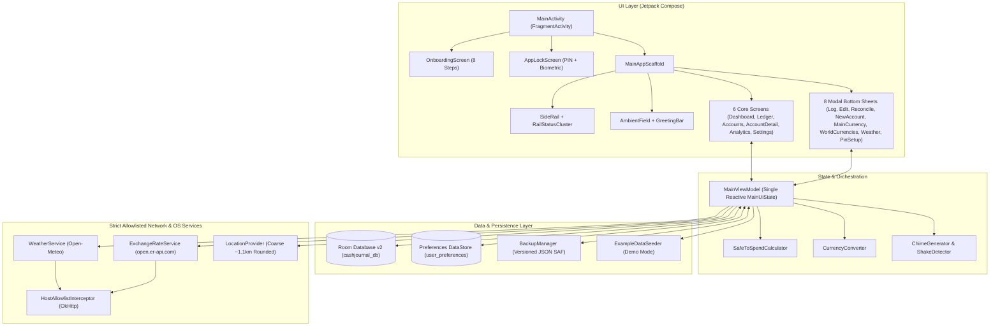
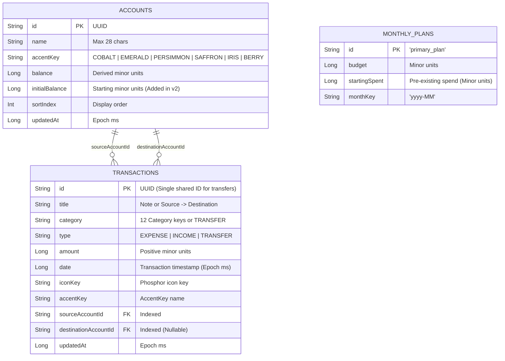

# CashJournal — Complete Application Audit & Feature Reference Report

> [!NOTE]
> **Audit Scope & Verification**: This audit covers 100% of the source files, build scripts, database schemas, domain algorithms, UI screens, modal sheets, sensory engines, security configurations, and unit tests in the `CashJournal` repository (`v1.0.14-dev`). All 9 automated unit test suites (`./gradlew testDebugUnitTest`) were executed and verified passing during this audit.

---

## 1. Executive Summary & Product Overview

**CashJournal** (`app.cashjournal`) is a native, offline-first personal finance and cash-flow telemetry application for Android (`minSdk 26` / Android 8.0 through `targetSdk 34` / Android 14). It is built with **Kotlin 2.0**, **Jetpack Compose (Material 3 infrastructure with a bespoke Daylight Frosted-Glass Design System)**, **Room SQLite (v2)**, **Jetpack DataStore**, **Kotlinx Serialization**, **OkHttp**, and **Phosphor Icons**.

### Core Architectural Pillars
1. **100% Free & Keyless**: Zero paid SDKs, zero user accounts, and zero API keys. External telemetry uses keyless open endpoints (Open-Meteo for weather/geocoding and ExchangeRate-API Open Access for daily FX rates).
2. **100% Local & Private**: All financial records reside strictly within the device's internal sandbox. Cloud auto-backup and device-to-device extraction are disabled at the OS manifest level (`allowBackup="false"`).
3. **Zero-Drift Mathematical Integrity**: Monetary values are stored exclusively as 64-bit integer minor units (`Long`). Account balances are dynamically derived in SQLite from `initialBalance + SUM(inflows) - SUM(outflows)`, preventing incremental drift across retroactive edits, deletions, and atomic transfers.
4. **Dual-Layer Network Lockdown**: Both Android's `network_security_config.xml` and a runtime OkHttp [`HostAllowlistInterceptor`](file:///c:/Users/Yahya/Projects/CashJournal/app/src/main/java/app/cashjournal/data/network/HostAllowlistInterceptor.kt) restrict outbound HTTPS traffic to exactly three hosts: `api.open-meteo.com`, `geocoding-api.open-meteo.com`, and `open.er-api.com`.
5. **Ergonomic One-Handed UI & Sensory Feedback**: Features a spring-animated floating [`SideRail`](file:///c:/Users/Yahya/Projects/CashJournal/app/src/main/java/app/cashjournal/ui/components/SideRail.kt) that can swap between left and right screen edges via UI toggle or physical device knock/shake ([`ShakeDetector`](file:///c:/Users/Yahya/Projects/CashJournal/app/src/main/java/app/cashjournal/ui/sensory/ShakeDetector.kt)), paired with procedurally synthesized dual-sine audio chimes ([`ChimeGenerator`](file:///c:/Users/Yahya/Projects/CashJournal/app/src/main/java/app/cashjournal/ui/sensory/ChimeGenerator.kt)) and dynamic GPU-rendered background blobs ([`AmbientField`](file:///c:/Users/Yahya/Projects/CashJournal/app/src/main/java/app/cashjournal/ui/components/AmbientField.kt)).



---

## 2. Complete Feature & Functional Reference

### 2.1 Entry Point, App Lock & Lifecycle ([`MainActivity.kt`](file:///c:/Users/Yahya/Projects/CashJournal/app/src/main/java/app/cashjournal/MainActivity.kt))
* **Edge-to-Edge Portrait Shell**: Extends `FragmentActivity` (enabling `BiometricPrompt` support) and calls `enableEdgeToEdge()`. Locked to portrait orientation.
* **ADB / Intent Demo Seeding**: Passing `--ez seed true` via intent extra in `onCreate` ([L38-L40](file:///c:/Users/Yahya/Projects/CashJournal/app/src/main/java/app/cashjournal/MainActivity.kt#L38-L40)) or `onNewIntent` ([L131-L137](file:///c:/Users/Yahya/Projects/CashJournal/app/src/main/java/app/cashjournal/MainActivity.kt#L131-L137)) invokes `viewModel.seedExampleData()`.
* **Screen Privacy (`FLAG_SECURE`)**: Observes `state.userPreferences.screenPrivacyEnabled` ([L51-L60](file:///c:/Users/Yahya/Projects/CashJournal/app/src/main/java/app/cashjournal/MainActivity.kt#L51-L60)) and applies `WindowManager.LayoutParams.FLAG_SECURE` to block screenshots, screen recording, and recent-apps thumbnails.
* **15-Second Background Auto-Lock**:
  * Starts locked (`isAppLocked = true`) whenever `pinEnabled && pinHash.isNotEmpty()`.
  * Records `lastBackgroundTimestamp` in `onStop()` ([L126-L129](file:///c:/Users/Yahya/Projects/CashJournal/app/src/main/java/app/cashjournal/MainActivity.kt#L126-L129)).
  * Upon `onStart()` ([L116-L124](file:///c:/Users/Yahya/Projects/CashJournal/app/src/main/java/app/cashjournal/MainActivity.kt#L116-L124)), if the app was backgrounded for more than `15,000 ms`, `isAppLocked.value` is reset to `true`, gating access behind [`AppLockScreen`](file:///c:/Users/Yahya/Projects/CashJournal/app/src/main/java/app/cashjournal/ui/screens/AppLockScreen.kt).

---

### 2.2 First-Run Onboarding Flow ([`OnboardingScreen.kt`](file:///c:/Users/Yahya/Projects/CashJournal/app/src/main/java/app/cashjournal/ui/onboarding/OnboardingScreen.kt))
A full-screen, 8-step guided setup over the animated [`AmbientField`](file:///c:/Users/Yahya/Projects/CashJournal/app/src/main/java/app/cashjournal/ui/components/AmbientField.kt) with an 8-segment progress bar, spring horizontal page transitions (`320ms`), and bilingual support ([`OnboardingStrings.kt`](file:///c:/Users/Yahya/Projects/CashJournal/app/src/main/java/app/cashjournal/ui/onboarding/OnboardingStrings.kt)):

| Step | Title (EN / ID) | Functionality & Interactive Controls |
| :--- | :--- | :--- |
| **Step 1** | *Your money, on your phone.* | Displays the CashJournal squircle emblem and 3 privacy guarantee cards (`ShieldCheck`: No account to create, `DeviceMobile`: Stays on this phone, `CloudSlash`: Nothing uploaded). |
| **Step 2** | *Choose your language* | Instant selection between **English** and **Bahasa Indonesia**; immediately crossfades all onboarding text. |
| **Step 3** | *Where are you from?* | Live-searchable country/currency selector ([`Country.kt`](file:///c:/Users/Yahya/Projects/CashJournal/app/src/main/java/app/cashjournal/domain/model/Country.kt)) with vector [`CountryFlag`](file:///c:/Users/Yahya/Projects/CashJournal/app/src/main/java/app/cashjournal/ui/components/CountryFlag.kt) icons and currency code badges (`IDR`, `USD`, `EUR`, `GBP`, `SGD`, `JPY`, `AUD`, `MYR`). |
| **Step 4** | *What should we call you?* | Optional name input (`max 40 chars`) with a live `SpaceGrotesk` character counter (`N / 40`) and a **Skip** action. |
| **Step 5** | *Show local weather?* | Three privacy-tiered modes: **Approximate location** (~1 km rounded coordinates), **Search for my city** (8 quick-pick city chips: Bandung, Jakarta, Surabaya, Medan, Singapore, Tokyo, London, New York + custom text input), or **Not now**. |
| **Step 6** | *Transparent Privacy* | Interactive permission request cards for **Approximate Location** (`ACCESS_COARSE_LOCATION`) and **Daily Reminders** (`POST_NOTIFICATIONS` on Android 13+), plus a read-only **Local Data Storage** card explaining the isolated `Device Sandbox` (zero storage permissions needed). |
| **Step 7** | *Where should the menu sit?* | Left vs. Right [`SegmentedControl`](file:///c:/Users/Yahya/Projects/CashJournal/app/src/main/java/app/cashjournal/ui/components/SegmentedControl.kt) with an interactive mini phone wireframe that animates the rail position in real time, plus a **Shake to swap sides** toggle. |
| **Step 8** | *How would you like to start?* | Choose between **Load Demo Mode** (default; populates 4 sample accounts, 10 transactions, and a 7.5M IDR budget via [`ExampleDataSeeder`](file:///c:/Users/Yahya/Projects/CashJournal/app/src/main/java/app/cashjournal/data/ExampleDataSeeder.kt)) or **Start from scratch**. |
| **Done** | *You're all set.* | Animated `CheckCircle` confirmation screen transitioning into the main [`DashboardScreen`](file:///c:/Users/Yahya/Projects/CashJournal/app/src/main/java/app/cashjournal/ui/screens/DashboardScreen.kt). |

---

### 2.3 Main Scaffold, Side Rail & Shared Components ([`MainAppScaffold.kt`](file:///c:/Users/Yahya/Projects/CashJournal/app/src/main/java/app/cashjournal/ui/MainAppScaffold.kt))

* **Dynamic Content Margins & Rail Physics**:
  * Content padding dynamically mirrors based on rail placement (`20.dp` on the non-rail side, `78.dp` on the rail side) using `spring(stiffness = 320f, dampingRatio = 0.65f)`.
  * When swapping sides (via Settings or physical device knock/shake), the floating rail leaps across the screen while tilting `±18°` (`tiltAngle`) and firing a tactile haptic tick.
* **Floating [`SideRail.kt`](file:///c:/Users/Yahya/Projects/CashJournal/app/src/main/java/app/cashjournal/ui/components/SideRail.kt) & [`RailStatusCluster.kt`](file:///c:/Users/Yahya/Projects/CashJournal/app/src/main/java/app/cashjournal/ui/components/RailStatusCluster.kt)**:
  * **Unified Status Ring (`42.dp`)**: Custom `Canvas` ring displaying:
    * **270° Battery Arc**: Polls `BatteryManager.BATTERY_PROPERTY_CAPACITY` every 60s. Color-coded Emerald (`>30%`), Saffron (`11–30%`), or Berry (`≤10%`), with a Charcoal depleted track.
    * **4-Dot Cellular Signal Cluster**: Polls `TelephonyManager.signalStrength` every 30s and normalizes 4-bar and 5-bar OEM scales via [`SignalStrengthHelper`](file:///c:/Users/Yahya/Projects/CashJournal/app/src/main/java/app/cashjournal/util/SignalStrengthHelper.kt) into 4 polar dots at `60°, 80°, 100°, 120°`.
    * **Center Privacy Vault Button**: Toggles `hideBalances` (`Eye` when visible, `EyeSlash` in Cobalt when masked).
    * **Live Clock**: Displays `HH:mm` (ID) or `h:mm` (EN) below the status ring, updating every 30s.
    * **Nested Back Button**: On `AccountDetailScreen`, the status cluster smoothly morphs (`scaleIn` + `fadeIn`) into a `CaretLeft` back button.
  * **Liquid Tab Drip Indicator**: Switching between the 5 tabs (`Dashboard`, `Ledger`, `Accounts`, `Analytics`, `Settings`) animates a Cobalt droplet over `420ms` that stretches vertically (`+14.dp`) and narrows horizontally (`-6.dp`) mid-flight.
  * **Long-Press Tooltips & Shockwave**: Holding any rail button floats a frosted glass tooltip label inward (`±66.dp`). If the user shakes the phone while holding a button, a shockwave collapse/re-bloom animation transfers the tooltip to the opposite side.
  * **Quick-Add (`+`) Button**: Anchored at the bottom of the rail to open [`LogTransactionSheet`](file:///c:/Users/Yahya/Projects/CashJournal/app/src/main/java/app/cashjournal/ui/sheets/LogTransactionSheet.kt) from any screen.
* **Per-Digit Wave Privacy Masking ([`MaskedAmount.kt`](file:///c:/Users/Yahya/Projects/CashJournal/app/src/main/java/app/cashjournal/ui/components/MaskedAmount.kt))**:
  * Toggling privacy mode triggers a staggered wave (`32ms` per character, right-to-left when hiding, left-to-right when revealing) where each digit shrinks, fades, translates vertically, and morphs into 7 dots (`•••••••` with `0.12em` letter spacing) while preserving the currency symbol on hero totals.
* **Ambient Background Field ([`AmbientField.kt`](file:///c:/Users/Yahya/Projects/CashJournal/app/src/main/java/app/cashjournal/ui/components/AmbientField.kt))**:
  * Renders up to 6 radial-gradient color blobs matching the user's accounts, sorted by balance. Blob diameter scales non-linearly with account share:
    $$\text{Diameter} = \left(0.28 + 0.42 \times \left(\frac{\text{balance}}{\text{maxBalance}}\right)^{0.8}\right) \times \text{ScreenWidth}$$
  * Drifts on a 30-second sinusoidal trajectory in isolated GPU layers (`graphicsLayer`) and shifts `±16px` in response to rail side changes.

---

### 2.4 Primary Screens (`ui/screens/`)

#### 1. [`DashboardScreen.kt`](file:///c:/Users/Yahya/Projects/CashJournal/app/src/main/java/app/cashjournal/ui/screens/DashboardScreen.kt)
* **Total Net Worth Hero**: Displays the primary currency symbol in Cobalt (`24.sp`), the aggregated balance across all accounts (`30.sp` extra-bold `SpaceGrotesk`), and `{N} accounts · all in {CODE}`.
* **Safe-to-Spend Today Card (`28.dp` GlassCard)**:
  * Shows the daily allowance (`{symbol} X / day`), status badge (`Safe` in Emerald, `Near Limit` in Saffron, `Recalibrate` in `#F87171`, `No Funds Available` or `Set a monthly budget` in Slate), and remaining cycle telemetry (`{daysLeft} days left · {remaining} remaining`).
  * **64dp Circular Gauge**: Custom `Canvas` arc showing `displayPercent% spent` (capped at `100%`).
* **Active Accounts Carousel**: Horizontal scrolling list of `130.dp × 96.dp` glass cards with account accent radial haze, colored dot, uppercase name, and balance, masked on the right by a `48.dp` horizontal fade gradient. Shows an empty-state CTA card when no accounts exist.
* **Recent Activity**: Displays the 5 newest transactions in a `24.dp` `GlassCard`. Tapping any row opens [`TransactionEditSheet`](file:///c:/Users/Yahya/Projects/CashJournal/app/src/main/java/app/cashjournal/ui/sheets/TransactionEditSheet.kt).
* **Monthly Budget Runway Card (`16.dp` SubtleGlassCard)**: Displays the active cycle date label (e.g., `25 Sep – 24 Oct 2026`), total budget, status-colored `LinearProgressIndicator`, total spent, and days left.
* **Bottom Mist Mask & [`ScrollForMorePill.kt`](file:///c:/Users/Yahya/Projects/CashJournal/app/src/main/java/app/cashjournal/ui/components/ScrollForMorePill.kt)**: Applies an offscreen `BlendMode.DstIn` alpha fade over the bottom `64.dp` of the viewport and floats a bobbing `"Scroll for more"` pill that scrolls down 65% of the viewport height on tap.

#### 2. [`LedgerScreen.kt`](file:///c:/Users/Yahya/Projects/CashJournal/app/src/main/java/app/cashjournal/ui/screens/LedgerScreen.kt)
* **Filter Pills**: Horizontal row of 4 pills (`All`, `Expense`, `Income`, `Transfer`), each displaying its live count from `state.transactions`.
* **Real-Time Search**: Filters transactions instantaneously by matching `title`, `category.defaultName`, `category.indonesianName`, or unformatted `amount` digits.
* **Chronological Day Grouping**: Groups transactions by calendar day under uppercase headers (`TODAY`/`HARI INI`, `YESTERDAY`/`KEMARIN`, or `EEEE, MMM d`) inside a `LazyColumn`.
* **Interactive Editing**: Tapping any [`TransactionRow`](file:///c:/Users/Yahya/Projects/CashJournal/app/src/main/java/app/cashjournal/ui/components/TransactionRow.kt) opens [`TransactionEditSheet`](file:///c:/Users/Yahya/Projects/CashJournal/app/src/main/java/app/cashjournal/ui/sheets/TransactionEditSheet.kt) for full retroactive CRUD.

#### 3. [`AccountsScreen.kt`](file:///c:/Users/Yahya/Projects/CashJournal/app/src/main/java/app/cashjournal/ui/screens/AccountsScreen.kt)
* **World Currencies Telemetry Card**:
  * Converts Total Net Worth into a selected foreign currency, displaying the converted total, `1 {TARGET} = {RATE} {MAIN}` cross-rate, online/offline indicator dot with elapsed minutes since last sync, and a manual refresh button (`ArrowsClockwise`).
  * **Quick Currency Chips**: 8 flag-badged chips (`USD`, `EUR`, `SGD`, `JPY`, `GBP`, `MYR`, `SAR`, `THB`, excluding the active main currency) plus a `+ World` button that opens [`WorldCurrenciesSheet`](file:///c:/Users/Yahya/Projects/CashJournal/app/src/main/java/app/cashjournal/ui/sheets/WorldCurrenciesSheet.kt).
* **Account Glass Cards (`24.dp`)**:
  * Renders each account with a `4.dp` left accent border, radial accent background glow, `% of total` tinted pill, large balance, and a `3.dp` bottom bar proportional to the largest account balance (`min 2%`).
* **Reorder Mode**: Tapping `Edit` transforms the card chevrons into `ArrowUp` / `ArrowDown` reorder controls, persisting new `sortIndex` positions in Room.

#### 4. [`AccountDetailScreen.kt`](file:///c:/Users/Yahya/Projects/CashJournal/app/src/main/java/app/cashjournal/ui/screens/AccountDetailScreen.kt)
* **Account Balance & Reconciliation**: Shows the account's `% of total` share, a `24.dp` balance card with a `Reconcile Balance` action button (opening [`ReconcileBalanceSheet`](file:///c:/Users/Yahya/Projects/CashJournal/app/src/main/java/app/cashjournal/ui/sheets/ReconcileBalanceSheet.kt)), and two telemetry tiles:
  * **Inflow (`Emerald`)**: Sum of `INCOME` into this account + incoming `TRANSFER`s (`destinationAccountId == account.id`).
  * **Outflow (`Charcoal`)**: Sum of `EXPENSE`s from this account + outgoing `TRANSFER`s (`sourceAccountId == account.id`).
* **Account Activity**: Chronological list of all transactions involving this account as source or destination.

#### 5. [`AnalyticsScreen.kt`](file:///c:/Users/Yahya/Projects/CashJournal/app/src/main/java/app/cashjournal/ui/screens/AnalyticsScreen.kt)
* **Last 6 Months Cash Flow Bar Chart**:
  * Aggregates monthly `INCOME` and `EXPENSE` totals across the last 6 calendar months (strictly excluding `TRANSFER`s).
  * Renders paired `7.dp` bars (`Emerald` Inflow, `Persimmon` Outflow) normalized to the 6-month peak (`90.dp` max height), or a `4.dp` baseline dot for zero-activity months.
* **Monthly Spending Runway Calibrator**:
  * Interactive `−` / `Slider` / `+` controls to adjust the monthly budget (step size `500,000` for zero-decimal currencies like IDR, or `5,000` minor units / `50.00` for decimal currencies).
  * Displays real-time daily safe-to-spend impact or a `Recalibrate` warning when spending exceeds the budget.
* **Top Spending Categories Donut Chart**:
  * Filters expenses strictly within the active billing cycle (`cycleRange.startMillis..cycleRange.endMillis`), ranks categories by spend, takes the top 4 + aggregates the remainder into `Other`, and draws an `80.dp` multi-segment `Canvas` ring with center total spent and a percentage legend.

#### 6. [`SettingsScreen.kt`](file:///c:/Users/Yahya/Projects/CashJournal/app/src/main/java/app/cashjournal/ui/screens/SettingsScreen.kt)
Organized into 8 cards:
1. **Language**: Instant switch between `English` and `Bahasa Indonesia`.
2. **Main Currency**: Displays current currency and opens [`MainCurrencySheet`](file:///c:/Users/Yahya/Projects/CashJournal/app/src/main/java/app/cashjournal/ui/sheets/MainCurrencySheet.kt).
3. **Payday / Cycle Start Day**: Opens an interactive dialog with a `1..28` slider and live billing-cycle range preview (`SafeToSpendCalculator.getCycleRange`).
4. **Security & Access**:
   * **PIN Lock**: Opens [`PinSetupSheet`](file:///c:/Users/Yahya/Projects/CashJournal/app/src/main/java/app/cashjournal/ui/sheets/PinSetupSheet.kt) to create/confirm a 4-digit PIN, or `PinVerifyOrRemoveSheet` to verify the existing PIN before removal.
   * **Biometric Unlock**: Gated on PIN setup; prompts hardware biometric verification via [`BiometricAuthHelper`](file:///c:/Users/Yahya/Projects/CashJournal/app/src/main/java/app/cashjournal/ui/security/BiometricAuthHelper.kt) before enabling.
   * **Screen Privacy**: Toggles `WindowManager.LayoutParams.FLAG_SECURE`.
   * **Lock App Now**: Immediately engages [`AppLockScreen`](file:///c:/Users/Yahya/Projects/CashJournal/app/src/main/java/app/cashjournal/ui/screens/AppLockScreen.kt).
5. **Sensory & Feedback**: Toggles for **Sound Effects**, **Tactile Haptics**, and **Daily Reminder**.
6. **Sidebar Placement**: Left/Right segmented control, **Knock / Shake to Swap** toggle, and a 3-level **Knock Sensitivity** selector (`Gentle`, `Balanced`, `Firm`).
7. **Weather**: Opens [`WeatherDetailSheet`](file:///c:/Users/Yahya/Projects/CashJournal/app/src/main/java/app/cashjournal/ui/sheets/WeatherDetailSheet.kt), toggles `°C` / `°F`, and shows relative time since last weather sync.
8. **Data & Portability + About**:
   * **Export Backup (JSON)**: Exports full database & preferences via Android Storage Access Framework (`CreateDocument`).
   * **Restore Backup (JSON)**: Shows overwrite confirmation dialog, then imports & recalculates balances via SAF (`OpenDocument`).
   * **Export Excel**: Placeholder button (`"Coming soon"` toast).
   * **Replay Onboarding Flow**: Resets `onboardingComplete = false`.
   * **Clear All Data**: Destructive confirmation dialog that wipes all accounts, transactions, and monthly plans while preserving user preferences.
   * **About**: Official logo, clickable attributions (`Open-Meteo.com` & `ExchangeRate-API`), and `BuildConfig.VERSION_NAME`.

#### 7. [`AppLockScreen.kt`](file:///c:/Users/Yahya/Projects/CashJournal/app/src/main/java/app/cashjournal/ui/screens/AppLockScreen.kt)
* Full-screen security gate featuring 4 animated PIN dots, a 3×4 numeric keypad, automatic biometric prompt on launch (`300ms` delay), and horizontal shake + `HapticFeedbackConstants.REJECT` feedback on incorrect PIN entry.

---

### 2.5 Modal Bottom Sheets (`ui/sheets/`)

| Sheet File | Purpose & Key Capabilities |
| :--- | :--- |
| [`LogTransactionSheet.kt`](file:///c:/Users/Yahya/Projects/CashJournal/app/src/main/java/app/cashjournal/ui/sheets/LogTransactionSheet.kt) | Segmented type picker (`Expense` Persimmon, `Income` Emerald, `Transfer` Cobalt), backdating chips (`Today`, `Yesterday`, `Custom Date` via `DatePickerDialog`), source/destination account chips, note input with live keyword category detection + manual category picker modal, `36.sp` cash-style amount entry, [`CustomNumericKeypad`](file:///c:/Users/Yahya/Projects/CashJournal/app/src/main/java/app/cashjournal/ui/components/CustomNumericKeypad.kt), and [`SaveSplash`](file:///c:/Users/Yahya/Projects/CashJournal/app/src/main/java/app/cashjournal/ui/components/SaveSplash.kt) 14-droplet particle burst on save. |
| [`TransactionEditSheet.kt`](file:///c:/Users/Yahya/Projects/CashJournal/app/src/main/java/app/cashjournal/ui/sheets/TransactionEditSheet.kt) | Full retroactive editing of any existing transaction (type, backdated timestamp, source/destination accounts, note, category, amount) plus safe deletion with confirmation dialog and automatic multi-account balance recalculation. |
| [`ReconcileBalanceSheet.kt`](file:///c:/Users/Yahya/Projects/CashJournal/app/src/main/java/app/cashjournal/ui/sheets/ReconcileBalanceSheet.kt) | The "Escape Hatch" for manual balance reconciliation. Shows current app balance and live-computed adjustment delta (`+` Emerald / `−` Persimmon) as the user types their real-world balance, then logs an audited `INCOME` or `EXPENSE` adjustment transaction. |
| [`NewAccountSheet.kt`](file:///c:/Users/Yahya/Projects/CashJournal/app/src/main/java/app/cashjournal/ui/sheets/NewAccountSheet.kt) | Creates a new account with name (`max 28 chars`), starting `initialBalance`, and 6 `AccentKey` color swatches (`Cobalt`, `Emerald`, `Persimmon`, `Saffron`, `Iris`, `Berry`). |
| [`MainCurrencySheet.kt`](file:///c:/Users/Yahya/Projects/CashJournal/app/src/main/java/app/cashjournal/ui/sheets/MainCurrencySheet.kt) | Searchable country/currency selector with confirmation dialog that converts all existing accounts, transactions, and monthly budget into the new currency using cached exchange rates. |
| [`WorldCurrenciesSheet.kt`](file:///c:/Users/Yahya/Projects/CashJournal/app/src/main/java/app/cashjournal/ui/sheets/WorldCurrenciesSheet.kt) | Searchable list of 16 world currencies with vector flags, live/offline sync status badge, 1-unit exchange rates, and converted Net Worth previews. |
| [`WeatherDetailSheet.kt`](file:///c:/Users/Yahya/Projects/CashJournal/app/src/main/java/app/cashjournal/ui/sheets/WeatherDetailSheet.kt) | Configures weather location mode (`Approximate location`, `Search city` with live Open-Meteo geocoding results, or `Off`). |
| [`PinSetupSheet.kt`](file:///c:/Users/Yahya/Projects/CashJournal/app/src/main/java/app/cashjournal/ui/sheets/PinSetupSheet.kt) | Houses both `PinSetupSheet` (2-step create & confirm 4-digit PIN) and `PinVerifyOrRemoveSheet` (verifies current PIN before disabling lock). |

---

## 3. Data Architecture, Schemas & Mathematical Formulas

### 3.1 Room Database Schema (`cashjournal_db`, Version 2)
Defined in [`AppDatabase.kt`](file:///c:/Users/Yahya/Projects/CashJournal/app/src/main/java/app/cashjournal/data/local/AppDatabase.kt) with `MIGRATION_1_2` adding `initialBalance` and 3 query indices.



### 3.2 Zero-Drift Ledger Formula ([`AccountDao.kt`](file:///c:/Users/Yahya/Projects/CashJournal/app/src/main/java/app/cashjournal/data/local/dao/AccountDao.kt#L41-L78))
Every account's `balance` is dynamically recomputed in SQLite inside a `@Transaction` block whenever a transaction is created, edited, deleted, reconciled, seeded, or restored from backup:

$$\text{Balance}_A = \text{InitialBalance}_A + \sum_{\substack{t \in \text{INCOME} \\ \text{src}(t) = A}} \text{amount}_t + \sum_{\substack{t \in \text{TRANSFER} \\ \text{dst}(t) = A}} \text{amount}_t - \sum_{\substack{t \in \text{EXPENSE} \\ \text{src}(t) = A}} \text{amount}_t - \sum_{\substack{t \in \text{TRANSFER} \\ \text{src}(t) = A}} \text{amount}_t$$

### 3.3 Safe-to-Spend & Custom Cycle Engine ([`SafeToSpendCalculator.kt`](file:///c:/Users/Yahya/Projects/CashJournal/app/src/main/java/app/cashjournal/domain/model/SafeToSpendCalculator.kt))
Given a custom payday `cycleStartDay` $d \in [1, 28]$:
1. **Cycle Window**:
   * If $d = 1$: runs from the 1st of the current month (`00:00:00.000`) to the last millisecond of the current month (`23:59:59.999`).
   * If $d > 1$: runs from day $d$ of the current month (if `today >= d`) or day $d$ of the previous month (if `today < d`) to day $d - 1$ of the following month at `23:59:59.999`.
2. **Spend & Allowance Math**:
   $$\text{TotalSpent} = \text{StartingSpent}_{\text{active}} + \sum_{\substack{t \in \text{EXPENSE} \\ t.\text{date} \in [\text{start}, \text{end}]}} \text{amount}_t$$
   $$\text{Remaining} = \max(0, \text{Budget} - \text{TotalSpent})$$
   $$\text{SafePerDay} = \begin{cases} 0 & \text{if } \neg\text{hasAccounts} \lor \text{TotalNetWorth} \le 0 \\ \left\lfloor \dfrac{\text{Remaining}}{\max(1, \text{DaysLeft})} \right\rfloor & \text{otherwise} \end{cases}$$
   $$\text{DisplayPercent} = \min\left(100, \text{round}\left(\frac{\text{TotalSpent}}{\text{Budget}} \times 100\right)\right)$$
3. **Status Priority Evaluation**:
   * `NO_FUNDS` (if no accounts or $\text{TotalNetWorth} \le 0$) $\rightarrow$ `SET_BUDGET` (if $\text{Budget} \le 0$) $\rightarrow$ `RECALIBRATE` (if $\text{Remaining} \le 0$) $\rightarrow$ `NEAR_LIMIT` (if $\text{Percent} \ge 0.70$) $\rightarrow$ `SAFE`.

### 3.4 Cross-Currency Minor-Unit Conversion ([`CurrencyConverter.kt`](file:///c:/Users/Yahya/Projects/CashJournal/app/src/main/java/app/cashjournal/data/currency/CurrencyConverter.kt))
When converting minor units between currencies with different decimal scales ($D_{\text{src}}, D_{\text{dst}} \in \{0, 2\}$):
$$\text{Amount}_{\text{dst}} = \text{round}\left( \frac{\text{Amount}_{\text{src}}}{10^{D_{\text{src}}}} \times \frac{\text{Rate}_{\text{dst}}}{\text{Rate}_{\text{src}}} \times 10^{D_{\text{dst}}} \right)$$

---

## 4. Automated Unit Test Suite Audit

All 9 test suites in `app/src/test/java/app/cashjournal/` pass cleanly (`BUILD SUCCESSFUL`):

| Test File | What It Verifies | Status |
| :--- | :--- | :--- |
| [`AcceptanceCheckTest.kt`](file:///c:/Users/Yahya/Projects/CashJournal/app/src/test/java/app/cashjournal/AcceptanceCheckTest.kt) | Build Brief Section 16 acceptance numbers (`Rp 18.450.000` net worth, `Rp 150.294 / day` on Oct 14, 66% ring, `Rp 1M` expense $\rightarrow$ `Rp 91.470 / day` & 79% Near Limit, transfer isolation, knock sensitivity, 7-dot mask). | PASS |
| [`LedgerIntegrityTest.kt`](file:///c:/Users/Yahya/Projects/CashJournal/app/src/test/java/app/cashjournal/LedgerIntegrityTest.kt) | Zero-drift balance derivation on retroactive edits/deletes, atomic transfer net-worth conservation, manual balance reconciliation delta math, and backdating. | PASS |
| [`SafeToSpendTest.kt`](file:///c:/Users/Yahya/Projects/CashJournal/app/src/test/java/app/cashjournal/SafeToSpendTest.kt) | Leap-year February handling, status thresholds, last-day-of-month clamping, custom `cycleStartDay` (`1`, `25`, boundary clamping `0` & `31`), and cycle expense filtering. | PASS |
| [`BackupRestoreTest.kt`](file:///c:/Users/Yahya/Projects/CashJournal/app/src/test/java/app/cashjournal/BackupRestoreTest.kt) | `BackupPayload` JSON round-trip serialization, corrupted JSON failure handling, `version <= 0` rejection, and zero-drift recalculation after restore. | PASS |
| [`CurrencyConverterTest.kt`](file:///c:/Users/Yahya/Projects/CashJournal/app/src/test/java/app/cashjournal/CurrencyConverterTest.kt) | Same-currency identity, `USD` $\leftrightarrow$ `IDR` decimal scaling (`2` vs `0` decimals), `EUR` $\rightarrow$ `JPY` cross-rates, and missing-rate fallback. | PASS |
| [`CategoryDetectorTest.kt`](file:///c:/Users/Yahya/Projects/CashJournal/app/src/test/java/app/cashjournal/CategoryDetectorTest.kt) | Keyword detection across `FOOD`, `TRANSPORT`, `SHOPPING`, `UTILITIES`, `HOUSING`, `INVESTMENT`, `SALARY`, and `OTHER`. | PASS |
| [`HostAllowlistTest.kt`](file:///c:/Users/Yahya/Projects/CashJournal/app/src/test/java/app/cashjournal/HostAllowlistTest.kt) | Verifies `HostAllowlistInterceptor` permits the 3 allowed hosts and throws `SecurityException` on unauthorized hosts. | PASS |
| [`SignalStrengthHelperTest.kt`](file:///c:/Users/Yahya/Projects/CashJournal/app/src/test/java/app/cashjournal/SignalStrengthHelperTest.kt) | Monotonic mapping of 4-bar and 5-bar cellular signal scales into 4 UI dots. | PASS |
| [`WeatherIconMapperTest.kt`](file:///c:/Users/Yahya/Projects/CashJournal/app/src/test/java/app/cashjournal/WeatherIconMapperTest.kt) | WMO weather code mapping across day/night variants to Phosphor icons. | PASS |

---

## 5. Comprehensive Audit Findings: Bugs, Edge Cases & Risks

> [!CAUTION]
> **Critical Finding (`CRITICAL-1`)**: Changing the main currency converts `AccountEntity.balance` but **does not convert `AccountEntity.initialBalance`**. Because `AccountDao.recalculateAccountBalance()` recomputes `balance = initialBalance + SUM(net_flows)` whenever a transaction is logged, edited, or deleted, the account balance will suddenly revert its starting base back to the unconverted old currency value on the very next transaction!

### 5.1 Summary Matrix of Identified Issues

| ID | Severity | Category | Location | Summary |
| :--- | :--- | :--- | :--- | :--- |
| **CRITICAL-1** | **Critical** | Data Integrity / Currency | [`MainViewModel.kt:708-719`](file:///c:/Users/Yahya/Projects/CashJournal/app/src/main/java/app/cashjournal/ui/MainViewModel.kt#L708-L719) | `changeMainCurrency()` converts `acc.balance` but omits `acc.initialBalance`, corrupting balances on the next transaction recalculation. |
| **HIGH-1** | **High** | State / UI Sync | [`MainViewModel.kt:109,158,250`](file:///c:/Users/Yahya/Projects/CashJournal/app/src/main/java/app/cashjournal/ui/MainViewModel.kt#L158) | `_selectedAccount` stores a static snapshot; `AccountDetailScreen` balance card and `% of total` do not update after editing/deleting transactions or reconciling balance. |
| **HIGH-2** | **High** | State / Currency | [`AccountsScreen.kt:88-119`](file:///c:/Users/Yahya/Projects/CashJournal/app/src/main/java/app/cashjournal/ui/screens/AccountsScreen.kt#L88-L119) | `AccountsScreen` uses local `remember { mutableStateOf("USD") }` instead of `state.userPreferences.selectedWorldCurrency`, ignoring selections made in `WorldCurrenciesSheet`. Also uses hardcoded IDR division when `cachedRates == null`. |
| **HIGH-3** | **High** | UI / Privacy | [`MainAppScaffold.kt:197-240`](file:///c:/Users/Yahya/Projects/CashJournal/app/src/main/java/app/cashjournal/ui/MainAppScaffold.kt#L197-L240) | Selecting `"Not now"` / `"Off"` for weather never hides the weather widget in `GreetingBar`; it permanently shows a hardcoded `24°C` (`75°F`) Sun icon. |
| **HIGH-4** | **High** | Domain Logic | [`SafeToSpendCalculator.kt:132-137`](file:///c:/Users/Yahya/Projects/CashJournal/app/src/main/java/app/cashjournal/domain/model/SafeToSpendCalculator.kt#L132-L137) | `MonthlyPlan.startingSpent` checks `plan.monthKey == todayMonthKey` (calendar month), causing `startingSpent` to drop to `0` mid-cycle when `cycleStartDay > 1` crosses a month boundary. |
| **MED-1** | **Medium** | Keyword Detection | [`Category.kt:32-102,137-148`](file:///c:/Users/Yahya/Projects/CashJournal/app/src/main/java/app/cashjournal/domain/model/Category.kt#L137-L148) | Substring matching (`lower.contains(keyword)`) causes false positives on short keywords (`"theater"`/`"sweater"` match `"eat"` $\rightarrow$ `FOOD`; `"repair"`/`"chair"` match `"air"` $\rightarrow$ `UTILITIES`). |
| **MED-2** | **Medium** | Performance / Audio | [`AnalyticsScreen.kt:443-454`](file:///c:/Users/Yahya/Projects/CashJournal/app/src/main/java/app/cashjournal/ui/screens/AnalyticsScreen.kt#L443-L454) | Dragging the budget `Slider` calls `viewModel.updateBudget()` on every frame, spawning dozens of concurrent `AudioTrack` instances and Room DB writes. |
| **MED-3** | **Medium** | UX / Consistency | [`LogTransactionSheet.kt:204`](file:///c:/Users/Yahya/Projects/CashJournal/app/src/main/java/app/cashjournal/ui/sheets/LogTransactionSheet.kt#L204), [`TransactionEditSheet.kt:471`](file:///c:/Users/Yahya/Projects/CashJournal/app/src/main/java/app/cashjournal/ui/sheets/TransactionEditSheet.kt#L471), [`MainViewModel.kt:410`](file:///c:/Users/Yahya/Projects/CashJournal/app/src/main/java/app/cashjournal/ui/MainViewModel.kt#L410) | (a) `SALARY` is filtered out of `LogTransactionSheet` even when logging `INCOME`; (b) typing a note in `TransactionEditSheet` overwrites manual category selection; (c) `editTransaction` overwrites expense category accent with account accent. |
| **MED-4** | **Medium** | Security / Build | [`UserPreferencesRepository.kt:303`](file:///c:/Users/Yahya/Projects/CashJournal/app/src/main/java/app/cashjournal/data/preferences/UserPreferencesRepository.kt#L303), [`app/build.gradle.kts:55-56`](file:///c:/Users/Yahya/Projects/CashJournal/app/build.gradle.kts#L55-L56) | 4-digit PIN is hashed with unsalted SHA-256; release build type uses `debug.keystore` and `isMinifyEnabled = false`. |
| **MED-5** | **Medium** | Localization (i18n) | Multiple UI & ViewModel files | Numerous strings in `GreetingBar`, `DashboardScreen`, `AccountsScreen`, `AccountDetailScreen`, `AnalyticsScreen`, sheets, and `MainViewModel` toasts remain hardcoded in English when Bahasa Indonesia (`"in"`) is active. |
| **LOW-1** | **Low** | Backup Completeness | [`BackupManager.kt:133-145`](file:///c:/Users/Yahya/Projects/CashJournal/app/src/main/java/app/cashjournal/data/backup/BackupManager.kt#L133-L145) | `PreferencesBackupDto` omits `screenPrivacyEnabled`, `weatherOption`, `weatherCityLabel`, `weatherCityLat`, `weatherCityLon`, and `selectedWorldCurrency`. |
| **LOW-2** | **Low** | Unimplemented Stub | [`SettingsScreen.kt:624`](file:///c:/Users/Yahya/Projects/CashJournal/app/src/main/java/app/cashjournal/ui/screens/SettingsScreen.kt#L624), [`OnboardingScreen.kt:1171`](file:///c:/Users/Yahya/Projects/CashJournal/app/src/main/java/app/cashjournal/ui/onboarding/OnboardingScreen.kt#L1171) | Onboarding requests `POST_NOTIFICATIONS` and Settings toggles `dailyReminderEnabled`, but no `AlarmManager`/`WorkManager` notification scheduler exists. |
| **LOW-3** | **Low** | Sensory Consistency | Multiple UI Components | `tactileHapticsEnabled` preference is bypassed in `SegmentedControl`, `SettingToggleRow`, `CustomNumericKeypad` call sites, `OnboardingScreen`, and `PinSetupSheet`. |
| **LOW-4** | **Low** | Audio / Toast Glitch | [`MainViewModel.kt:564`](file:///c:/Users/Yahya/Projects/CashJournal/app/src/main/java/app/cashjournal/ui/MainViewModel.kt#L564), [`SettingsScreen.kt:532,969`](file:///c:/Users/Yahya/Projects/CashJournal/app/src/main/java/app/cashjournal/ui/screens/SettingsScreen.kt#L532) | Turning Sound Effects *off* plays a chime before the preference updates; PIN/Biometric actions trigger duplicate toast calls in ViewModel and `SettingsScreen`. |
| **LOW-5** | **Low** | Date Boundary Math | [`LedgerScreen.kt:143`](file:///c:/Users/Yahya/Projects/CashJournal/app/src/main/java/app/cashjournal/ui/screens/LedgerScreen.kt#L143), [`SafeToSpendCalculator.kt:90`](file:///c:/Users/Yahya/Projects/CashJournal/app/src/main/java/app/cashjournal/domain/model/SafeToSpendCalculator.kt#L90) | `"Yesterday"` check uses `nowYear == selYear && nowDay - 1 == selDay` (fails on Jan 1 for Dec 31); `diffMillis / 86_400_000L` integer division can truncate 1 day across DST spring-forward transitions. |
| **LOW-6** | **Low** | Dead Code / Cleanup | `app/build.gradle.kts:11`, `ui/preview/*`, `AppStrings.kt` | Unused `gitCommitCount` task in Gradle, unreferenced preview screens (`FoundationPreviewScreen`, `Phase3ComponentsScreen`), unused `onPinChange` callback, and 9 unused localized string fields in `AppStrings`. |

---

### 5.2 Detailed Breakdown of Key Findings

#### 1. `CRITICAL-1`: Unconverted `initialBalance` During Main Currency Change
In [`MainViewModel.kt`](file:///c:/Users/Yahya/Projects/CashJournal/app/src/main/java/app/cashjournal/ui/MainViewModel.kt#L707-L720):
```kotlin
val convertedAccounts = currentAccounts.map { acc ->
    val newBal = CurrencyConverter.convertMinorUnits(
        amountMinor = acc.balance,
        sourceCode = currentCode,
        targetCode = targetCode,
        baseCode = cached.baseCode,
        rates = cached.rates,
        sourceDecimals = sourceDecimals,
        targetDecimals = targetDecimals
    )
    acc.copy(balance = newBal, updatedAt = System.currentTimeMillis())
}
```
* **Why it breaks**: In Phase 9A, the database migrated to a zero-drift model where `balance` is recalculated from `initialBalance + SUM(net_flows)` via [`AccountDao.recalculateAccountBalance()`](file:///c:/Users/Yahya/Projects/CashJournal/app/src/main/java/app/cashjournal/data/local/dao/AccountDao.kt#L41-L59). Because `changeMainCurrency()` only converts `acc.balance` and leaves `acc.initialBalance` in the old currency (e.g., `12,500,000` IDR), logging or editing any transaction after switching to `USD` will cause `recalculateAccountBalance()` to add `12,500,000` (now interpreted as `$125,000.00` USD) to the converted USD transactions.
* **Fix**: Convert `acc.initialBalance` alongside `acc.balance` using `CurrencyConverter.convertMinorUnits`, and call `database.accountDao().recalculateAllAccountBalances()` inside the `withTransaction` block.

#### 2. `HIGH-1`: Stale `selectedAccount` State on `AccountDetailScreen`
In [`MainViewModel.kt`](file:///c:/Users/Yahya/Projects/CashJournal/app/src/main/java/app/cashjournal/ui/MainViewModel.kt#L158-L185):
* `_selectedAccount` is set once in `openAccountDetail(account)` ([L250-L253](file:///c:/Users/Yahya/Projects/CashJournal/app/src/main/java/app/cashjournal/ui/MainViewModel.kt#L250-L253)) and passed directly into `MainUiState(selectedAccount = account)`.
* **Fix**: In the `combine` block of `uiState` ([L158](file:///c:/Users/Yahya/Projects/CashJournal/app/src/main/java/app/cashjournal/ui/MainViewModel.kt#L158)), resolve the live account from `rawAccounts`:
  ```kotlin
  val account = (group3[1] as? Account)?.let { sel -> rawAccounts.find { it.id == sel.id } ?: sel }
  ```

#### 3. `HIGH-2`: Desynchronized World Currency Card on `AccountsScreen`
In [`AccountsScreen.kt`](file:///c:/Users/Yahya/Projects/CashJournal/app/src/main/java/app/cashjournal/ui/screens/AccountsScreen.kt#L88-L119):
* Line 88 defines `var selectedWorldCurrency by remember { mutableStateOf("USD") }` instead of reading `state.userPreferences.selectedWorldCurrency`. When a user opens [`WorldCurrenciesSheet`](file:///c:/Users/Yahya/Projects/CashJournal/app/src/main/java/app/cashjournal/ui/sheets/WorldCurrenciesSheet.kt) via the `+ World` button and selects a currency (e.g., `CHF` or `CAD`), DataStore updates `selectedWorldCurrency`, but `AccountsScreen` ignores it.
* Furthermore, when `cachedRates == null`, lines 93–100 and 116–119 divide `state.totalNetWorth` by hardcoded IDR constants (`15700.0` for USD) and multiply by `100` regardless of what `mainCurrencyCode` or `targetCurrency.decimalDigits` actually are.

#### 4. `HIGH-3`: Weather "Off" (`not_now`) Still Shows Fake `24°C` Weather in `GreetingBar`
In [`MainAppScaffold.kt`](file:///c:/Users/Yahya/Projects/CashJournal/app/src/main/java/app/cashjournal/ui/MainAppScaffold.kt#L197-L240):
* When `weatherOption == "not_now"` or `weather == null`, `MainAppScaffold` computes `TemperatureConverter.format(24.0, ...)` and calls `GreetingBar(...)` without passing `weatherEnabled = state.userPreferences.weatherOption != "not_now"`.
* Additionally, before the first weather reading arrives when weather *is* enabled (`weather == null`), Build Brief Section 7 specifies showing `Thermometer` and `"--"`, whereas `MainAppScaffold` shows `Sun` and `"24°C"`.

#### 5. `MED-1`: Substring Collisions in `Category.detectFromNote`
In [`Category.kt`](file:///c:/Users/Yahya/Projects/CashJournal/app/src/main/java/app/cashjournal/domain/model/Category.kt#L137-L148):
* Because `lower.contains(keyword)` checks raw substrings:
  * `"eat"` (`Category.FOOD`) matches `"theater"`, `"sweater"`, `"weather"`, `"create"`, `"meat"`, `"seat"`, `"heating"`.
  * `"air"` (`Category.UTILITIES`) matches `"chair"`, `"repair"`, `"haircut"`, `"airline"`, `"stairs"`.
  * `"kos"` (`Category.HOUSING`) matches `"cost"`, `"costume"`.
* **Fix**: Use word-boundary matching (`Regex("\\b${Regex.escape(keyword)}\\b")`) for single-word tokens.
